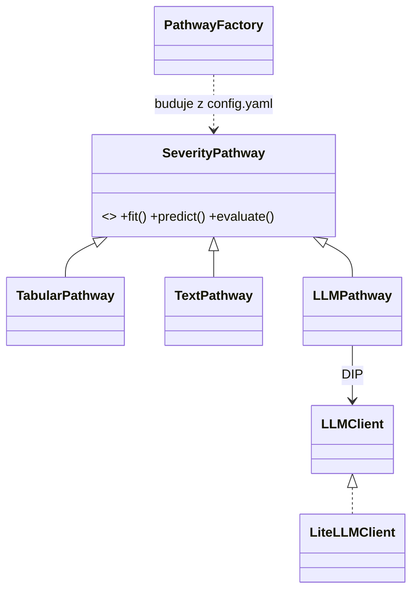

# Accident Severity Intelligence (us-accidents-ml)

Projekt końcowy kursu **AI & ML Engineering** (SAGES/Kodołamacz, gr. 06.12.2025).
Klasyfikacja powagi wypadku drogowego na danych
[US Accidents (Kaggle)](https://www.kaggle.com/datasets/sobhanmoosavi/us-accidents) — 7,7 mln zdarzeń, 2016–2023.

> **Co mierzy target:** `Severity` (1–4) w tym zbiorze opisuje **wpływ zdarzenia na ruch drogowy**
> (długość i czas utrudnień), nie obrażenia uczestników.

**Pytania badawcze** (dwa, celowo rozdzielone):

1. Ile sygnału o powadze wypadku **niesie** opis tekstowy (`Description`) względem cech
   strukturalnych (pogoda/czas/geo) — i czy fuzja obu poprawia wynik?
2. Ile tekst **zdradza** wprost (frazy skutkowe typu *road closed*, *major delays* to częściowo
   „przeczytana odpowiedź")? Dlatego ścieżka tekstowa ma **dwa warianty**: pełny tekst
   (uczciwie: „ekstrakcja severity z raportu") i **cenzurowany** (maskowanie fraz skutkowych
   regexem) — różnica między nimi ≈ udział leakage'u w wyniku.

## Kontrakt predykcji

Model przewiduje **w chwili zgłoszenia** (`Start_Time`). Cechy zakazane (znane dopiero po
zdarzeniu): `Distance(mi)`, `End_Time` i pochodne (czas trwania), `End_Lat`, `End_Lng`.
Lista `forbidden_features` żyje w `configs/config.yaml`, a test w pytest pilnuje, żeby pipeline
ich nie używał. W W2–3 jeden kontrolny run MLflow „z cechami post-hoc vs bez" ilustruje skalę
target leakage w raporcie.

## Protokół ewaluacji (wspólny dla wszystkich ścieżek)

- **Jeden zamrożony podział** train/val/test (test ~50 tys., stratyfikowany po `Severity`),
  tworzony w W1 skryptem `make_splits` (stały seed; indeksy jako parquet + manifest z hashem;
  kopia w GCS od W6). Przed splitem: **deduplikacja bliskich duplikatów**
  (klucz: `Start_Time` ±15 min + geohash 5–6 znaków — skala do zmierzenia w W1).
- Decyzja **random-stratified vs split czasowy** podjęta i opisana w W1 (zbiór ma skokową
  zmianę źródeł ~2020 — autorzy ostrzegają przed porównaniami rok-do-roku).
- **Metryka główna: macro-F1** (po niej stroi Optuna i po niej porównujemy ścieżki).
  Pomocnicze: F1 per klasa, confusion matrix, balanced accuracy, Quadratic Weighted Kappa
  (Severity jest porządkowe). Accuracy kłamie: ~80% zbioru to Severity=2.
- **Imbalance**: wagi klas (`class_weight` / wagi próbek w XGBoost). Świadomie bez SMOTE —
  niepraktyczny przy milionach wierszy.
- **Baseline'y w MLflow od pierwszego dnia W2**: `DummyClassifier` (most_frequent, stratified)
  i LogReg na 2–3 cechach.
- Wiersze testowe **nie uczestniczą w żadnym** treningu/tuningu (fit TF-IDF, podpróbka
  DistilBERT, CV Optuny).
- **LLM** oceniany na deterministycznej, stratyfikowanej podpróbce **1–2 tys. z test setu**
  (seed w configu). W tabeli końcowej: macro-F1 wszystkich ścieżek policzone także na tej
  wspólnej podpróbce + adnotacja N przy każdej liczbie.

## Ścieżki i budżet strojenia

| Ścieżka | Modele | HPO (na stratyfikowanej próbce, wyniki w MLflow) |
|---|---|---|
| Tabular | Dummy → LogReg → RandomForest → **XGBoost** (`device="cuda"`) | LogReg: defaulty (baseline); RF: ~20 triali Optuna; XGBoost: pełna Optuna |
| Tekst (pełny i cenzurowany) | TF-IDF+LogReg → *(stretch)* embeddingi zdaniowe → DistilBERT (RTX 5080; próbka 200–300 tys.) | TF-IDF: mały grid (ngram, min_df, C); DistilBERT: 2–3 konfiguracje (lr, epochs, batch) |
| LLM | Groq zero-shot przez LiteLLM; *(stretch)* lokalna Ollama | prompt few-shot dobierany na val, nie na test |
| Fuzja | **late fusion**: stacking prawdopodobieństw OOF (tabular + tekst) przez LogReg (timebox: pół dnia) | — |

## Architektura (wzorce i SOLID)

- `SeverityPathway` (ABC: `fit/predict/evaluate`) z implementacjami `TabularPathway`,
  `TextPathway`, `LLMPathway` — **Strategy**; szkic interfejsu powstaje już w W2.
- `PathwayFactory` buduje ścieżkę z `configs/config.yaml` — **Factory Method**.
- `LLMClient` — wąski interfejs (jedna metoda `classify`) jako cienki wrapper na LiteLLM —
  **DIP**, trywialnie mockowalny w pytest.
- Własne transformery sklearn (`BaseEstimator`/`TransformerMixin`) w `Pipeline` — **OCP**
  przez kompozycję. Mapowanie: SRP (moduły data/features/models/evaluation), OCP, DIP.



## Przepływ artefaktów modelu

MLflow = **lokalny tracking eksperymentów**. Finalny model → GCS pod wersjonowaną ścieżką
`gs://<bucket>/models/<nazwa>/<wersja>/`, wersja **przypięta w configu**. W CI krok
„pobierz model @ pinned version" (auth: WIF) **przed** `docker build` — model wpieczony
w obraz, tag zawiera wersję (`api-1.3.0-model-0.2.0`). Do obrazu trafiają: pipeline tabular
(joblib) + lekki wariant tekstowy (TF-IDF); **DistilBERT zostaje artefaktem R&D** w GCS
(obraz serwujący bez torcha / na kole CPU — mały i szybki w deployu). Odrzucona alternatywa
(model pobierany na starcie kontenera): cold start + uprawnienia runtime — ADR w `docs/adr/`.

## Quickstart

**Demo w 5 minut** (bez Kaggle i bez GCP) — od W7:

```bash
uv sync --extra dev
make demo   # pobiera próbkę ~100 tys. (asset GitHub Release), trenuje szybki baseline, podnosi FastAPI
```

**Pełny zbiór**: CSV (~3 GB) z Kaggle → `dane/US_Accidents_March23.csv`, konfiguracja w
`configs/config.yaml`, EDA w `notebooks/01_eda.ipynb` (DuckDB liczy po pełnym zbiorze lokalnie).

## Plan — 7 weekendów (przeplanowane 14.09: start 19–20.09, wysyłka ≤ 31.10; termin przesunięty z 27.08 na koniec października)

| Weekend | Zakres | Powtórka |
|---|---|---|
| W1 · 19–20.09 | EDA (DuckDB, pełny zbiór): braki **i ich powody**, imbalance, outliery, cechy czasowo-geo; **audyt leakage w `Description`** (top n-gramy per klasa, % fraz skutkowych → regex do configu); deduplikacja; **`make_splits` — zamrożony podział** | Z2–Z3 |
| W2+W3 · 26–27.09 | *(etapy scalone przy przeplanowaniu — baseline'y można wyprzedzić wieczorami 22–25.09)* Sob.: baseline'y (Dummy, LogReg) + feature engineering + RF (~20 triali); szkic `SeverityPathway`; MLflow od 1. runa. Niedz.: XGBoost + Optuna (CUDA); run kontrolny leakage; **→ kamień milowy: walking skeleton** (XGBoost w FastAPI + Dockerfile + lokalny kind; bez GCP) | Z3, Z7, Z11 |
| W4 · 3–4.10 | Ścieżka tekstowa: TF-IDF (pełny + cenzurowany); DistilBERT na próbce (RTX 5080); *(stretch)* embeddingi; → `src/us_accidents_ml/pipelines/text.py` (tylko zwycięski wariant) | Z8 |
| W5 · 10–11.10 | LLM: LiteLLM→Groq na podpróbce z protokołu + **Langfuse Cloud** (eval vs etykiety, koszt/latencja); **fuzja late-fusion** (timebox 0,5 dnia); *(stretch)* Ollama; **⚑ punkt decyzyjny** (patrz niżej) | Z9 |
| W6 · 17–18.10 | GCS (splity, modele) + eksport finalnego modelu; `make_sample`+Release; **testy jednostkowe transformerów/pipeline'ów**; porządki; **bufor na poślizg** | Z5–Z6 |
| W7 · 24–25.10 | FastAPI (`/predict`, `/predict-text`, `/explain`, `/health`, `/ready`, `model_version` w odpowiedzi) + Docker + `make demo`; *(stretch)* Streamlit | Z11–Z12 |
| W8 · 31.10–1.11 | **Minimum:** obraz→Artifact Registry, deploy **Cloud Run (dev)** przez CI/CD z WIF, manifesty k8s przetestowane na kind. **Stretch:** GKE Autopilot tym samym digestem (tag=SHA; merge→dev, git tag→prod) + Secret Manager. Pół dnia: README/PITCH/diagram, **wysyłka do feedbacku w sobotę 31.10** (niedziela 1.11 = zapas na poprawki niekrytyczne) | Z13–Z14 |

**⚑ Punkt decyzyjny (koniec W5, 11.10):** poślizg o 1 etap → tnij stretch / dołóż wieczory;
poślizg ≥ 2 etapy → DM do Rybińskiego o przesunięcie terminu (wdrożenie to twardy wymóg
rubryki — nie tniemy W7–W8). Tu też aktywacja kredytu GCP (300 USD / 90 dni — pokryje
deploy i listopadowe demo na rozmowach) + **budget alert 10/50 USD**.

**Dokumentacja przyrostowo** (definicja „done" etapu): aktualizacja README + wiersz w tabeli
wyników (macro-F1 + koszt per ścieżka) + 1–2 zdania „co nie zadziałało". ADR-y (`docs/adr/`,
format MADR, 4–6 szt.) pisane w momencie decyzji. Na końcu `docs/PITCH.md`
(problem → 3 podejścia → liczby → koszt).

## Zakres: core vs stretch

**CORE** (rubryka + minimum R&D): EDA+DuckDB · splity+protokół · Dummy/LogReg/RF/XGBoost+Optuna+MLflow
· TF-IDF (2 warianty) vs DistilBERT · LLM Groq z twardym evalem · fuzja late-fusion · pakiet
OOP+pytest · FastAPI · Docker · klaster (kind lokalnie — rubryka dopuszcza; Cloud Run dev) ·
CI/CD z WIF · README z wnioskami.
**STRETCH**: embeddingi zdaniowe · Ollama (chmura vs własny GPU) · GKE Autopilot · Streamlit ·
Langfuse self-hosted (Helm) · Prometheus/Grafana.

## Chmura (GCP)

- **GCS** — splity, modele (wersjonowane ścieżki), artefakty (W6)
- **Artifact Registry** — obrazy; **Cloud Run (dev)**; *(stretch)* **GKE Autopilot (prod)** tym samym digestem
- **Secret Manager** (klucze LLM) + **Workload Identity Federation** (CI→GCP bez kluczy JSON — świadomy upgrade względem us-accidents-etl)
- Higiena: budget alert po aktywacji kredytu; smoke-deploy „hello world" na starcie W8;
  `make teardown` (klaster/AR/Cloud Run); zasada: **klaster żyje godziny, nie tygodnie** —
  dowodem są manifesty, logi CI/CD i nagrane demo, nie żywy URL.

## LLMOps (krajobraz 2026)

- **LiteLLM** — jedna brama (minimum: Groq; stretch: + lokalna Ollama — kontrast „API vs własny GPU")
- **Langfuse Cloud** (darmowy tier — zero utrzymania przy 1–2 tys. predykcji): obserwowalność,
  wersjonowanie promptów, **eval liczony twardo vs etykiety `Severity`**
- Metryka: koszt i latencja / 1000 predykcji (Groq; stretch: vs Ollama); structured outputs (Pydantic) w API

## Data lineage

Kaggle CSV → **Spark ETL** ([us-accidents-etl](https://github.com/MarcinPrDev/us-accidents-etl) —
pakiet + testy + CI/CD + deploy na Dataproc; „big data w chmurze" zrealizowane w siostrzanym repo)
→ parquet → ten projekt.

## Roadmap (świadomie poza zakresem)

BigQuery (sandbox działa bez billingu — łatwo wrócić) · **DVC — świadomie pominięte**: dataset
statyczny (March23), artefakty wersjonują MLflow + GCS z przypiętymi ścieżkami · Langfuse
self-hosted (Helm) · ArgoCD/Prometheus/Grafana (killercoda bonus) · Gemini/Vertex AI ·
Pub/Sub (streaming) · Composer/Airflow · agenty i MCP · monitoring dryfu · trwałe demo na
Hugging Face Space (Streamlit + małe modele) po zgaszeniu GKE.

## Status

- [x] Szkielet projektu (pakiet, config, CI, notebook EDA)
- [x] **Pre-W1** (5.07): CSV w `dane/` ✅ · smoke test GPU ✅ (torch 2.11+cu128, sm_120, `scripts/smoke_gpu.py`) · termin przesunięty na koniec października (wrzesień) ✅ · klucz Groq przez LiteLLM ✅ (28.09, `scripts/smoke_llm.py`) — **Pre-W1 domknięte**
- [ ] gitleaks + LICENSE → upublicznienie repo (odłożone; najpóźniej przy wysyłce do feedbacku)
- [ ] W1 (start 28.09 wieczorami; parquet ✅ `scripts/csv_to_parquet.py`): EDA + audyt leakage + deduplikacja + `make_splits`
- [ ] W2+W3 (26–27.09): baseline'y + XGBoost+Optuna + **walking skeleton** (API+Docker+kind)
- [ ] W4 (3–4.10): tekst (pełny/cenzurowany) + DistilBERT
- [ ] W5 (10–11.10): LLM + Langfuse + fuzja + **punkt decyzyjny 11.10**
- [ ] W6 (17–18.10): GCS + testy jednostkowe + bufor
- [ ] W7 (24–25.10): API produkcyjne + `make demo` (+ Streamlit?)
- [ ] W8 (31.10–1.11): CI/CD→Cloud Run (+ GKE?) + dokumentacja + **wysyłka ≤ 31.10**

## Tooling — współpraca z AI

Projekt rozwijany z asystą **Claude (Anthropic)** w roli pair-programmera i reviewera
(plan, szkielet, code review, debugowanie). Decyzje projektowe, analiza, modelowanie
i wnioski — autor. Commity współtworzone z asystentem są oznaczone stopką
`Co-Authored-By` w historii git; ADR-y w `docs/adr/` pisane samodzielnie.

## Licencja

Kod: MIT. Dane US Accidents: CC BY-NC-SA 4.0 (Sobhan Moosavi) — dane poza repo, w repo tylko
kod i stratyfikowana próbka z atrybucją.
