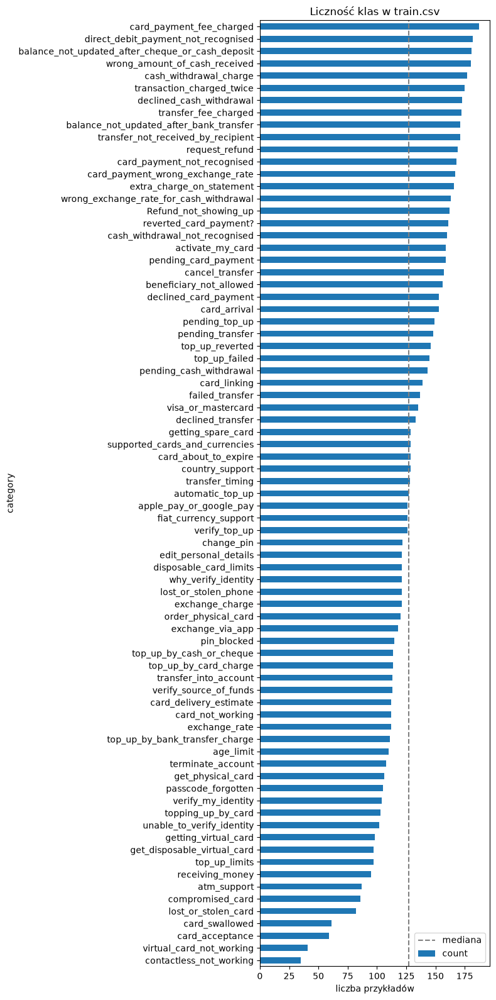
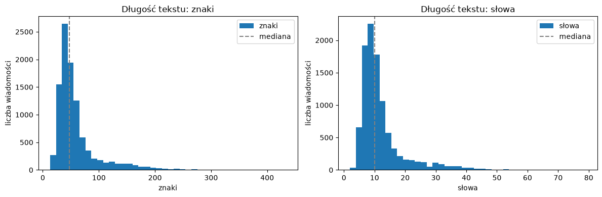
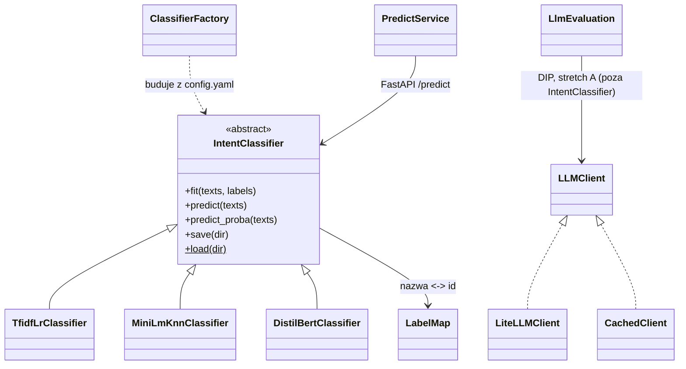
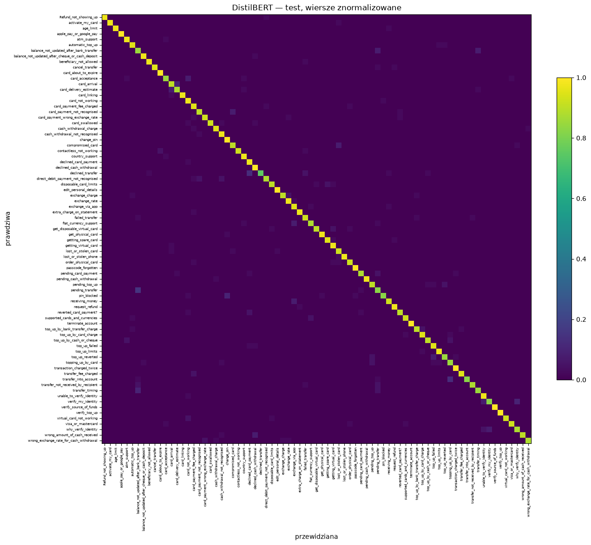

# Klasyfikacja zgłoszeń na BANKING77 — porównanie jakości, kosztu i wdrożenia metod NLP

[](https://github.com/MarcinPrDev/banking77-intent-ml/actions/workflows/ci.yaml)
[](https://github.com/MarcinPrDev/banking77-intent-ml/actions/workflows/deploy-kind.yaml)

Projekt końcowy kursu **AI & ML Engineering** (SAGES/Kodołamacz, gr. 06.12.2025).
Klasyfikacja intencji pojedynczej wiadomości klienta banku do jednej z **77 kategorii**
na benchmarku [BANKING77](https://github.com/PolyAI-LDN/task-specific-datasets) (PolyAI, 2020).

> **Zmiana tematu 30.09.2026.** Do 29.09 projekt dotyczył predykcji `Severity` na US Accidents.
> Powody i liczby z audytu: sekcja *Historia decyzji* i `docs/adr/0001-zmiana-tematu-na-banking77.md`.
> Repo i pakiet przemianowano 2.10.2026 (wcześniej `us-accidents-ml` / `us_accidents_ml`) — zapis
> w `docs/RENAME.md`; stare adresy GitHuba przekierowują.

> **Co system robi:** dostaje angielską wiadomość („I still haven't received my card"), zwraca
> identyfikator intencji (`card_arrival`). **Czego nie robi:** nie rozwiązuje sprawy klienta,
> nie ocenia ryzyka, nie wykrywa intencji spoza 77 klas (test nie waliduje OOD).

**Pytanie badawcze:** czy dostrajany mały transformer (DistilBERT) poprawia jakość klasyfikacji
względem TF-IDF + regresji logistycznej i zamrożonych embeddingów + kNN **na tyle, żeby uzasadnić
większy koszt uczenia i predykcji na CPU**? Wynikiem projektu jest uzasadniony wybór jednego modelu
i działająca usługa — także wtedy, gdy najdroższy model nie wygra.

## W skrócie

Porównałem trzy metody rozpoznawania 77 intencji bankowych i wdrożyłem wybrany model jako API
w Dockerze, z automatycznym wdrożeniem do kind w CI.
Na teście 3 080 wiadomości DistilBERT osiągnął accuracy 93,02%, MiniLM+kNN 92,05%,
a TF-IDF+LR 90,81%.
Odpowiedź na pytanie badawcze brzmi „częściowo”: przy pierwszeństwie jakości uznaję większy koszt
DistilBERT za uzasadniony względem TF-IDF+LR (p95 rozgrzanej predykcji CPU przy jednym wątku,
batch=1, bez narzutu HTTP: 31,42 wobec 0,43 ms), ale przewaga accuracy nad kNN nie osiągnęła
istotności w teście McNemara po korekcie Holma.
DistilBERT wybrano po obejrzeniu wyników testu, więc wynik nie jest niezależnym potwierdzeniem
wyboru ani dowodem opłacalności w rzeczywistym banku.

## Spis treści

- **Raport:** [Dane](#dane) · [Protokół ewaluacji](#protokół-ewaluacji-wspólny-dla-wszystkich-modeli)
  · [Modele i budżet strojenia](#modele-i-budżet-strojenia) · [Wyniki](#wyniki)
  ([tabela końcowa](#tabela-końcowa)) · [Analiza błędów](#analiza-błędów-w3)
  · [Odpowiedź na pytanie badawcze](#odpowiedź-na-pytanie-badawcze)
  · [Ograniczenia](#ograniczenia-i-granice-weryfikacji)
  · [Co nie zadziałało](#co-nie-zadziałało-i-co-zrobiłbym-inaczej) · [Dalsze prace](#dalsze-prace)
- **Uruchomienie:** [Quickstart](#quickstart) · [Demo](#demo) · [Odtworzenie wyników](#odtworzenie-wyników)
  · [Wdrożenie](#wdrożenie)
- **Projekt:** [Architektura](#architektura-wzorce-i-solid) · [Przepływ artefaktów modelu](#przepływ-artefaktów-modelu)
  · [Wymagania projektu końcowego](#wymagania-projektu-końcowego--gdzie-są-spełnione)
  · [Dlaczego bez Sparka i CV](#dlaczego-bez-sparka-i-cv) · [Status i księga godzin](#status)
  · [Plan](#plan--5-slotów-60-h-3009--31102026) · [Historia decyzji](#historia-decyzji)
  · [Tooling](#tooling--współpraca-z-ai) · [Licencja](#licencja)

## Dane

| | Trening (`train.csv`) | Test (`test.csv`) |
|---|---:|---:|
| Wiersze | 10 003 | 3 080 |
| Kategorie | 77 | 77 |
| Przykłady na kategorię | 35–187 (mediana 127) | dokładnie 40 |
| Puste teksty / etykiety | 0 / 0 | 0 / 0 |
| Nadmiarowe duplikaty po normalizacji¹ | 31 | 4 |
| Grupy znormalizowane z różnymi etykietami | 1 | 1 |

¹ Normalizacja audytowa: Unicode NFKC → casefold → tokeny `\w+` połączone spacją. **25 tekstów
testowych ma odpowiednik w train** po tej normalizacji (etykiety zgodne); bez nich zostaje **3 055**.
Liczby z własnego audytu danych (30.09.2026, normalizacja jak w `split.dedup_normalization`
w configu). Kod w repo: duplikaty i konflikt w train — notebook 01 §5 i `data/splits.py`; pokrycie
testu i podzbiory 3 055 / 385 — `data/audit.py` (CLI `scripts/make_test_subsets.py`); notatka
źródłowa poza repo.

- **Źródło:** repozytorium `PolyAI-LDN/task-specific-datasets`, przypięty commit
  `57ec275d8078af65b7731c2a98be812d844a6d6b`, pliki `banking_data/train.csv`
  (SHA-256 `b06e26ac…cbc664b`) i `banking_data/test.csv` (SHA-256 `d12d6e3b…cfeeb474d`), łącznie
  1 079 034 B. Pełne sumy w `configs/config.yaml`; pobranie i weryfikacja: `scripts/fetch_data.py`.
  Nie mieszamy z kopiami z HF/MTEB (inna licencja w metadanych, inny protokół, w v2 usunięte wiersze).
- **Licencja danych:** CC BY 4.0 — atrybucja w sekcji *Licencja*. Dane poza repo; w repo kod,
  skrypt pobrania, mapa etykiet i manifest splitu.
- **Co wiemy o pochodzeniu:** karta danych nie dokumentuje sposobu pozyskania ani anonimizacji
  (przy danych osobowych wpis „N/A"). Własny skan 13 083 tekstów pięcioma wzorcami (e-mail, URL,
  ≥9 cyfr, IBAN, przedstawianie się) dał **0 trafień — to nie dowodzi braku PII** (bez NER, bez
  ręcznego przeglądu). **Wykrycie istotnych PII w trakcie EDA = podstawa rezygnacji ze zbioru.**
- **Znane problemy etykiet:** Ying & Thomas (2022) wskazują automatycznie **1 428 potencjalnych
  problemów w train (~14%)**. Nie usuwamy ich hurtowo i nie zmieniamy etykiet testu po obejrzeniu
  predykcji; analizujemy pomyłki i niejednoznaczne intencje w analizie błędów.
- **Ograniczenia zbioru:** test jest sztucznie zrównoważony (wynik nie odwzorowuje częstości
  rzeczywistych zgłoszeń); przy 40 przykładach na klasę jedna pomyłka = 2,5 p.p. recallu klasy;
  brak czasu i identyfikatorów rozmów (nie da się zweryfikować podziału chronologicznego).
- **EDA — tylko train (10 003 wiadomości):** mediana / P95 / maksimum długości:
  znaki 47 / 151,9 / 433, słowa 10 / 29 / 79, tokeny DistilBERT z tokenami specjalnymi
  13 / 37 / 98 ([notebook, §4, §6 i §9](notebooks/01_eda.ipynb)).
  `max_len=128` nie obcina żadnej wiadomości train; nie daje to gwarancji dla przyszłych zgłoszeń.
  Najkrótsze teksty mają mało kontekstu, wśród najdłuższych są opisy weryfikacji w formie
  odpowiedzi, a podobne intencje bywają niejednoznaczne i wymagają uwagi na szczegóły.

Wykresy z notebooka 01 (train, 10 003 wiadomości; notebooki w repo są bez wyników — filtr
nbstripout — więc tu zapisane wyniki komórek, bez tekstów zdań):





## Protokół ewaluacji (wspólny dla wszystkich modeli)

1. **Przypięte:** commit, sumy plików, mapa nazw kategorii → id (`configs/label_map.json`).
2. **Walidacja z train:** ~15% (`split.val_size`), stratyfikowana; **znormalizowane duplikaty
   trafiają razem do jednej części**; indeksy w `dane/splits/` (w gicie — same numery wierszy,
   bez tekstów; katalog nietykalny)
   + manifest `configs/split_manifest.json` (git-tracked: seed, val_size, n_train, n_val,
   sha256 indeksów). Konflikty etykiet zbadane przed podziałem.
3. **Test tylko do dwóch rzeczy:** audytu integralności i oceny końcowej. Żadnego fitu, HPO,
   wyboru epoki, progu ani doboru promptu na teście. TF-IDF dopasowany wyłącznie na train.
4. **Refit — decyzja 14.10.2026:** trzy zamrożone konfiguracje uczone od nowa na całych
   10 003 zdaniach (train + dawna walidacja). DistilBERT: harmonogram na 5 epok, stop po 4.
   Po reficie brak niezależnej walidacji. Porównanie z *Full*: accuracy na pełnym teście 3 080,
   z uwzględnieniem różnic strojenia i jednego seeda.
5. **Metryki:** `accuracy` — główna, do porównania z literaturą; **macro-F1 — metryka wyboru
   checkpointu/konfiguracji na walidacji (ustalone z góry)**; recall i F1 per klasa; macierz
   pomyłek. Przy jednym seedzie nie wyciągamy wniosków z różnic o ułamek punktu procentowego.
6. **Kontrola wrażliwości:** każdy model raportowany także na podzbiorze **3 055** tekstów bez
   pokrycia z train (ustalonym przed treningiem). To nie nowy benchmark — nie porównywać
   z publikacjami na 3 080.
7. **Koszt:** czas treningu, rozmiar całego artefaktu, latencja CPU p50/p95 dla batch=1
   (z preprocessingiem i ekstrakcją embeddingów), **zimny start osobno od rozgrzanej predykcji**.
   Surowego wyniku kNN/softmaxu nie nazywamy skalibrowanym prawdopodobieństwem.
8. **LLM (stretch A):** jeden model, jeden zamrożony prompt, **385 wiadomości testowych
   (5 na klasę) wybranych z góry** — te same 385 dla wszystkich modeli w tabeli; raport jakości,
   błędów formatu, tokenów, latencji i kosztu. Dobór promptu tylko na walidacji. **Ekspozycja LLM
   na benchmark nieustalona** — brak gwarancji czystego testu; wynik nie dowodzi generalizacji.

**Zamrożenie — 14.10.2026, przed pierwszym wynikiem na teście:**

- TF-IDF+LR: próba #12; MiniLM+kNN: k = 1, `uniform`, cosinus;
  DistilBERT: LR 6e-5, epoka 4 przy harmonogramie na 5 epok, `max_len=128`.
- Pełne parametry: `models.<nazwa>.frozen` i baza w configu; przypięte rewizje wag, seed 42.
  Bez nowego HPO i zmian konfiguracji po wyniku testowym.
- Kolejność: commit z tym wpisem i [ADR-0002](docs/adr/0002-protokol-ewaluacji.md)
  → tag `experiments-frozen` na tym commicie → refit → jednorazowa ocena na teście.
- Artefakty W2 zachowane; finalne w `models/final/`. Koszty finalnych modeli mierzone ponownie.

**Punkty odniesienia (protokół Full, pełny train i test):** DistilBERT-base **92,1%**
(Qi i in. 2021: batch 32, max_len 128, AdamW wd 0,01, warmup 10% do LR 4e-5, 5 epok);
BERT-base 93,3%; RoBERTa-base 94,1%; BERT-large 93,66% (Casanueva i in. 2020).
Dummy (jedna klasa) = 1/77 = **1,30%**. Kanonicznego wyniku TF-IDF+LR nie ma — wyznaczamy własny.
Liczby z publikacji to konkretne konfiguracje, nie gwarantowany przedział wyników tego projektu.

## Modele i budżet strojenia

| Model | Budżet strojenia (walidacja, MLflow) | Cel | Wagi / licencja |
|---|---|---|---|
| Dummy | brak | kontrola rozkładu i metryk | — |
| **TF-IDF + Logistic Regression** | `tfidf_lr.hpo_trials` = 16 konfiguracji wektoryzatora (słowa/znaki, n-gramy, min_df), regularyzacji (C) i wag klas (`class_weight`); punkt startu = pierwsza konfiguracja z configu (W1) | tani, interpretowalny baseline; kandydat do wdrożenia | — |
| **all-MiniLM-L6-v2 (zamrożony) + kNN** | kilka `k` × ważenie (uniform/distance) | wartość reprezentacji semantycznej bez dostrajania | HF `sentence-transformers/all-MiniLM-L6-v2`, Apache-2.0, rewizja przypięta w configu |
| **DistilBERT + głowica 77 klas** | 5 LR {2–6}e-5 × 5 epok = 25 kandydatów; budżet ustalony przed wynikami, pozostałe parametry wg Qi 2021 | efekt dostrajania reprezentacji; RTX 5080 | HF `distilbert/distilbert-base-uncased`, Apache-2.0, rewizja przypięta |
| *(stretch A)* LLM zero-shot | brak strojenia; prompt dobrany na walidacji | koszt/latencja/błędy formatu vs modele dostrajane | Groq (plan płatny, Developer tier) przez LiteLLM; model w `llm.model` |
| *(fallback)* TF-IDF + LinearSVC | mały grid C | trzecia metoda, gdy transformer nie ruszy — niewykorzystany | — |

Wartości liczbowe (budżety, hiperparametry startowe, seed) — wyłącznie z `configs/config.yaml`.
Budżet DistilBERT zwiększono z 2–3 do 5 LR, by sprawdzić wartości po obu stronach 4e-5
z publikacji; decyzja przed wynikami zapobiega dokładaniu prób pod wynik, ale nie wyrównuje
budżetów między modelami.
Czas treningu, VRAM i koszty CPU na sprzęcie autora zapisano w MLflow.

## Architektura (wzorce i SOLID)

Trzy adaptery w `models/classifiers.py` realizują interfejs `IntentClassifier`
z `models/predictor.py`. Fabryka w `models/factory.py` buduje lub wczytuje wybrany predyktor.

- **Strategy:** wspólny interfejs predyktora (`fit / predict / predict_proba / save / load`) z
  implementacjami dla TF-IDF+LR, MiniLM+kNN i DistilBERT. API i ewaluacja widzą tylko interfejs
  — podmiana modelu = zmiana wpisu w configu, nie kodu. LLM (stretch) **poza** interfejsem
  (decyzja autora 18.10.2026): kontrakt wymaga `predict` == argmax(`predict_proba`), a odpowiedź
  spoza 77 nazw ma zostać błędem formatu, nie klasą 0 — ocena w `evaluation/llm_eval.py`.
- **Factory:** `build_predictor` tworzy adapter zamrożonej konfiguracji,
  a `load_predictor` wczytuje zapisany artefakt; wybór klasy przez rejestr `STRATEGIES`.
- **Pipeline sklearn** w TF-IDF+LR: `TfidfVectorizer` → `LogisticRegression`, zapis razem
  w `model.joblib`. W MiniLM+kNN kodowanie tekstu przez `features/embeddings.py`, a indeks
  kNN zapisany osobno; bez własnych transformerów sklearn.
- **LabelMap** — jedna klasa mapująca nazwa ↔ id, ładowana z przypiętego pliku; wszystkie modele
  i API korzystają z tej samej mapy etykiet.
- **LLMClient** (stretch) — wąski interfejs `complete(prompt)`, implementacja `LiteLLMClient`
  (Groq przez LiteLLM) i `CachedClient` (cache odpowiedzi) — DIP, w testach atrapa bez sieci.
- Mapowanie SOLID: SRP (moduły `data/features/models/evaluation/api`), OCP (nowy model = nowa
  klasa i wpis w rejestrze fabryki), LSP (każdy predyktor przechodzi ten sam test kontraktu
  zapis→odczyt→identyczne predykcje), DIP (API zależy od interfejsu, nie od torcha).



Na diagramie `ClassifierFactory` oznacza funkcje w `models/factory.py`, a `PredictService`
obsługę żądań w `api/app.py`; nie są to osobne klasy w kodzie.

## Przepływ artefaktów modelu

**MLflow** (lokalnie, poza gitem: baza `mlflow.db` z runami + artefakty w `mlruns/`; podgląd:
`uv run mlflow ui --backend-store-uri sqlite:///mlflow.db`) = tracking wszystkich runów: parametry, metryki na walidacji,
czas treningu, rozmiar artefaktu. **Wybrany model ([ADR-0003](docs/adr/0003-wybor-modelu-do-wdrozenia.md), 15.10): DistilBERT** — oceniony
artefakt z refitu w `models/final/distilbert`, bez kopiowania. Sekcja `deploy` w configu
(`model_version: distilbert-v1`, `artifact_dir`) — jedno źródło dla build-arg obrazu, tagu,
manifestu k8s i odpowiedzi `/health` (`MODEL_VERSION`; bez tej zmiennej API zwraca
`deploy.model_version`). Manifest z hashami plików powstaje przy pakowaniu do Release
(`scripts/model_release.py pack`, W4).
Artefakt jest **wpiekany w obraz CPU podczas `docker build`** (bez pobierania na starcie
kontenera — brak cold startu i uprawnień runtime). Tag obrazu zawiera wersję modelu.

**Skąd CI bierze artefakt do `docker build` — rozstrzygnięte w ADR-0003: opcja (a)**, GitHub
Release asset przypięty tagiem (`deploy.model_version`) + sha256 w configu; pliki bit w bit
zgodne z ocenionym artefaktem. Rozważane były też: (b) trening lekkiego modelu w CI z danych
pobranych przez `fetch_data.py --only train` (bez `test.csv`; działa tylko dla TF-IDF; manifest
splitu niesie tylko hash, więc w CI trzeba odtworzyć podział `make_splits` i porównać hash
z manifestem — albo refitować na całych 10 003 bez podziału) — odrzucone, bo tworzy nowy
artefakt; (c) GCS (tylko jeśli GCP wejdzie jako stretch) — odrzucone. W4 implementuje (a).
Wybrany DistilBERT wymaga torcha CPU w obrazie — rozmiar 3,18 GB (W3); budowa od zera w CI
98 s (run `deploy-kind` na PR #1, 18.10 — *Status*, W4).

**Release `distilbert-v1` (18.10):**
[github.com/MarcinPrDev/banking77-intent-ml/releases/tag/distilbert-v1](https://github.com/MarcinPrDev/banking77-intent-ml/releases/tag/distilbert-v1)
— tag na `d809c57` (commit refitu, `experiments-frozen`), asset `distilbert-v1.tar`
(268 789 760 B), SHA-256 w `deploy.release_sha256`. Archiwum: niezmienione pliki
`models/final/distilbert` + `manifest.json` (SHA-256 każdego pliku, hash mapy etykiet, wersje
bibliotek, runy refit `5b883a97` i ocena `fb0d0bde`); tar bez kompresji z ustalonymi
metadanymi — te same pliki dają tę samą sumę. `scripts/model_release.py unpack` sprawdza sumę
archiwum, wersję, mapę etykiet, skład archiwum i sumę każdego pliku.

**MiniLM+kNN (niewybrany w ADR-0003; opis zostaje dla porządku):** adapter zapisuje indeks kNN i metadane, a wagi enkodera
z przypiętej rewizji pozostają w cache Hugging Face. Obraz musi zawierać również enkoder:
do wyboru wpieczenie cache HF albo zapis enkodera wewnątrz artefaktu. W tabeli kosztów
rozmiar obejmuje **indeks kNN + wagi, tokenizer i konfigurację enkodera**. `load()` rozgrzewa
enkoder przed gotowością API; pomiar zimnego startu nadal obejmuje `load` i pierwszą predykcję
w nowym procesie.

## Quickstart

**Wymagania przed startem:** Python 3.11 i uv; `gh` zalogowany na konto z dostępem do repo
(pobranie modelu z Release, dopóki repo jest prywatne); do obrazu i klastra uruchomiony Docker
(Docker Desktop) oraz kind v0.33.0 i kubectl ≥ 1.36 w `PATH`; do treningu DistilBERT GPU NVIDIA.
Na Windows sprawdź też porty (niżej: *Porty lokalne*).

**Kontrola na świeżym klonie (29.10.2026, autor):** klon `46f47df` → środowisko → dane z SHA-256
→ weryfikacja plików W1 → testy i lint → modele bazowe (wyniki jak w *Wyniki na walidacji*)
→ model z Release → obraz (budowa 97 s) → smoke `[OK]` — **ok. 7 min 15 s**, jedno potknięcie
obsługi (smoke trzeba uruchomić w drugim terminalu, przy działającym kontenerze); ciepłe cache uv
i Dockera, bez kind i bez treningu DistilBERT.

```bash
# Środowisko lokalne (Python 3.11, uv) — JEDNA komenda z pełną listą extras używanych lokalnie:
uv sync --extra dev --extra nlp --extra gpu --extra serving
# Jednorazowo po klonie: filtr gita czyści wyjścia notebooków przy commicie (lokalnie zostają);
# --keep-id zachowuje identyfikatory komórek (bez niego nbstripout numeruje je od nowa)
uv run nbstripout --install --attributes .gitattributes
git config filter.nbstripout.clean "$(git config filter.nbstripout.clean) --keep-id"
uv run python scripts/fetch_data.py        # train.csv + test.csv z przypiętego commitu, weryfikacja SHA-256
uv run pytest                              # strażnik protokołu + testy dymne
uv run ruff check .
# UWAGA: `uv sync` jest "exact" — extras pominięte w komendzie są USUWANE ze środowiska
# (torch/transformers znikną po gołym `uv sync --extra dev`). Goły `--extra dev` jest tylko dla CI.
# Po każdym sync na maszynie z GPU: python -c "import torch; print(torch.cuda.is_available())"
# gpu = torch z indeksu cu128 (RTX 5080/sm_120) + transformers; nlp = sentence-transformers;
# serving = fastapi, uvicorn, httpx (API od W2); llm (stretch A): dodatkowo --extra llm
# + GROQ_API_KEY w .env (poza gitem); ui (stretch 3, Streamlit): dodatkowo --extra ui
# Bez GPU NVIDIA albo na macOS: zamiast --extra gpu użyj --extra cpu (torch 2.11.0 z indeksu CPU,
# jak w obrazie; koła cu128 są tylko dla Linuksa i Windows). Wystarcza do testów, API i obrazu;
# trening DistilBERT wymaga --extra gpu (accelerate + CUDA).
```

**Model do API i obrazu** — oceniony artefakt `models/final/distilbert` z GitHub Release (`gh`
zalogowany na konto z dostępem do repo) albo z refitu (`uv run python scripts/refit_final.py`):

```bash
gh release download distilbert-v1 -p distilbert-v1.tar -D dist
uv run python scripts/model_release.py unpack dist/distilbert-v1.tar   # weryfikacja → models/final/distilbert
```

**Porty lokalne:** 18080 (API, kontener, UI) i 18081 (klaster kind). Na Windows Hyper-V, WSL2
i Docker Desktop dynamicznie wykluczają bloki portów TCP, a zakresy zmieniają się po restarcie
(21.10.2026 m.in. 7969–8068 i 8071–8170, czyli 8000, 8080 i 8081). Sprawdzenie:
`netsh interface ipv4 show excludedportrange protocol=tcp`. Jeśli port wypada w zakresie, wybierz
inny — dla kind także `hostPort` w `k8s/kind/cluster.yaml`.

**API lokalnie** — serwuje model z `deploy.artifact_dir` (ADR-0003: DistilBERT); dokumentacja
endpointów: `http://localhost:18080/docs`.

```bash
uv run uvicorn banking77_intent_ml.api.app:create_app --factory --port 18080
```

**UI demo** (stretch 3, `--extra ui`) — Streamlit nad działającym API: formularz, stan
`/health`, wynik `/predict`; model zostaje w API. Adres API w panelu bocznym (domyślnie
`ui.api_url` z configu = `http://localhost:18080`; dla kind `http://localhost:18081`):

```bash
uv run streamlit run src/banking77_intent_ml/ui/app.py
```

**Obraz Docker CPU** (W3) — z artefaktem pobranym wyżej; `MODEL_VERSION` = `deploy.model_version`
z configu:

```bash
docker build --build-arg MODEL_VERSION=distilbert-v1 -t banking77-intent-api:distilbert-v1 .
docker run --rm -p 18080:8000 banking77-intent-api:distilbert-v1
uv run python scripts/smoke_api.py --url http://localhost:18080   # drugi terminal: smoke
```

**Klaster kind lokalnie** (W4; kind v0.33.0, kubectl ≥ 1.36, obraz zbudowany wyżej) — te same
manifesty co w CI (`k8s/`); Service NodePort dostępny z hosta pod `127.0.0.1:18081`
(`k8s/kind/cluster.yaml`); tag obrazu = `deploy.model_version`:

```bash
kind create cluster --name banking77 --config k8s/kind/cluster.yaml
kind load docker-image banking77-intent-api:distilbert-v1 --name banking77
kubectl apply -f k8s/
kubectl set image deployment/banking77-intent-api api=banking77-intent-api:distilbert-v1
kubectl rollout status deployment/banking77-intent-api --timeout=180s
uv run python scripts/smoke_api.py --url http://localhost:18081
kind delete cluster --name banking77
```

Ten sam przebieg w GitHub Actions: `.github/workflows/deploy-kind.yaml` (push na `main`, pull
request, ręcznie) — pierwszy zielony run na `main`:
[39138227351](https://github.com/MarcinPrDev/banking77-intent-ml/actions/runs/39138227351).

**GKE Autopilot (stretch, płatne; projekt GCP z billingiem, gcloud z `gke-gcloud-auth-plugin`)**
— ten sam obraz i te same manifesty; obraz z Artifact Registry przypięty digestem i podmieniany
w locie (`k8s/deployment.yaml` bez zmian), test przez port-forward, bez publicznego adresu.
`<PROJECT>` / `<NUMER>` = ID i numer projektu GCP, `<DIGEST>` = digest z `docker push`:

```bash
gcloud services enable container.googleapis.com artifactregistry.googleapis.com
gcloud artifacts repositories create banking77 --repository-format=docker --location=europe-central2
gcloud auth configure-docker europe-central2-docker.pkg.dev
docker tag banking77-intent-api:distilbert-v1 europe-central2-docker.pkg.dev/<PROJECT>/banking77/banking77-intent-api:distilbert-v1
docker push europe-central2-docker.pkg.dev/<PROJECT>/banking77/banking77-intent-api:distilbert-v1
# tylko gdy konto usługi węzłów nie ma ról w projekcie (u nas: nowy projekt, zero ról)
gcloud artifacts repositories add-iam-policy-binding banking77 --location=europe-central2 --member=serviceAccount:<NUMER>-compute@developer.gserviceaccount.com --role=roles/artifactregistry.reader
gcloud container clusters create-auto banking77-gke --region=europe-central2
kubectl apply -f k8s/service.yaml
kubectl set image --local -f k8s/deployment.yaml api=europe-central2-docker.pkg.dev/<PROJECT>/banking77/banking77-intent-api@<DIGEST> -o yaml | kubectl apply -f -
kubectl rollout status deployment/banking77-intent-api --timeout=540s
kubectl port-forward svc/banking77-intent-api 18082:8000   # zostaw działające
uv run python scripts/smoke_api.py --url http://localhost:18082 --timeout 120   # drugi terminal
gcloud container clusters delete banking77-gke --region=europe-central2
gcloud artifacts repositories delete banking77 --location=europe-central2
```

## Demo

Obraz z *Quickstart* (DistilBERT wpieczony w obraz CPU), `/health` i `/predict` na trzech
zdaniach. Zdania pochodzą z `configs/smoke_cases.json` — napisane na potrzeby testu dymnego,
nie ze zbioru BANKING77. Demo pokazuje, że usługa działa; o jakości mówią tabele wyników,
nie te trzy zdania.

```bash
docker run --rm -p 18080:8000 banking77-intent-api:distilbert-v1
# drugi terminal (bash; bez terminala: http://localhost:18080/docs)
curl -s http://localhost:18080/health
curl -s -X POST http://localhost:18080/predict -H "Content-Type: application/json" \
  -d "{\"text\": \"My new card still hasn't arrived, when will it come?\"}"
```

Prawdziwe odpowiedzi (28.10.2026, obraz zbudowany z kodu zgodnego z `main`):

```text
{"status":"ok","model":"distilbert","model_version":"distilbert-v1"}
{"intent":"card_arrival","intent_id":12,"score":0.9861456751823425,"model_version":"distilbert-v1"}
{"intent":"exchange_rate","intent_id":33,"score":0.8856154680252075,"model_version":"distilbert-v1"}
{"intent":"lost_or_stolen_card","intent_id":42,"score":0.6754384636878967,"model_version":"distilbert-v1"}
```

| Zdanie | Intencja (`intent_id`) | `score` |
|---|---|---:|
| My new card still hasn't arrived, when will it come? | `card_arrival` (12) | 0,986 |
| What exchange rate will I get if I pay in euros? | `exchange_rate` (33) | 0,886 |
| Someone stole my card, please block it right away. | `lost_or_stolen_card` (42) | 0,675 |

Pusty tekst albo same spacje → `422`. `score` to wynik modelu dla zwróconej klasy, nie
skalibrowane prawdopodobieństwo (zob. *Ograniczenia i granice weryfikacji*). Ten sam Dockerfile
i model z Release przechodzą w CI deploy do kind i test HTTP — ostatni zielony run na `main`:
[Deploy kind 40617499359](https://github.com/MarcinPrDev/banking77-intent-ml/actions/runs/40617499359).

## Odtworzenie wyników

Quickstart odtwarza **wdrożenie** z ocenionym artefaktem z Release. Ta sekcja odtwarza **liczby**
z README (walidacja, koszt, test) od zera, w dwóch rozdzielnych przebiegach. Każdy przebieg to
**osobny klon i nowy magazyn MLflow**: `mlflow.db` i `mlruns/` powstają w katalogu klonu przy
pierwszym runie. Nie kopiuj ich z innego klonu — blokady budżetu liczą runy w magazynie.

- **A. Zamrożone modele** — konfiguracje z `models.*.frozen` w configu, bez strojenia: wyniki
  walidacji, refit na 10 003, koszt i **jedna** ocena testowa.
- **B. Ponowne HPO** — pełne badania W2 na walidacji; sprawdza procedurę wyboru konfiguracji.
  Nie zmienia configu i nie dotyka testu.

Przygotowanie (A i B): środowisko i dane jak w Quickstart (`--extra gpu` — trening DistilBERT
wymaga GPU NVIDIA; MiniLM liczy się też na CPU, wolniej). Wagi MiniLM i DistilBERT pobiorą się
przy pierwszym użyciu z HF Hub, pod rewizjami przypiętymi w configu. Pliki W1 są w gicie — skrypty
W1 tylko je weryfikują i niczego nie nadpisują:

```bash
uv run python scripts/make_label_map.py      # mapa etykiet = configs/label_map.json
uv run python scripts/make_splits.py         # podział train/val = manifest („zgodny”)
uv run python scripts/make_test_subsets.py   # podzbiory 3 055 / 385 = manifest (same liczby i hashe)
```

**A. Zamrożone modele** — kolejność obowiązkowa: refit i test dopiero po krokach walidacji.

| Krok | Komenda (`uv run python scripts/…`) | Blokada | Porównaj z |
|---|---|---|---|
| A1. Modele bazowe | `train_baselines.py --model dummy`, potem `--model tfidf_lr` | bez `--model` odmowa | *Wyniki na walidacji*: Dummy, TF-IDF + LR (W1) |
| A2. Zamrożone konfiguracje na train | `export_model.py tfidf_lr`, `minilm_knn`, `distilbert` | istniejący `models/<nazwa>` = odmowa | *Wyniki na walidacji* (accuracy i macro-F1 wypisuje skrypt; bez runu MLflow) |
| A3. Koszt CPU artefaktów W2 | `measure_cost.py` | badanie `cpu_cost_w2` raz w magazynie | *Koszt na CPU* |
| A4. Refit na 10 003 | `refit_final.py` | brak tagu `experiments-frozen`, istniejący artefakt albo run refitu = odmowa | runy `final_refit`, artefakty `models/final/` |
| A5. Koszt finalnych artefaktów | `measure_cost.py --final` | badanie `cpu_cost_final` raz w magazynie | tabela końcowa (koszt) |
| A6. **Ocena na teście — raz** | `evaluate_test.py` | brak tagu albo `models/final/`, istniejący run `split=test` = odmowa | tabela końcowa (3 080, 3 055) |

Po A6 analiza błędów: `notebooks/02_analiza_bledow.ipynb` (artefakty runów testowych z MLflow
i predykcje artefaktów W2 z A2 na walidacji). Jedna ocena testowa: drugiego przebiegu A6 w tym
samym magazynie skrypt nie wykona, a wynik testu nie wraca do kroków A1–A5. Na tym samym sprzęcie
(RTX 5080) ścieżki odtwarzały zamrożone runy co do bitu; na innym GPU lub sterowniku możliwe są
małe różnice. Nowe artefakty nie zastępują Release `distilbert-v1` — wdrożenie zawsze bierze
oceniony artefakt z Release (suma w configu).

**B. Ponowne HPO** — osobny klon i magazyn; bez refitu i bez testu.

| Krok | Komenda (`uv run python scripts/…`) | Blokada | Porównaj z |
|---|---|---|---|
| B1. TF-IDF + LR, Optuna TPE (16 prób) | `hpo_tfidf_lr.py` | badanie (tag `hpo_study`) raz w magazynie | `models.tfidf_lr.frozen` (próba #12) |
| B2. MiniLM + kNN, siatka k × wagi | `knn_minilm.py` | jak wyżej | `models.minilm_knn.frozen` (k = 1, `uniform`) |
| B3. DistilBERT, 5 LR × 5 epok | `train_distilbert.py` | jak wyżej; checkpointy ok. 6,3 GB w `dane/cache/distilbert` | `models.distilbert.frozen` (LR 6e-5, epoka 4) |
| B4. Seedy DistilBERT (stretch 1) | `seed_study_distilbert.py` | badanie `seed_study` raz; wymaga runu z B3 w tym samym magazynie (kontrola seeda 42) | *Rozrzut DistilBERT po seedach* |

Skrypty B drukują zwycięzcę jako fragment YAML — configu nie zmieniamy: konfiguracje zamrożono
14.10, przed testem (ADR-0002). Inny zwycięzca to wniosek do raportu, nie powód do nowego
strojenia.

**Stretch LLM** (opcjonalnie; klucz `GROQ_API_KEY` w `.env`, środowisko z `--extra llm`, płatne
API): `llm_zero_shot.py --stage val --prompt v1`, `--prompt v2`, potem `--stage test` z
`llm.frozen_prompt` z configu. Blokady jak wyżej: każdy wariant raz na walidacji, test raz w
magazynie; odpowiedzi w cache `dane/cache/llm` (przerwany przebieg bez ponownego kosztu).

## Plan — 5 slotów, 60 h (30.09 → 31.10.2026)

*Plan z 30.09.2026; przebieg faktyczny i księga godzin — [Status](#status).*

Podział pracy: dane/protokół/EDA **10 h** · modele/HPO **12 h** · ewaluacja i analiza błędów **6 h**
· pakiet/API/testy **8 h** · Docker/kind/CI **9 h** · raport/demo **7 h** · rezerwa **8 h**.
Godziny slotu obejmują weekend i wieczory danego tygodnia — od 5.10.2026 każdy wieczór pn–pt
(także piątek) jest roboczy (~1–1,5 h, jedno małe zadanie; rozkład dzienny w playbookach slotów
i w kalendarzu), a godziny ponad budżet slotu idą do księgi rezerwy. Nazwy slotów W1–W5 są
używane przez skille (`/start-etapu Wn`) i kalendarz.

| Slot | Termin | h | Wymagany rezultat (definicja „done") |
|---|---|---:|---|
| **W1** | pt 2.10 (wieczór) + **3–4.10** | 12 | dane pobrane i zweryfikowane; krótka EDA + audyt jakości (duplikaty, konflikty, długości, PII); mapa etykiet; **zamrożona walidacja** (grupowany, stratyfikowany split + manifest); TF-IDF baseline w MLflow; predykcje przeżywają zapis/odczyt; krótki test uruchomienia DistilBERT na GPU |
| **W2** | **10–11.10** | 14 | trzy ścieżki (TF-IDF+LR, MiniLM+kNN, DistilBERT) z ograniczonym HPO na walidacji; pierwsze pomiary CPU (latencja, rozmiar); szkic interfejsu predyktora + Factory; **FastAPI z baseline'em** (`/predict`, `/health`, wersja modelu) |
| **W3** | **17–18.10** | 14 | **zamrożenie eksperymentów**; ocena końcowa na teście + podzbiór 3 055; analiza błędów; wybrany artefakt wersjonowany; testy jednostkowe (mapa etykiet, walidacja wejścia, zapis→odczyt, kontrakt API); Dockerfile (obraz CPU). **Bez nowych rodzin modeli** |
| **W4** | nd **18.10** + wieczory **19–22.10** (23–25.10 bez pracy) | 14 | **kind + automatyczny workflow** (build → load → Deployment/Service → test HTTP) w GitHub Actions; próba odtworzenia projektu z instrukcji na czystym klonie; wykorzystanie rezerwy; stretch po rdzeniu, do 22.10 |
| **W5** | **31.10 (sobota)** | 6 | raport (README z wynikami i wnioskami), demo, kontrola reprodukowalności, **oddanie**. Bez nowych funkcji |
| | **Razem** | **60** | **Wdrożenie działa przed ostatnim dniem; 1.11 tylko poprawki po wysyłce** |

**Księga godzin:** 60 h = 52 h pracy + 8 h rezerwy. Rezerwa leży w W4 (ogony W1–W3, próba
odtworzenia, debug workflow). Wieczory 26–30.10 (test obrony, gitleaks, wnioski — do 4,5 h) są
**poza** 60 h: pokrywa je niewykorzystana rezerwa albo świadome nadgodziny. Wieczory
30.09–1.10 pochłonęła decyzja o zmianie tematu (research + weryfikacje) — poza budżetem W1.
Stan rezerwy: wiersz w *Status*, aktualizowany na koniec każdego slotu.

**Dokumentacja przyrostowo:** koniec slotu = aktualizacja *Status* w README + wiersz w tabeli
wyników (accuracy, macro-F1, koszt) + 1–2 zdania „co nie zadziałało". ADR-y (`docs/adr/`, MADR)
pisane w momencie decyzji.

## Minimum vs stretch

*Stan na 29.10: minimum zrealizowane; stretch — seedy, LLM zero-shot, UI i GKE — zrobione w W4
(szczegóły w [Status](#status)).*

**MINIMUM (zalicza rubrykę):** EDA z audytem jakości · przypięte dane + zamrożony protokół ·
Dummy / TF-IDF+LR / MiniLM+kNN / DistilBERT z ograniczonym HPO w MLflow · porównanie jakości
i kosztu · analiza błędów · pakiet OOP (Strategy/Factory/pipeline'y) + pytest · FastAPI ·
Docker (CPU) · **kind z automatycznym deployem i testem HTTP w CI** · README z wnioskami
i instrukcją odtworzenia.

**STRETCH — w tej kolejności, dopiero po domknięciu minimum:**
1. dodatkowe seedy zamrożonej konfiguracji DistilBERT, mierzone **na walidacji** (rozrzut
   zamiast jednej liczby; test nietknięty — decyzja autora 18.10);
2. **LLM zero-shot (wariant A)** — Groq przez LiteLLM na 385 wiadomościach, protokół jak wyżej;
3. prosty UI (Streamlit) nad API;
4. GCP: GKE tym samym obrazem (klaster żyje godziny), Artifact Registry.

Rezerwa 8 h **nie jest** z góry budżetem na stretch.

**Plan stretchu (decyzja autora 18.10):** wszystkie cztery punkty w tej kolejności, każdy po
rdzeniu danego wieczoru W4, z granicą w czwartek 22.10 (W5 bez nowych funkcji; pt–nd 23–25.10
bez pracy). Co nie zdąży, zostaje opisane w README jako niezrobione.

## Bramka po W1 i fallback

*Wynik: bramka niezaliczona 4.10, zielona przy powtórce 9.10; fallback LinearSVC niepotrzebny
(DistilBERT działał na GPU od W1).*

**Bramka (powtórka: piątek 9.10, pierwotnie niedziela 4.10) — kontynuujemy, jeśli:** dane i grupowany podział są
odtwarzalne (fetch → make_splits → identyczny manifest), baseline uczy się sensownie ponad Dummy
na tej samej walidacji, predykcje przeżywają zapis/odczyt, i wiadomo, gdzie pójdzie czas wdrożenia.
**Nie uzależniamy decyzji od 92%.** Jeśli po 3–4 h diagnostyki baseline nie działa → naprawić
loader / mapę etykiet / pipeline **przed** kolejnymi modelami. Problemy GPU mają osobny timebox
i nie blokują ścieżek CPU.

**Stan na 9.10:** warunki techniczne są spełnione — dane i zamrożony podział są odtwarzalne,
TF-IDF+LR osiąga 84,39% accuracy wobec 1,87% Dummy `most_frequent` na walidacji, a zapis i odczyt
modelu zachowują identyczne predykcje. **Decyzja autora (pt 9.10): kontynuujemy — W2 od 10.10.**
Czas wdrożenia: autor ocenia plan W2–W4 jako wykonalny przy większym dziennym wymiarze pracy;
godziny ponad plan slotów trafiają do księgi rezerwy (*Status*).

**Fallback:** przy problemach z transformerem trzecią metodą zostaje **TF-IDF + LinearSVC**
(mniej powtórki DL, rdzeń rubryki zachowany). Przy budżecie bliższym 50 h — od początku tnij HPO
i UI, nie wdrożenie. Poślizg o 1 slot w W1–W3 → tnij stretch/HPO i dokładaj wieczory tak, by W4
zaczął się z działającym obrazem Docker; W4–W5 są nietykalne (wdrożenie = twardy wymóg rubryki) —
jeśli na starcie W4 nie ma obrazu, wdrażamy baseline TF-IDF, nie czekamy na lepszy model.

## Wdrożenie

- **FastAPI:** `POST /predict` (tekst → intencja, id, wersja modelu), `GET /health` (status +
  `MODEL_VERSION`); walidacja wejścia (Pydantic), test kontraktu odpowiedzi w pytest.
- **Metryki (dodatek W5, 29–30.10):** `GET /metrics` w formacie Prometheusa — liczba i czas żądań
  według metody, trasy i statusu, predykcje według intencji, rozkład `score`. Rozkład predykcji
  i score to sygnał zmiany ruchu, nie miara jakości. Adnotacje `prometheus.io/*` w Deployment;
  serwera Prometheus w klastrze nie ma. W CI krok po smoke sprawdza `/metrics` przez Service.
- **Docker:** obraz CPU z wpieczonym artefaktem; jeden wybrany model. Config i mapa etykiet
  w obrazie: `COPY configs/ /app/configs/` + `ENV BANKING77_CONFIG=/app/configs/config.yaml`
  (settings liczą ścieżki od położenia configu). DistilBERT z torchem z indeksu CPU, nie
  z PyPI (na Linuxie koło z PyPI zawiera CUDA). Rozmiar: 2,21 GB na runnerze CI
  (`docker image ls`); lokalnie Docker Desktop pokazuje 3,18 GB zajętości dysku przy 822 MB
  skompresowanej treści — inna księgowość magazynu obrazów. Budowa od zera w CI: 98 s.
- **kind w CI (obowiązkowe):** workflow GitHub Actions: `docker build` → `kind create cluster`
  → `kind load docker-image` → `kubectl apply` (Deployment + Service) → `kubectl rollout status`
  → **test HTTP** `/health` i `/predict` → teardown klastra. Dokumentujemy, że to klaster
  testowy; dowodem wdrożenia są manifesty, logi workflow i test HTTP, nie żywy URL.
  Pierwszy zielony run na `main`:
  [39138227351](https://github.com/MarcinPrDev/banking77-intent-ml/actions/runs/39138227351)
  (18.10, 6 min 28 s). Manifesty (W4): `k8s/deployment.yaml` (2 repliki, sondy startowa/gotowości/życia na `/health`,
  requests 500m CPU / 512Mi, limit pamięci 1Gi), `k8s/service.yaml` (NodePort 30080),
  `k8s/kind/cluster.yaml` (konfiguracja klastra kind, węzeł przypięty digestem).
- **GKE (stretch #4, wykonane 22.10 ręcznie, poza CI):** ten sam obraz i te same manifesty na
  GKE Autopilot w `europe-central2` (Warszawa, Kubernetes 1.36.4-gke). Klaster żył ok. 14 min;
  `teardown` tego samego wieczoru — klaster i repozytorium Artifact Registry usunięte, w projekcie
  brak VM, dysków, adresów i reguł przekierowania. Przebieg (komendy w *Quickstart*; log z ID
  projektu zastąpionym przez `<PROJECT>`: [`docs/gke-2026-10-22.log`](docs/gke-2026-10-22.log)):
  - obraz z czystego drzewa `fbf1627` (pliki modelu zgodne z manifestem Release); push do
    Artifact Registry 36 s — obraz amd64 821 775 937 B, wdrożony po digeście indeksu
    `sha256:c85a5c62…`;
  - `gcloud container clusters create-auto` 255 s; rollout 193 s od `kubectl apply`: Autopilot
    dołożył węzeł od zera, pobranie obrazu ok. 60 s, gotowość ok. 12–14 s po starcie kontenera —
    do tego czasu sonda startowa dostawała connection refused (uvicorn słucha dopiero po
    załadowaniu i rozgrzaniu modelu; w kontenerze lokalnie ok. 4 s);
  - smoke `[OK]` przez `kubectl port-forward` (`/health`, 14 zdań kontrolnych, 422, wersja
    `distilbert-v1`); 2/2 pody, 0 restartów, po 369 MiB RAM; Autopilot nie zmienił zasobów
    z manifestu (dodał tylko domyślne ephemeral-storage 1Gi);
  - konto usługi węzłów nie miało w nowym projekcie żadnych ról → `roles/artifactregistry.reader`
    tylko na repozytorium obrazu;
  - bez publicznego adresu: Service NodePort bez reguły zapory, test przez port-forward — trafia
    w jeden pod, więc nie sprawdza rozkładu ruchu przez Service.

  Koszt wg cennika GKE dla Warszawy (22.10): pody 0,0573 USD za vCPU·h i 0,0063421 USD za GiB·h
  (Autopilot liczy zasoby podów, nie węzła) → nasze 2 × 0,5 vCPU / 0,5 GiB ≈ 0,064 USD/h; opłatę
  za klaster 0,10 USD/h pokrywa kredyt GKE (74,40 USD/mies. na konto rozliczeniowe), **nie
  compute**; Artifact Registry: 0,5 GiB miesięcznie bez opłat. Rzeczywista kwota wg raportu
  rozliczeń GCP za październik 2026 (odczyt 28.10): koszt 0,10 zł, w całości pokryty środkami
  („inne oszczędności” −0,10 zł) — do zapłaty 0,00 zł.
- **Sekrety:** `GROQ_API_KEY` tylko w `.env` (poza gitem) / GitHub Secrets; w kodzie i configu
  żadnych kluczy.

## Dlaczego bez Sparka i CV

Dane to **~1 MB** (13 083 krótkich zdań; mediana 10 słów w train i 9 w test, maksimum 79 słów).
Każdy krok — wczytanie, TF-IDF, embeddingi, nawet fine-tuning — mieści się w pamięci jednej maszyny;
Spark ETL dodałby infrastrukturę bez uzasadnienia w objętości danych („big data w chmurze" — Spark
ETL, Dataproc, CI/CD — zrealizowano w siostrzanym repo
[us-accidents-etl](https://github.com/MarcinPrDev/us-accidents-etl)).
Zadanie jest czysto tekstowe — CV nie ma tu sensownego zastosowania. Zakres powtórki
kursu: Python, klasyczne ML, OOP/testy, eksperymenty (MLflow), DL/NLP (transformery), API,
Docker, Kubernetes, CI/CD; LLM jako stretch.

## Wymagania projektu końcowego — gdzie są spełnione

Punkty *End-to-end* z dokumentu kursu „Wszystko o projekcie końcowym” (SAGES, gr. 06.12.2025)
i miejsca, w których projekt je realizuje:

| Wymaganie | Gdzie w repo |
|---|---|
| 1a. Analiza rozkładów cech | [Dane](#dane) — liczność klas w train i teście, długości tekstów (znaki, słowa, tokeny); [`notebooks/01_eda.ipynb`](notebooks/01_eda.ipynb) §2 i §4 |
| 1b. Analiza braków danych i ich powodów | [Dane](#dane) — zero pustych tekstów i etykiet, pochodzenie i czyszczenie nieudokumentowane; notebook 01 §1 |
| 1c. Analiza wartości odstających | [Dane](#dane) — maksima długości i teksty skrajne; notebook 01 §4 i §6 (teksty skrajne i niejednoznaczne) |
| 1d. Utworzenie nowych cech | TF-IDF (słowa lub n-gramy znakowe) i embeddingi MiniLM — [Modele i budżet strojenia](#modele-i-budżet-strojenia); słownictwo: notebook 01 §7 |
| 2a. Przetestowanie kilku algorytmów | Dummy, TF-IDF + LR, MiniLM + kNN, DistilBERT, LLM zero-shot (stretch) — [Wyniki](#wyniki) |
| 2b. Optymalizacja hiperparametrów | Optuna (TF-IDF + LR), siatka (kNN), LR × epoki (DistilBERT) — [Modele i budżet strojenia](#modele-i-budżet-strojenia); [Wrażliwość na budżet strojenia](#wrażliwość-na-budżet-strojenia) |
| 3a. Programowanie obiektowe, wzorce, SOLID | [Architektura (wzorce i SOLID)](#architektura-wzorce-i-solid) |
| 3b. Pipeline'y do przetwarzania danych | pipeline'y sklearn i przepływ artefaktów — [Architektura](#architektura-wzorce-i-solid), [Przepływ artefaktów modelu](#przepływ-artefaktów-modelu) |
| 3c. Testy jednostkowe | `tests/` (pytest w CI: [`ci.yaml`](.github/workflows/ci.yaml)), w tym strażnik protokołu [`tests/test_contract.py`](tests/test_contract.py) |
| 4a. API, konteneryzacja, wdrożenie na klaster, CI/CD | FastAPI ([`src/banking77_intent_ml/api/`](src/banking77_intent_ml/api/)), [`Dockerfile`](Dockerfile), [`k8s/`](k8s/), workflow [`deploy-kind.yaml`](.github/workflows/deploy-kind.yaml) z testem HTTP — [Wdrożenie](#wdrożenie) |
| 4b. Lokalnie lub na GCP | kind lokalnie i w CI; GKE Autopilot (stretch, 22.10) — [Wdrożenie](#wdrożenie) |

## Status

- [x] Szkielet projektu (pakiet, config, CI, uv) — przeniesiony z poprzedniego tematu
- [x] Smoke testy: GPU (torch cu128, sm_120, `scripts/smoke_gpu.py`), klucz Groq przez LiteLLM
      (`scripts/smoke_llm.py`) — infrastruktura sprawdzona przed pivotem
- [x] **30.09:** decyzja o zmianie tematu na BANKING77 · **2.10:** nowy plan-of-record, config,
      strażnik protokołu (`tests/test_contract.py`) i `scripts/fetch_data.py` w repo
- [x] **ADR-0001 — zmiana tematu na BANKING77**: zaakceptowany 9.10 (kontekst i opcje zestawione
      z notatek researchu; sekcje *Decyzja* i *Konsekwencje* — autor)
- [x] **[ADR-0002 — protokół ewaluacji](docs/adr/0002-protokol-ewaluacji.md)** — zaakceptowany 14.10:
      grupowany split, grupa konfliktowa, mapa etykiet, podzbiory testowe i refit na 10 003.
- [x] **W1** (pt 2.10 wieczór + weekend 3–4.10; twarde minimum domknięte w wieczory 5–9.10):
  - [x] dane pobrane i zweryfikowane (`scripts/fetch_data.py`: SHA-256, 10 003 / 3 080 wierszy)
  - [x] loader z walidacją struktury (`data/loader.py`) + testy na sztucznych CSV
  - [x] mapa etykiet `configs/label_map.json` (77 kategorii, id wg `sorted()` nazw)
  - [x] zamrożony split train/val (`scripts/make_splits.py`): 8 504 / 1 499, 9 972 grupy
    duplikatów (31 nadmiarowych), grupa konfliktowa w train; indeksy w `dane/splits/` (w gicie)
    + `configs/split_manifest.json`; ponowne uruchomienie tylko weryfikuje („zgodny”)
  - [x] strażnik protokołu zielony na realnych plikach (zakres rozszerzony 4.10)
  - [x] podzbiory testowe 3 055 / 385 + audyt nazw kategorii testu (S2, 5.10; pliki w
    `dane/splits/` tylko do odczytu)
  - [x] wspólna `evaluate()` + Dummy ×2 (6.10) i TF-IDF+LR (7.10) w MLflow — wyniki w tabeli niżej
  - [x] zapis/odczyt modelu (`models/persistence.py`, 9.10): joblib + metadane (wersje bibliotek,
    hash mapy etykiet, id runu); identyczne predykcje w nowym procesie, udowodnione testem
  - [x] krótka EDA z wnioskami (`notebooks/01_eda.ipynb`, sekcje 1–8, 6.10); długości w tokenach
    → sob 10.10, redakcja wniosków → wt 13.10
  - [x] rewizje wag przypięte w configu (9.10; MiniLM i DistilBERT, licencje apache-2.0) + test
    uruchomienia DistilBERT na GPU (`scripts/smoke_gpu.py`, 9.10): działa — mini-epoka 10 kroków
    × batch 32 na zdaniach z train, bf16, szczyt VRAM 1,40 GB z 17,1 GB; bez metryk
  - Bramka po W1: 4.10 nie przeszła (brak baseline'u w MLflow i testu zapisu/odczytu), warunkowo
    kontynuowano; **powtórka pt 9.10: zielona — kontynuujemy, W2 od 10.10** (szczegóły:
    *Bramka po W1 i fallback*)
  - Co nie zadziałało: twarde minimum nie zmieściło się w weekendzie 3–4.10 — baseline
    w MLflow i zapis/odczyt przechodzą na wieczory 5–9.10 (pierwsze do cięcia: DistilBERT, EDA)
- [x] **2.10 — zależności pod BANKING77**: z zależności głównych usunięte `xgboost`, `duckdb`,
      `pygeohash`; dodany extra `serving` (`fastapi`, `uvicorn[standard]`, `httpx` — wymagany przez
      `TestClient`); `optuna` zostaje do decyzji przy HPO w W2 (Optuna czy siatka) — rozstrzygnięte
      w W2: Optuna (TPE) dla TF-IDF+LR, siatka dla kNN i DistilBERT
- [x] **W2** (plan 10–11.10, realizacja 12–14.10): trzy ścieżki + HPO + pomiary CPU + API
  z baseline'em — **zamknięty 14.10, bramka zielona**; ADR-0002 i decyzja o reficie zapisane 14.10 (W3)
  - [x] HPO TF-IDF+LR (12.10): Optuna TPE, 16 prób na walidacji, wybór po macro-F1 (remis → mniej
    cech); zamrożona próba #12 w `models.tfidf_lr.frozen`
  - [x] MiniLM+kNN (12.10): embeddingi z przypiętej rewizji (cache), siatka k {1, 3, 5, 10} ×
    {uniform, distance} na walidacji; zamrożone k = 1, `uniform` w `models.minilm_knn.frozen`
  - [x] DistilBERT (13.10): 5 LR {2–6}e-5 × 5 epok (budżet podniesiony z 2–3 przed wynikami),
    ocena co epokę, wybór po macro-F1 (remis → mniej epok); zamrożony wariant 4, epoka 4
    w `models.distilbert.frozen`, artefakt w `models/distilbert/`; zwycięzca na brzegu siatki LR
  - [x] Wspólny interfejs predyktora (13.10): `IntentClassifier` + fabryka z configu + trzy
    adaptery (kod autora); test kontraktu zielony dla trzech ścieżek; każdy adapter odtwarza
    zamrożony run na walidacji co do bitu; artefakty `models/tfidf_lr/` i `models/minilm_knn/`
    (`scripts/export_model.py`, trening na train) oraz `models/distilbert/` z zamrożenia
  - [x] FastAPI z baseline'em (13.10): `POST /predict` (top-1: intencja, id, `score`, wersja
    modelu), `GET /health`, 422 dla pustego lub za długiego tekstu (> 500 znaków), predyktor
    ładowany raz (lifespan); serwuje `api.model` (TF-IDF+LR); lokalnie port 8080 (8000
    zarezerwowany przez Windows)
  - [x] Pomiary kosztu CPU (14.10): latencja batch=1 p50/p95 przy 1 i 8 wątkach, zimny start,
    rozmiar artefaktu — tabela *Koszt na CPU* niżej
  - Co nie zadziałało: weekend 10–11.10 bez pracy, więc W2 przesunął się na 12–14.10.
    Czas zabrały też problemy środowiska: czerwone CI po imporcie `sentence-transformers`,
    brak `accelerate`, zmiany API w `transformers` 5 i puste `CUDA_VISIBLE_DEVICES` na Windows.
- [x] **W3** (plan 12–18.10, realizacja 14–18.10; zamknięty 18.10): zamrożenie, ocena końcowa,
  analiza błędów, artefakt, testy, Docker
  - [x] Zamrożenie (14.10): ADR-0002 (protokół z W1 + refit przed testem), tag
    `experiments-frozen` na `d809c57`
  - [x] Refit na 10 003 (14.10): runy `final_refit`, artefakty w `models/final/`; koszt
    finalnych artefaktów — badanie `cpu_cost_final`
  - [x] Ocena końcowa na teście — raz (14.10): tabela końcowa i interpretacja niżej
  - [x] Analiza błędów (15.10): notebook 02, wnioski w sekcji *Analiza błędów (W3)*
  - [x] ADR-0003 (15.10): wdrażamy DistilBERT; model w CI z GitHub Release (opcja a); sekcja
    `deploy` w configu (`distilbert-v1`, `models/final/distilbert`)
  - [x] Obraz Docker CPU (15.10): `banking77-intent-api:distilbert-v1`, **3,18 GB** (`.venv`
    1,9 GB — torch CPU 750 MB, pyarrow 153 MB, scipy 113 MB, transformers 112 MB; model 257 MiB);
    torch 2.11.0+cpu (`torch.version.cuda` = None, brak pakietów `nvidia-*`); model ładuje się
    bez sieci; gotowość 3,5 s od `docker run`; RAM 391 MiB; test przeniesienia: te same id
    w 50/50, |Δ score| ≤ 3e-07. Zależności główne (mlflow, optuna, matplotlib, seaborn,
    pyarrow) zostają w obrazie — decyzja autora 15.10, rozmiar zmierzony
  - [x] `scripts/smoke_api.py` (15.10): `/health` z wersją z configu, 14 zdań kontrolnych
    (napisanych na potrzeby testu, nie ze zbioru) z oczekiwanymi wynikami ocenionego artefaktu
    (`configs/smoke_cases.json`), 422 dla pustego tekstu; wobec kontenera: [OK]. Test
    przeniesienia na dawnej walidacji wykonany jednorazowo (te same id w 50/50)
  - [x] Testy W3 §1.5 (16.10): mapa etykiet (`test_labels`, strażnik w `test_contract`),
    walidacja wejścia API — 422 (`test_api`), zapis i odczyt dla trzech adapterów z identycznymi
    predykcjami (`test_predictor`, test kontraktu), API przez TestClient, smoke (`test_smoke_api`);
    strażnik protokołu 0,06 s. Zgodność wersji: artefakty sklearn — odczyt odmawia przy innej
    wersji sklearn (`test_persistence`); DistilBERT — obraz instaluje z tego samego `uv.lock`
    (transformers 5.13.0, torch 2.11.0), a smoke porównuje wyniki zdań kontrolnych z ocenionym
    artefaktem (decyzja autora 16.10: bez osobnej kontroli wersji w `load`)
  - [x] Rozgrzewka DistilBERT (18.10): `load` wykonuje predykcję na syntetycznym tekście przed
    gotowością API. Pomiary kontenera z 15.10 dotyczą wersji sprzed tej zmiany.
  - Co nie zadziałało: notebook wymagał poprawy typów komórek i uzupełnienia obliczeń dla
    podanych liczb. Obraz CPU pozostał duży (3,18 GB), bo zachowano zależności treningu i analizy.
- [x] **W4** (start nd 18.10, wieczory 19–22.10; pt–nd 23–25.10 bez pracy — decyzja autora 18.10;
  zamknięty 26.10): kind + workflow CI + test HTTP + odtworzenie z instrukcji
  - [x] Runner CI przypięty do `ubuntu-24.04` (18.10; `ubuntu-latest` przechodzi na 26.04 od 19.10)
  - [x] Obraz przebudowany z rozgrzewką DistilBERT (18.10): build 94 s z cache zależności;
    gotowość 3,96 s od `docker run`, pierwsze `/predict` 15,5 ms (kolejne 13,4–14,6 ms),
    RAM 382 MiB, smoke [OK]
  - [x] Manifesty `k8s/` + test lokalny na kind v0.33.0 / Kubernetes v1.37.0 (18.10): decyzje
    autora — 2 repliki, requests 500m CPU / 512Mi, limit pamięci 1Gi bez limitu CPU, Service
    NodePort; utworzenie klastra 54 s, `kind load` 54 s, rollout 4 s, smoke [OK] przez NodePort,
    ruch na obie repliki (19/16 żądań), pamięć podów 381/377 MiB, bez restartów
  - [x] Model w GitHub Release (18.10; ADR-0003, opcja a): Release `distilbert-v1`, asset
    268 789 760 B, SHA-256 w `deploy.release_sha256`; `scripts/model_release.py pack/unpack`
    (manifest: sumy plików, mapa etykiet, wersje bibliotek, runy refit `5b883a97` i ocena
    `fb0d0bde`); pobranie z GitHuba i weryfikacja: 5 plików bajt w bajt zgodnych z ocenionym
    artefaktem. Użycie w workflow — w `deploy-kind.yaml`
  - [x] Workflow `deploy-kind.yaml` (18.10): zielony za pierwszym razem na PR #1 i na `main` —
    [run 39138227351](https://github.com/MarcinPrDev/banking77-intent-ml/actions/runs/39138227351),
    6 min 28 s. Kroki (run na PR): zwolnienie dysku 85 s (wolne 13 → 31 GB z 72 GB, po budowie
    24 GB), model z Release + weryfikacja 4 s, budowa obrazu od zera 98 s (2,21 GB), klaster kind
    44 s, `kind load` 100 s, rollout 13 s, smoke 3 s; tag w Deployment = `deploy.model_version`;
    akcje przypięte pełnym SHA, bez sekretów (tylko `GITHUB_TOKEN`)
  - [x] Próba odtworzenia na świeżych klonach (21–22.10): **łącznie ok. 38 min, 4 potknięcia**
    (2 niespełnione warunki wstępne, blokada portów, błąd własnego skryptu spoza repo).
    **Ciepłe cache uv, Dockera, wag HF i obrazu kind**.
    Czas obejmuje obsługę i diagnozę; nie jest obietnicą czasu pierwszego uruchomienia.
  - Zaliczono 21.10 (`4504fcc`): testy 264/264, lint, weryfikację Release, budowę obrazu oraz
    A1–A6 w osobnym klonie. Ocena testowa raz w nowym MLflow; predykcje i score wszystkich
    trzech modeli identyczne z pierwotnymi runami — porównanie `predictions_test.csv` z obu
    magazynów MLflow po `row_id` (3 080 wierszy na model, zero różnic klas i score).
    Zaliczono 22.10: smoke lokalnego API,
    kontenera i kind na 18080/18081, ze świeżego klonu lokalnego commita `a6d7be5`, z własnym
    środowiskiem i ponownie pobranym Release. A1–A6 bez powtórki.
  - Warunki wstępne: Docker Desktop był wyłączony, a aktywne konto `gh` (`MartinPrG`) nie miało
    dostępu do repo. Uruchomiono Dockera i użyto konta `MarcinPrDev`; zmiana konta zajęła
    ok. 30 s od odmowy do poprawnego ponowienia komendy. To nie błędy instrukcji.
  - Co nie zadziałało: wykluczone porty hosta 8080/8081 oraz zbyt krótki timeout we własnym
    skrypcie pomocniczym spoza repo, sprawdzającym gotowość API (nie w `smoke_api.py`).
    Wykluczenie TCP 8071–8170 potwierdził `netsh interface ipv4 show excludedportrange protocol=tcp`.
    Objaw: odmowa dostępu do gniazda, mimo załadowania modelu i poprawnej budowy obrazu.
    Czas stracony na Docker, porty i skrypt pomocniczy: niezmierzony osobno. Po uruchomieniu
    Dockera, zmianie konta i portów oraz pominięciu tego skryptu właściwe smoke testy przeszły.
  - Wcześniejsza próba 18.10 (próba techniczna asystenta): testy, budowa obrazu i smoke
    kontenera oraz kind przeszły.
    Poprawiono kolejność pobrania modelu przed API, dopisano `--extra cpu` dla macOS oraz
    sekcję *Odtworzenie wyników* (A — zamrożone modele, B — ponowne HPO).
  - Odniesienie dla wdrożenia bez cache: [Deploy kind, run 39138227351](https://github.com/MarcinPrDev/banking77-intent-ml/actions/runs/39138227351)
    na świeżym runnerze GitHuba — 6 min 28 s, szczegóły wyżej. Ten run nie obejmuje treningów
    A1–A6. Po zmianie portu kind na 18081 workflow zielony na `7a97783`
    ([run 39849732584](https://github.com/MarcinPrDev/banking77-intent-ml/actions/runs/39849732584))
    i `eaed6f7` ([run 39858858539](https://github.com/MarcinPrDev/banking77-intent-ml/actions/runs/39858858539)).
  - [x] Stretch po rdzeniu, do czw 22.10 — wszystkie cztery:
    - [x] seedy DistilBERT na walidacji (18.10): tabela i wniosek w *Wyniki na walidacji*
    - [x] LLM zero-shot (20.10): plan Groq Developer (decyzja autora; limity 250 000 tokenów/min
      zamiast 8 000), walidacja v1 i v2, zamrożony v2, test 385 raz — tabela przy ocenie
      końcowej wraz z wnioskiem
    - [x] UI Streamlit (21.10): `src/banking77_intent_ml/ui/` — cienki klient API (formularz,
      `/health`, `/predict`, czytelne błędy 422 i braku połączenia), extra `ui` (streamlit
      1.66.1), 4 testy (Streamlit AppTest z atrapą API); sprawdzone na żywo z lokalnym API:
      wymyślona wiadomość o nieotrzymanej karcie → `card_arrival`, score 0,986
    - [x] GKE Autopilot (22.10, ręcznie, poza CI): ten sam obraz i manifesty w `europe-central2`,
      smoke `[OK]` przez port-forward, klaster i rejestr usunięte tego samego wieczoru —
      szczegóły i koszt w *Wdrożenie*
  - Co nie zadziałało: Groq zwracał błędy 429 przy limicie 8 000 tokenów/min — pomogła zmiana
    planu; przy małym limicie odpowiedzi rozumowanie zużywało go w całości, więc odpowiedź
    była pusta. W nowym projekcie GCP konto usługi węzłów nie miało żadnych ról.
- [ ] W5 (31.10): raport, demo, reprodukowalność, **oddanie**
- [ ] gitleaks + LICENSE → upublicznienie repo (najpóźniej przy wysyłce)
  - [x] gitleaks v8.30.1 (28.10): `gitleaks git --log-opts="--all" --redact` — 123 commity
    we wszystkich refach (gałęzie, tagi), brak wycieków
  - [x] `LICENSE` (MIT, 28.10)
- [x] **2.10 — zmiana nazwy** repo, pakietu i folderu na `banking77-intent-ml` /
      `banking77_intent_ml` (`docs/RENAME.md`)
- [x] **2.10 — porządki po poprzednim temacie**: notebook EDA, `csv_to_parquet.py`, `sanity_w1.py`
      i loader US Accidents usunięte z repo (treść w historii gita do commita `bc20003`; kopie
      robocze i dane poza repo). Loader BANKING77 i nowy `notebooks/01_eda.ipynb` powstają w W1
- Rezerwa: zużyto **8 z 8 h** (stan po W1, 9.10: W1 zajął 20 h przy budżecie 12 h; kolejne
  nadwyżki = świadome nadgodziny albo cięcie wg kolejności z *Bramka po W1 i fallback*;
  aktualizacja na koniec każdego slotu)
  - W2 (12–14.10): **14 h pracy przy budżecie 14 h — 0 h nadwyżki**; rezerwa nadal zużyta 8 z 8 h.
  - W3 (14–18.10): **14 h pracy przy budżecie 14 h — 0 h nadwyżki**; rezerwa nadal zużyta 8 z 8 h.
  - W4 (18–22.10): **ok. 22 h pracy przy budżecie 14 h — ok. 8 h nadwyżki** (świadome nadgodziny;
    rezerwa wyczerpana po W1). Łącznie W1–W4 ok. 70 h wobec 54 h budżetu slotów.

## Wyniki

### Wyniki na walidacji

W1–W2; zamrożona walidacja z manifestu — do wyboru konfiguracji, nie do porównań z literaturą;
wszystkie liczby z MLflow:

| Model | Konfiguracja (zamrożona) | Acc (val) | Macro-F1 (val) | N-train / N-val | Budżet HPO | Czas treningu |
|---|---|---:|---:|---:|---:|---:|
| Dummy `most_frequent` | — | 1,87% | 0,05% | 8 504 / 1 499 | 0 | < 0,01 s |
| Dummy `stratified` (seed 42) | — | 1,13% | 1,04% | 8 504 / 1 499 | 0 | < 0,01 s |
| TF-IDF + LR | W1, przed HPO: wartości domyślne sklearn 1.9 (unigramy, `C` = 1,0, bez wag klas) | 84,39% | 83,89% | 8 504 / 1 499 | 0 (HPO w W2) | 0,50 s |
| TF-IDF + LR | **zamrożona (HPO W2, próba #12):** znaki `char_wb` (2,4), `min_df` 2, `sublinear_tf`, `C` ≈ 49,7, wagi `balanced` | 89,26% | 89,32% | 8 504 / 1 499 | 16 (Optuna TPE) | 2,95 s |
| MiniLM + kNN | **zamrożona (siatka W2):** all-MiniLM-L6-v2 @ `1110a243` (zamrożone embeddingi, cosinus) + kNN k = 1, `uniform` | 91,06% | 91,27% | 8 504 / 1 499 | 8 (siatka 4 × 2) | 7,7 s (kodowanie train, GPU) + 0,01 s (kNN) |
| DistilBERT | **zamrożona (W2):** distilbert-base-uncased @ `12040acc`, LR 6e-5, epoka 4 z 5 (wariant 4; reszta jak Qi 2021: batch 32, `max_len` 128, warmup 10%, wd 0,01) | 90,99% | 90,76%[^distilbert] | 8 504 / 1 499 | 25 (5 LR × 5 epok) | 22,8 s (5 epok z oceną co epokę, GPU) |

[^distilbert]: 90,76% to `val_macro_f1` z epoki 4 runu `f37e7471`; główne `macro_f1` tego runu to 90,78% z epoki 5. Różnica jest poniżej 0,001 (0,1 punktu procentowego), więc reguła remisu wybrała wcześniejszą epokę.

### Rozrzut DistilBERT po seedach

Stretch 1, 18.10; decyzje autora przed wynikiem: 5 nowych seedów + kontrolnie 42, zamrożona
konfiguracja, wynik po epoce 4 bez wyboru epoki per seed; ta sama zamrożona walidacja
8 504 / 1 499, test nietknięty; liczby z MLflow, badanie `seed_study=distilbert_val_seeds`,
commit `f93d533`:

| Seed | Acc (val) | Macro-F1 (val) | Run |
|---|---:|---:|---|
| 42 — kontrola (odtwarza run W2 `f37e7471` co do bitu) | 90,99% | 90,76% | `e2de28e4` |
| 1 | 91,06% | 90,80% | `b5601e4a` |
| 2 | 91,33% | 91,14% | `b2d3378f` |
| 3 | 91,26% | 91,02% | `72aa5341` |
| 4 | 91,26% | 91,12% | `4ca957e5` |
| 5 | 90,93% | 90,80% | `5adb3736` |
| **6 seedów: średnia (odch. std)** | **91,14% (0,17)** | **90,94% (0,17)** | |
| min – max | 90,93–91,33% | 90,76–91,14% | |

Odniesienie: MiniLM + kNN (deterministyczny, bez seeda) — macro-F1 91,27% na tej samej
walidacji. Trening jednego seeda 22–25 s (GPU).

Zmiana seeda nie odwróciła rankingu macro-F1 na tej walidacji: MiniLM + kNN pozostał wyżej
we wszystkich sześciu przebiegach. To ocena losowości treningu na jednym podziale, nie dowód
przewagi na nowych danych.

### Wrażliwość na budżet strojenia

Macro-F1 na tej samej zamrożonej walidacji 1 499 zdań, jeden seed; liczby z MLflow:

| Ścieżka | Bez strojenia | Mniejszy budżet | Pełny budżet (zamrożona) | Zysk ze strojenia |
|---|---:|---:|---:|---:|
| TF-IDF + LR | 0,8389 — domyślne sklearn (W1) | 0,8833 — 8 pierwszych prób | 0,8932 — 16 prób Optuny | +0,0543 |
| MiniLM + kNN | 0,9006 — k = 5, `uniform` (domyślne sklearn) | — | 0,9127 — siatka 8 punktów | +0,0121 |
| DistilBERT | 0,9022 — konfiguracja Qi 2021 (LR 4e-5, 5 epok) | — | 0,9076 — 25 kandydatów (5 LR × 5 epok) | +0,0054 |

„8 pierwszych prób” to próby 0–7 tego samego badania Optuny (najlepsza: próba 6); TPE losuje
pierwsze 10 prób, więc ta kolumna to w praktyce przeszukiwanie losowe. Pełny budżet DistilBERT
to wartość wybrana regułą remisu (epoka 4: 0,9076; epoka 5: 0,9078).

**Zysk ze strojenia (W2):** najwięcej na tej walidacji zyskał TF-IDF+LR (+0,0543 macro-F1);
drugie osiem prób dodało 0,0099. MiniLM+kNN zachował najwyższy wynik, a DistilBERT poprawił
konfigurację Qi 2021 o 0,0054. Przy różnych punktach startowych, budżetach i jednym seedzie
nie jest to porównanie pełnych możliwości modeli.

**Ograniczenie DistilBERT:** zwycięskie LR 6e-5 leży na brzegu siatki, a macro-F1 dla LR
2e-5–4e-5 nadal rosło w 5. epoce, więc ten budżet nie wyczerpuje możliwości modelu.

### Koszt na CPU

W2, pomiar `cpu_cost_w2` z 14.10, kod z commita `aa210d7`; batch=1 przez wspólny interfejs
predyktora, tylko CPU; liczby z MLflow:

| Ścieżka | Wątki | Latencja p50 | Latencja p95 | Zimny start: mediana (max) | Artefakt | Run MLflow |
|---|---:|---:|---:|---:|---:|---|
| TF-IDF + LR | 1 | 0,28 ms | 0,42 ms | 0,85 s (0,86 s) | 5,0 MB | `ee671463` |
| TF-IDF + LR | 8 | 0,27 ms | 0,36 ms | 0,85 s (0,86 s) | 5,0 MB | `7fe52480` |
| MiniLM + kNN | 1 | 9,57 ms | 13,83 ms | 4,40 s (4,45 s) | 104,7 MB | `48ddd8ae` |
| MiniLM + kNN | 8 | 7,58 ms | 8,97 ms | 4,38 s (4,50 s) | 104,7 MB | `53dd2727` |
| DistilBERT | 1 | 17,52 ms | 31,27 ms | 3,20 s (3,24 s) | 268,8 MB | `36c5c183` |
| DistilBERT | 8 | 7,28 ms | 9,91 ms | 3,13 s (3,13 s) | 268,8 MB | `1312a257` |

Metodyka (decyzje autora 14.10, `evaluation.cost` w configu): latencja po rozgrzaniu = 20
predykcji rozgrzewki, potem 200 zdań z walidacji (seed 42, te same dla każdej ścieżki) × 3
przebiegi, `predict_proba` na jednym tekście, percentyle z `numpy.percentile`. Zimny start =
mediana i maksimum z 10 nowych procesów: import kodu + `load` + pierwsza predykcja, bez startu
interpretera; pliki modeli były już w cache systemu plików. Zimny start to głównie import kodu
(~0,78 s na każdej ścieżce, sklearn) i `load` (TF-IDF 0,07 s, MiniLM+kNN 3,60 s z rozgrzaniem
enkodera, DistilBERT 2,31–2,34 s). 8 wątków = rdzenie fizyczne tej maszyny (AMD Zen 5,
Windows 11). Artefakt = cały katalog `models/<nazwa>`; dla MiniLM+kNN z wagami enkodera
z cache Hugging Face (91,6 MB). Bez narzutu HTTP z API.

**Jakość a koszt (W2, pomiary `cpu_cost_w2` w MLflow):** TF-IDF+LR ma najniższą latencję,
najmniejszy artefakt i najkrótszy zimny start, kosztem niższego macro-F1.
MiniLM+kNN wygrywa jakością; DistilBERT ma niższe macro-F1 i większy artefakt, ale krótszy
zimny start i podobną latencję po rozgrzaniu przy 8 wątkach CPU.
Przy k = 1 `score` kNN w API zawsze wynosi 1,0 — nie informuje o pewności predykcji.

TF-IDF + LR: dwa runy tej samej konfiguracji (`89d5ccf6`, `bb347398` — ten drugi dał artefakt
w `models/`) mają identyczne metryki, co przy okazji potwierdza determinizm treningu.

**Interpretacja (autor, 7.10):** TF-IDF + LR uzyskał accuracy 84,39% i macro-F1 83,89% na 1 499
zdaniach walidacji wydzielonej z train, po treningu na 8 504 zdaniach; literaturowe 92,1%
DistilBERT dotyczy testu 3 080 zdań po treningu na pełnych 10 003, więc wyniki nie są
bezpośrednio porównywalne. Niewielka różnica między metrykami nie wyklucza słabości pojedynczych
klas: `virtual_card_not_working` ma najniższe F1 (50,0%) i recall (33,3%) przy precision 100% —
model wskazał tę klasę dwukrotnie, oba razy trafnie, ale pozostałe cztery przykłady przypisał
innym klasom; przy sześciu przykładach jedna pomyłka zmienia recall o 16,7 punktu procentowego.

### Tabela końcowa

W3, test dotknięty raz; koszt finalnych artefaktów po reficie; N-train 10 003 dla wszystkich
ścieżek; wszystkie liczby z MLflow / wykonanego kodu:

| Model | Acc (test 3 080) | Acc (3 055) | Macro-F1 (3 080) | Macro-F1 (3 055) | Czas treningu (10 003) | Artefakt | Latencja CPU p50 / p95 | Zimny start (1 w. / 8 w.) |
|---|---:|---:|---:|---:|---:|---:|---:|---:|
| Dummy | 1,30% (arytmetyka) | — | — | — | 0 | — | — | — |
| TF-IDF + LR | 90,81% | 90,77% | 90,83% | 90,78% | 4,9 s (CPU) | 5,2 MB | 0,28 / 0,43 ms (1 w.) · 0,27 / 0,42 ms (8 w.) | 0,85 s / 0,85 s |
| MiniLM + kNN | 92,05% | 92,01% | 92,03% | 91,99% | 3,0 s (GPU) | 107,0 MB | 12,16 / 16,83 ms (1 w.) · 9,26 / 10,89 ms (8 w.) | 4,69 s / 4,69 s |
| DistilBERT | 93,02% | 92,96% | 93,05% | 93,00% | 25,5 s (GPU) | 268,8 MB | 17,48 / 31,42 ms (1 w.) · 8,22 / 11,45 ms (8 w.) | 3,30 s / 3,19 s |

Źródła (MLflow): ocena końcowa — runy `0c08edb4`, `04ec980a`, `fb0d0bde` (`split=test`,
commit `6cae45d`; kolumnę macro-F1 (3 055) dopisano 28.10 z metryki `clean_macro_f1` tych
samych runów, bez ponownej oceny); refit na 10 003 — runy `f7e23471`, `4509d9d4`, `5b883a97` (`final_refit`,
commit `d809c57` = tag `experiments-frozen`); koszt — badanie `cpu_cost_final`, po dwa runy
na ścieżkę (1 i 8 wątków: `4e0fe1ce`/`9b7c4505`, `a8276f36`/`bea6c48a`, `56a7fbb4`/`0ec07580`),
metodyka jak w tabeli *Koszt na CPU*. Runy zapisały hashe commitów sprzed przepisania historii
14.10; odpowiedniki — artefakt `provenance/git-commit-map-2026-10-14.json` w każdym runie.
Czas treningu = `fit` adaptera na 10 003 zdaniach z wczytaniem wag lub enkodera (GPU: RTX 5080).
Artefakt MiniLM + kNN = indeks 10 003 wektorów + wagi enkodera z cache Hugging Face.

**Interpretacja oceny końcowej (14.10, refit na 10 003):**

- DistilBERT najlepszy w tym przebiegu: accuracy 93,02%, macro-F1 93,05%.
  Przewaga accuracy: 0,97 p.p. nad MiniLM+kNN i 2,21 p.p. nad TF-IDF+LR.
- Protokół Full: accuracy o 0,92 p.p. wyższe niż DistilBERT u Qi i in. (92,1%)
  i o 0,28 p.p. niższe niż BERT-base (93,3%). Inny LR, liczba epok i jeden seed;
  bez wniosku o powtarzalnej przewadze nad wynikiem z publikacji.
- Na walidacji prowadził MiniLM+kNN, na teście DistilBERT. Inny zbiór oceny i więcej danych
  treningowych po reficie; brak podstaw do przypisania zmiany rankingu samemu refitowi.
- Po wyłączeniu 25 nakładek: spadek accuracy najwyżej o 0,06 p.p., ranking bez zmian.
  Mały wpływ wykrytego pokrycia train/test na wynik ogólny.

Źródło: runy `fb0d0bde`, `04ec980a`, `0c08edb4` z commita `6cae45d`; jedna ocena na ścieżkę.
Wyniki na 385 przykładach — niżej, razem z LLM (stretch 2, 20.10).
DistilBERT wybrano do wdrożenia po obejrzeniu wyników testu, z uwzględnieniem kosztów.
93,02% to wynik zamrożonego modelu, ale nie niezależne potwierdzenie tego wyboru.
Wybór spośród trzech modeli zamrożonych przed testem; po ocenie bez dalszego strojenia.

### Istotność różnic accuracy (3 080)

Dodatek z 29–30.10. Prerejestracja analizy w commicie `0fe484a`, zapisanym przed obliczeniami.

Analiza zapisanych predykcji, bez ponownego treningu i predykcji. Dokładny dwustronny test
McNemara, korekta Holma dla trzech par, próg 0,05. Parowany bootstrap: 10 000 losowań,
seed 42, 95% przedziały percentylowe. Parametry z `evaluation.significance` i `models.seed`.

| Para (A − B) | Różnica accuracy (p.p.) | 95% przedział bootstrapu (p.p.) | p po Holmie | Istotna przy 0,05 |
|---|---:|---:|---:|---|
| DistilBERT − MiniLM+kNN | +0,97 | [0,03; 1,92] | 0,050315 | nie |
| DistilBERT − TF-IDF+LR | +2,21 | [1,23; 3,15] | 0,00001598 | tak |
| MiniLM+kNN − TF-IDF+LR | +1,23 | [0,19; 2,27] | 0,042138 | tak |

Oba modele semantyczne mają istotnie wyższe accuracy niż TF-IDF+LR na tym teście.
DistilBERT ma o 30 błędów mniej niż kNN, ale p po Holmie = 0,050315 jest większe niż 0,05.
To nie dowód równej jakości. Przedział bootstrapu tej pary nie obejmuje zera, lecz jest
przybliżony i liczony osobno dla pary, bez korekty wielokrotnych porównań. To inna procedura
niż dokładny McNemar; dla tej pary korekta Holma nie zmieniła p.
O istotności rozstrzyga wcześniej ustalony test z korektą Holma.

Źródło: MLflow `546ebc7e1d2b4823b975964549568892`, tag `analysis=significance`, artefakt
`significance.csv`; predykcje z runów `fb0d0bde`, `04ec980a`, `0c08edb4`.
Run zapisał commit `b6d938b`; poprawka wyboru runów w loaderze została zapisana później
jako `8120316`, więc hash runu nie obejmuje tej poprawki.

### LLM zero-shot na 385 wiadomościach testu

Stretch 2, 20.10; decyzje autora: `groq/openai/gpt-oss-20b`, temperatura 0, `reasoning_effort`
low; odpowiedź = dokładnie jedna nazwa etykiety, inaczej błąd formatu liczony jako pomyłka; prompt
dobrany na walidacji, test raz. Te same 385 wiadomości (5 na klasę, wybrane w W1) dla wszystkich
ścieżek; metryki `llm385_*` z MLflow:

| Ścieżka | Acc (385) | Macro-F1 (385) | Błędy formatu | Koszt i latencja | Run |
|---|---:|---:|---:|---|---|
| DistilBERT | 91,95% | 92,02% | — | tabela końcowa (CPU) | `fb0d0bde` |
| MiniLM + kNN | 91,69% | 91,57% | — | tabela końcowa (CPU) | `04ec980a` |
| TF-IDF + LR | 91,17% | 91,12% | — | tabela końcowa (CPU) | `0c08edb4` |
| LLM zero-shot (prompt v2) | 80,78% | 79,67% | 3 | 0,0213 USD za 385 zapytań; p50 0,15 s / p95 0,65 s przez API | `219ab1e3` |

LLM zero-shot był tani w użyciu (całe badanie około 0,064 USD), ale uzyskał niższe accuracy
i macro-F1 niż wszystkie trzy modele uczone na BANKING77. Błędy formatu to tylko 3 z 74
pomyłek, więc główny problem to wybór intencji. DistilBERT wyprzedził kNN o jedną poprawną
odpowiedź; nie uznajemy tej różnicy za dowód stabilnej przewagi. Wniosek o LLM dotyczy
badanego modelu z promptem v2, nie wszystkich modeli zero-shot.

Dobór promptu na walidacji (ta sama próbka 385 zdań, 5 na klasę, seed `split.random_state`):
v1 — accuracy 79,74%, macro-F1 79,71%, 2 błędy formatu (run `526e5400`); **v2** — 81,30% /
81,47%, 4 błędy (run `081d183e`); zamrożony v2 wg macro-F1 (decyzja autora 20.10). Tokeny na
teście: 215 396 wejścia / 17 285 wyjścia (ok. 560 na zapytanie — lista 77 etykiet w promptcie).
Latencja LLM obejmuje sieć i kolejkę API, więc nie porównuje się wprost z pomiarami CPU modeli
lokalnych. Ekspozycja modelu na benchmark nieustalona — wynik nie dowodzi generalizacji.

### Basal zero-shot — dodatek z 30–31.10

Skąd ten dodatek: pod koniec października 2026 r. o Basalu było w Polsce głośno
w związku z jego wynikami w rankingach. To polski model decyzyjny (Remigiusz Kinas;
wersja 4,5B dostrojona z `speakleash/Bielik-4.5B-v3.0-Instruct` według NOTICE pakietu):
wybiera jedną z podanych opcji i zwraca rozkład prawdopodobieństw.
Klasyfikacja intencji ma właśnie taki kształt, więc Basal nadawał się do sprawdzenia bez dostrajania.
Dodatek jest hobbystyczny i wykracza poza wymagania zaliczenia: powstał z ciekawości,
żeby sprawdzić nowy model w praktyce i dowiedzieć się jak najwięcej.

Rozszerzenie po głównym badaniu, bez zmiany wybranego modelu do wdrożenia.
Prerejestracja: `9360375`, infrastruktura: `3e054ef`, instrukcja i opisy v2: `5c6797f`.
Plan obejmował dwa modele i dwa warianty opisów. Model 11B FP8 odpadł technicznie:
w tym środowisku Windows tryby z grafami CUDA nie zmieściłyby się w 16 GB lub wymagałyby
niedostępnego Tritona, a `eager` nie obsługuje poprawnie jego formatu ModelOpt FP8.
Ustalone z kodu silnika i rozmiarów wag oraz buforów KV, bez uruchomienia modelu 11B.
Zmiana prerejestracji (`16fb241`) przed odczytem wyników walidacji 4,5B, nie na podstawie
jakości 11B. Pozostało porównanie v1 i v2 na modelu 4,5B.

Model `Remek/basal-2.0-4.5B`, rewizja `e5ba914`, silnik `basal-serve` 2.4.1.
Wybór jednej z 77 podanych intencji, bez swobodnego generowania odpowiedzi.
Zero-shot: bez dostrajania wag w tym projekcie i bez przykładów w żądaniu.
Ekspozycja Basala na BANKING77 podczas wcześniejszego treningu nieustalona.
Wspólna instrukcja dla obu wariantów; v1 to nazwy etykiet zapisane jako frazy,
a v2 — krótkie opisy. Niejednoznaczne nazwy sprawdzone wyłącznie na części treningowej.
Kalibracja dostarczona z modelem, bez własnej kalibracji ani potwierdzenia jej jakości na BANKING77.

Walidacja: te same 385 zdań co dla LLM, po 5 na klasę, zgodny `sha256_val_sample` w runach.
Każdy wariant oceniony raz. Wybór według macro-F1; różnica od najlepszego wyniku poniżej
0,001 oznacza remis rozstrzygany kosztem modelu, potem pierwszeństwem v1.

| Kandydat | Macro-F1 (walidacja 385) | Accuracy (walidacja 385) | p50 żądania HTTP | Run MLflow |
|---|---:|---:|---:|---|
| **4,5B v2** | **0,8080** | **0,8156** | 1 101,5 ms | `ad6c563c` |
| 4,5B v1 | 0,7435 | 0,7506 | 482,6 ms | `c4aff0b3` |

Opisy v2 poprawiły macro-F1 o 0,0645, przy wyższej latencji. Zwyciężyła jakość, reguła remisu
nie zadziałała. Na tej samej walidacji LLM v2 miał macro-F1 0,8147 (`081d183e`), a LLM v1
0,7971 (`526e5400`). Wynik Basal v2 jest bliski LLM v2, ale dotyczy to tylko walidacji.

Pomiar na RTX 5080, tryb `eager`, `--template-prefix off --deterministic`, batch=1.
p50 to `latency_wall_p50_ms`: czas po stronie klienta, z lokalnym HTTP.
Tryby z grafami CUDA dla 4,5B nie zmieściły się w pamięci; pomiar nie pokazuje najlepszej możliwej
wydajności silnika. Inne warunki niż predykcja lokalnych klasyfikatorów na CPU i zdalne API LLM.

Zamrożony wybór: `basal_4_5b` / `v2`, commit `4a87d48` przed testem.
Test 31.10: jeden przebieg na 3 080 zdaniach, z tych samych predykcji także wynik na
podzbiorze 385. Run `8cdd3c0f`, tagi `split=test`, `stage=extension`; zapisane predykcje
i tabele per klasa. Czas około 57 min; p50 żądania HTTP 1 089,8 ms, p95 1 144,1 ms.

| Model | Accuracy (3 080) | Macro-F1 (3 080) | Accuracy (385) | Macro-F1 (385) |
|---|---:|---:|---:|---:|
| DistilBERT | 0,9302 | 0,9305 | 0,9195 | 0,9202 |
| MiniLM + kNN | 0,9205 | 0,9203 | 0,9169 | 0,9157 |
| TF-IDF + LR | 0,9081 | 0,9083 | 0,9117 | 0,9112 |
| LLM v2 (zero-shot) | — | — | 0,8078 | 0,7967 |
| Basal 4,5B v2 (zero-shot) | 0,8039 | 0,7966 | 0,7870 | 0,7787 |

Źródło: metryki `test_*` i `llm385_*` w MLflow. Basal: `8cdd3c0f`, DistilBERT: `fb0d0bde`,
MiniLM+kNN: `04ec980a`, TF-IDF+LR: `0c08edb4`, LLM: `219ab1e3`.
LLM oceniony tylko na 385 wiadomościach; porównania w tej części dotyczą tych samych wierszy.

Basal uzyskał niższe accuracy i macro-F1 niż wszystkie trzy modele uczone na BANKING77,
zarówno na 3 080, jak i na 385 zdaniach. W tym badaniu brak dostrajania nie zrekompensował
niższej jakości i kosztu predykcji na GPU. Wniosek dotyczy modelu 4,5B z opisami v2 w trybie
`eager`, nie całej rodziny Basal ani najlepszego możliwego czasu tego silnika.

Na 385 wiadomościach Basal trafił 303 razy, a LLM 311 — różnica 8 odpowiedzi.
Na walidacji Basal miał wyższe accuracy, ale niższe macro-F1 niż LLM v2.
Nie rozstrzygam trwałej przewagi jednej z tych ścieżek. Testu istotności dla tej pary
nie było w prerejestracji i nie został wykonany.

Macro-F1 Basala spadło z 0,8080 na walidacji (385) do 0,7966 na pełnym teście (3 080)
i 0,7787 na podzbiorze testowym (385). To różne próbki; sam spadek nie dowodzi przeuczenia
opisów. Pokazuje ograniczenie przenoszenia wyniku z małej walidacji na test.

## Analiza błędów (W3)

Notebook: [`notebooks/02_analiza_bledow.ipynb`](notebooks/02_analiza_bledow.ipynb) — najczęstsze pary
pomyłek i recall per klasa z oceny końcowej (same agregaty, bez czytania zdań testowych), porównanie
błędów trzech ścieżek po `row_id`, przegląd 20 błędów modeli W2 na walidacji; etykiety bez zmian.



Macierz pomyłek DistilBERT na teście (3 080 zdań, wiersze znormalizowane, więc przekątna
to recall klasy; zapisany wynik komórki notebooka 02, §1, bez tekstów zdań).

Główna trudność to rozróżnianie bliskich intencji. Krótkie zdania często nie zawierają
wystarczającego kontekstu.

Modele semantyczne poprawiają wynik ogólny względem TF-IDF. Nadal potrafią jednak skupić się
na pobocznym fragmencie zdania.

DistilBERT popełnia najmniej błędów. Wysoki score nie gwarantuje poprawności, a score kNN
przy k równym 1 nie informuje o pewności odpowiedzi.

## Odpowiedź na pytanie badawcze

Częściowo: w tym projekcie poprawa jakości względem TF-IDF+LR uzasadnia dla mnie większy
koszt DistilBERT, ale wobec MiniLM+kNN wyniki nie dają jednoznacznej odpowiedzi.
Na teście 3 080 zdań: accuracy 93,02% wobec 92,05% MiniLM+kNN i 90,81% TF-IDF+LR.
To odpowiednio 30 i 68 błędów mniej.
(Macro-F1 na tym samym teście: odpowiednio 93,05%, 92,03% i 90,83%.)
Zgodnie z ADR-0003 pierwszeństwo ma jakość; progu opłacalności nie ustalono.

Cena wyboru: większy artefakt i wyższe p95 predykcji na CPU przy jednym wątku.
Dla DistilBERT, MiniLM+kNN i TF-IDF+LR odpowiednio: 268,8 / 107,0 / 5,2 MB
oraz p95 31,42 / 16,83 / 0,43 ms.
Pomiar po rozgrzaniu, batch=1, 200 zdań z dawnej walidacji, trzy przebiegi; bez narzutu HTTP.
Zimny start przy jednym wątku krótszy niż dla kNN: 3,30 s wobec 4,69 s,
ale dłuższy niż dla TF-IDF+LR (0,85 s); mediana z 10 nowych procesów.
Sam refit, bez strojenia, na 10 003 zdaniach: 25,5 s dla DistilBERT i 3,0 s dla MiniLM+kNN na GPU,
4,9 s dla TF-IDF+LR na CPU. Różny sprzęt, więc bez prostego przeliczenia czasu na koszt.

To kompromis projektowy, nie dowód opłacalności w banku.
Argument jakościowy mocniejszy wobec TF-IDF+LR: DistilBERT wyżej na walidacji (1 499 zdań)
i teście (3 080 zdań). Wobec kNN wynik niejednoznaczny: na walidacji (1 499 zdań)
wygrywał kNN, na teście (3 080 zdań) DistilBERT.
Na teście 3 080 zdań przewaga DistilBERT nad TF-IDF+LR jest istotna po korekcie Holma,
a nad kNN nie osiąga progu 0,05 (p po Holmie = 0,050315).
DistilBERT wybrano dopiero po obejrzeniu wyników testu;
93,02% na 3 080 zdaniach nie stanowi niezależnego potwierdzenia tego wyboru.
Bez dalszego strojenia po teście i bez dowodu trwałej przewagi nad kNN.

## Ograniczenia i granice weryfikacji

- Pochodzenie i anonimizacja tekstów nieudokumentowane. Skan 13 083 tekstów: zero trafień
  prostych wzorców, bez dowodu braku PII. Szczegóły w sekcji [Dane](#dane).
- Wskazania Ying & Thomas dotyczą potencjalnych problemów etykiet, nie potwierdzonych błędów.
  Etykiety pozostawione bez zmian.
- Test 3 080 zdań jest zrównoważony: 40 przykładów na klasę. Jedna pomyłka to 2,5 p.p.
  recallu klasy. Wynik nie odwzorowuje częstości rzeczywistych zgłoszeń.
  Brak czasu i identyfikatorów rozmów ogranicza kontrolę podziału danych.
  Podzbiór 3 055 służy kontroli wpływu pokrycia z train, nie porównaniu z publikacjami.
- DistilBERT oceniony na teście 3 080 zdań dla jednego seeda treningu. TF-IDF+LR i kNN
  przy zamrożonej konfiguracji są deterministyczne. Seed Optuny wpływał na dobór
  konfiguracji TF-IDF+LR; siatka kNN była pełna. Badanie sześciu seedów DistilBERT
  dotyczyło tylko walidacji (1 499 zdań), bez różnych podziałów danych.
  Nie potwierdza stabilności rankingu na teście. O wyborze po teście — w sekcji
  [Odpowiedź na pytanie badawcze](#odpowiedź-na-pytanie-badawcze).
- [Analiza istotności na 3 080 zdaniach](#istotność-różnic-accuracy-3-080): przewaga obu modeli
  semantycznych nad TF-IDF+LR istotna po Holmie; DistilBERT–kNN bez odrzucenia hipotezy
  równej accuracy (p po Holmie = 0,050315). To nie dowód równoważności modeli. Bootstrap opisuje
  niepewność próby przy ustalonych modelach, bez losowości treningu i strojenia.
  Analiza nie usuwa ograniczenia wyboru modelu po teście. Nie obejmuje podzbioru 385,
  na którym DistilBERT ma tylko jedno trafienie więcej niż kNN.
- Ograniczone i różne budżety strojenia. LR DistilBERT 6e-5 na brzegu siatki;
  krzywe walidacyjne dla niższych LR jeszcze rosły. Porównanie wybranych konfiguracji,
  nie pełnych możliwości modeli. Porównanie z literaturą tylko na teście Full
  (3 080 zdań, refit na 10 003), z zastrzeżeniem różnic LR, epok i seeda.
- System obsługuje tylko język angielski. Brak walidacji intencji spoza 77 klas (OOD)
  i rzeczywistych zgłoszeń firmy.
  Model zawsze wybiera znaną klasę. Score nie jest skalibrowaną pewnością;
  przy k=1 w kNN zawsze wynosi 1,0. Dawna walidacja weszła do refitu,
  więc kalibracja i próg przekazania sprawy człowiekowi wymagają nowych danych.
- LLM oceniony na 385 wiadomościach, tych samych co modele lokalne w tabeli porównawczej.
  Ekspozycja LLM na BANKING77 nieustalona. Wynik nie dowodzi generalizacji;
  latencja obejmuje sieć i API, więc nie jest wprost porównywalna z lokalną predykcją CPU.
- Koszt zależy od sprzętu i warunków pomiaru. Pomiary CPU bez narzutu HTTP i obciążenia
  równoległymi żądaniami; zimny start z plikami w cache systemu.
  Czasy refitu nie obejmują strojenia, a rozmiar artefaktu nie oznacza rozmiaru obrazu ani RAM.
  Zielone smoke testy potwierdzają działanie wdrożenia, nie jakość na nowych danych
  ani gotowość do pracy produkcyjnej.
- Zgodność predykcji obrazu CPU z ocenionym artefaktem sprawdzono na 50 zdaniach dawnej
  walidacji: 50 zgodnych id, różnica score najwyżej 3e-07, oraz na 14 zdaniach smoke.
  Bez ponownej oceny obrazu na teście. Odtworzenie wyników na świeżym klonie wykonano
  na tej samej maszynie; nie potwierdza zgodności na innym sprzęcie.

## Co nie zadziałało i co zrobiłbym inaczej

- Plan czasu był zbyt ciasny. Rezerwa wyczerpała się już po W1, a W4 wymagał nadgodzin.
  Następnym razem wcześniej ograniczyłbym stretch i zostawił więcej czasu na odtworzenie
  projektu oraz redakcję raportu.
- Model do wdrożenia wybrałem dopiero po wynikach testu. Następnym razem decyzja na podstawie
  walidacji i kosztów, przed otwarciem testu. Dane do kalibracji wydzielone przed refitem;
  badanie kilku seedów i niepewności różnic zaplanowane od początku.
- Analiza błędów w notebooku początkowo miała tekst w komórkach kodu i liczby bez obliczeń
  pokazujących ich źródło. Następnym razem każda tabela i wniosek od razu obok kodu,
  który je uzasadnia, oraz uruchomienie całego notebooka przed review.
- Problemy środowiska i usług zabierały czas: zależności, zmiany API bibliotek, porty Windows,
  limity Groq i brak ról konta w GCP. Wcześniej sprawdziłbym wymagania, uprawnienia i limity
  krótkim przebiegiem. Dla LLM także to, czy budżet tokenów wystarcza na niepustą odpowiedź.
- Obraz CPU zawierał zależności treningu i analizy. Następnym razem wcześniej oddzieliłbym
  środowisko serwowania, a własną próbę z README na świeżym klonie zrobiłbym zaraz
  po pierwszym działającym wdrożeniu, nie dopiero 21–22.10. Pozwoliłoby to wcześniej
  wykryć brakujące kroki instrukcji.

## Dalsze prace

Po oddaniu projektu (decyzja C z 13.10):

- Szersze HPO dla wszystkich trzech ścieżek.
- Zagnieżdżona grupowana CV: strojenie na podziałach wewnętrznych, ocena na zewnętrznych;
  znormalizowane duplikaty zawsze razem.
- Kilka seedów, żeby sprawdzić stabilność wyników.
- Front jakość–koszt: warianty, których nie da się poprawić w jednym kryterium bez pogorszenia drugiego.

Dodatkowo (27.10):

- OOD: nowe zgłoszenia z intencjami spoza 77 klas, obok przykładów znanych intencji.
  Sprawdzenie odrzucania nieznanych spraw i przekazywania ich człowiekowi,
  z uwzględnieniem błędnego odrzucania znanych intencji. Dobór reguły i ocena na osobnych danych.
- Kalibracja score DistilBERT, np. temperature scaling, na nowych oznaczonych danych.
  Osobne części do kalibracji, wyboru progu przekazania człowiekowi i końcowej oceny.
  Ocena wykresem kalibracji i ECE; bez użycia obecnego testu ani dawnej walidacji z refitu.
  Sama kalibracja nie zastępuje sprawdzenia OOD.

Dodatkowo (31.10):

- Kolejne modele Basal: nowe wersje modeli i silnika ukazują się na bieżąco, a NOTICE pakietu
  2.4.1 wymienia też warianty `mini` i `omni`. Ten sam protokół: wybór wariantu na walidacji 385,
  jeden przebieg testu dla zamrożonego wyboru. Także 11B FP8 — na GPU, na którym zmieszczą się
  tryby z grafami CUDA.

## Historia decyzji

- **[ADR-0001](docs/adr/0001-zmiana-tematu-na-banking77.md) — zmiana tematu z US Accidents na BANKING77**.
  Etykieta `Severity` w US Accidents okazała się mieszanką skal różnych dostawców API z dryfem
  schematu (udział klasy 3 w Source1 spada z ~18% do 0% od 2021; zgodność między źródłami
  kappa 0,01–0,05), bez uczciwego publicznego punktu odniesienia dla kontraktu „w chwili
  zgłoszenia". Przy budżecie 50–65 h do 31.10 i szacunku 59–89 h dla starego planu wybrano
  zbiór z ugruntowanym benchmarkiem i gotowym testem (kryterium: bezpieczeństwo terminu).
- Wnioski z audytu US Accidents (drabina leakage, kappa źródeł) i temat NHTSA Recalls →
  **po oddaniu projektu**, nie jako stretch.
- **[ADR-0002](docs/adr/0002-protokol-ewaluacji.md) — protokół ewaluacji** (zaakceptowany 14.10):
  grupowany split, grupa konfliktowa, mapa etykiet, podzbiory testowe 3 055 / 385 i refit
  na 10 003 przed testem.
- **[ADR-0003](docs/adr/0003-wybor-modelu-do-wdrozenia.md) — wybór modelu do wdrożenia i źródło
  artefaktu w CI** (zaakceptowany 15.10): DistilBERT, model w CI z GitHub Release (opcja a);
  wybór po ocenie na teście, bez liczbowego progu — zob. *Odpowiedź na pytanie badawcze*.

## Tooling — współpraca z AI

Projekt rozwijany z asystą **Claude (Anthropic)** w roli pair-programmera i reviewera
(plan, szkielet, code review, debugowanie). Decyzje projektowe, analiza, modelowanie
i wnioski — autor. Commity współtworzone z asystentem są oznaczone stopką
`Co-Authored-By` w historii git. ADR-y w `docs/adr/`: sekcje *Decyzja* i *Konsekwencje* pisze
autor; w ADR-0001 sekcje *Kontekst* i *Rozważane opcje* zestawił asystent z notatek researchu
(oznaczone w pliku).

## Licencja

**Kod:** MIT — plik [`LICENSE`](LICENSE).
**Dane:** BANKING77 — Casanueva, Temčinas, Gerz, Henderson, Vulić (2020), *Efficient Intent
Detection with Dual Sentence Encoders*, PolyAI; repozytorium `PolyAI-LDN/task-specific-datasets`,
licencja **CC BY 4.0**. Dane nie są przechowywane w repo — pobiera je `scripts/fetch_data.py`
z przypiętego commitu. Zmiany własne względem oryginału: wydzielenie walidacji z train (indeksy
w manifeście), normalizacja tekstu wyłącznie do audytu duplikatów; teksty i etykiety nie są
modyfikowane. Wagi modeli: all-MiniLM-L6-v2 i distilbert-base-uncased — Apache-2.0.
