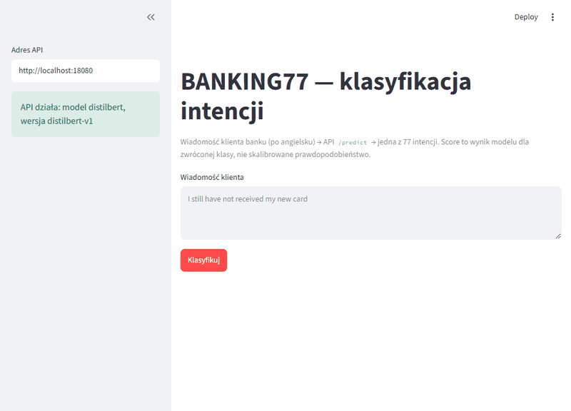
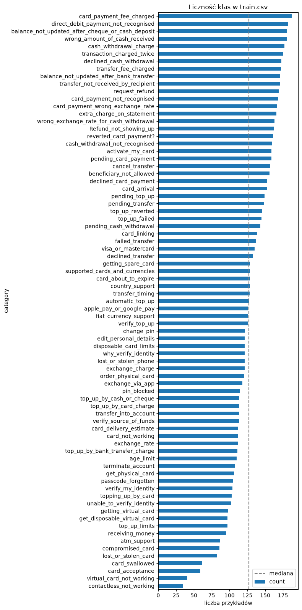
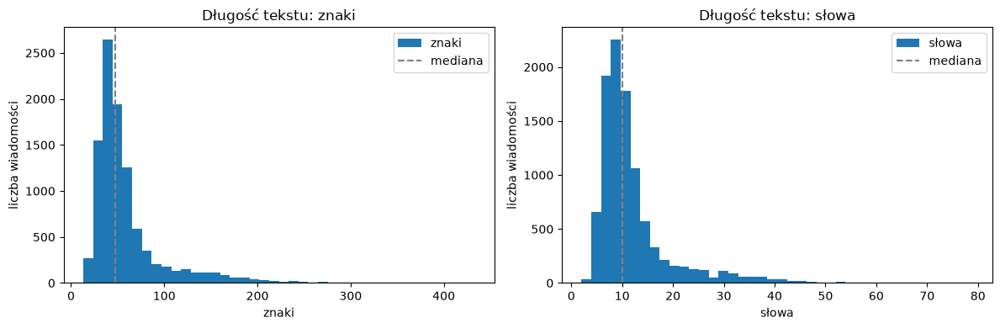
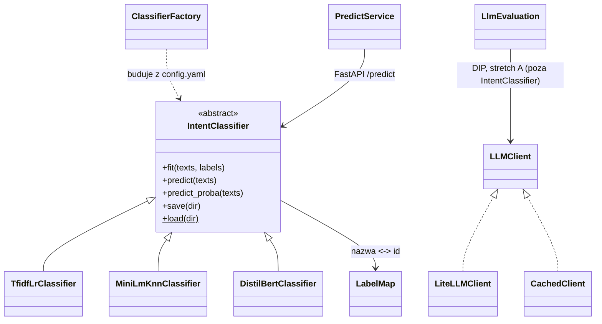
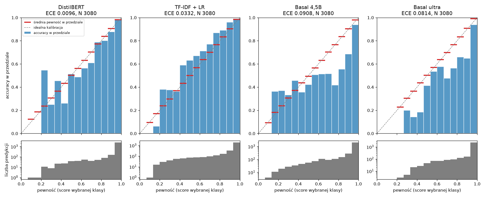
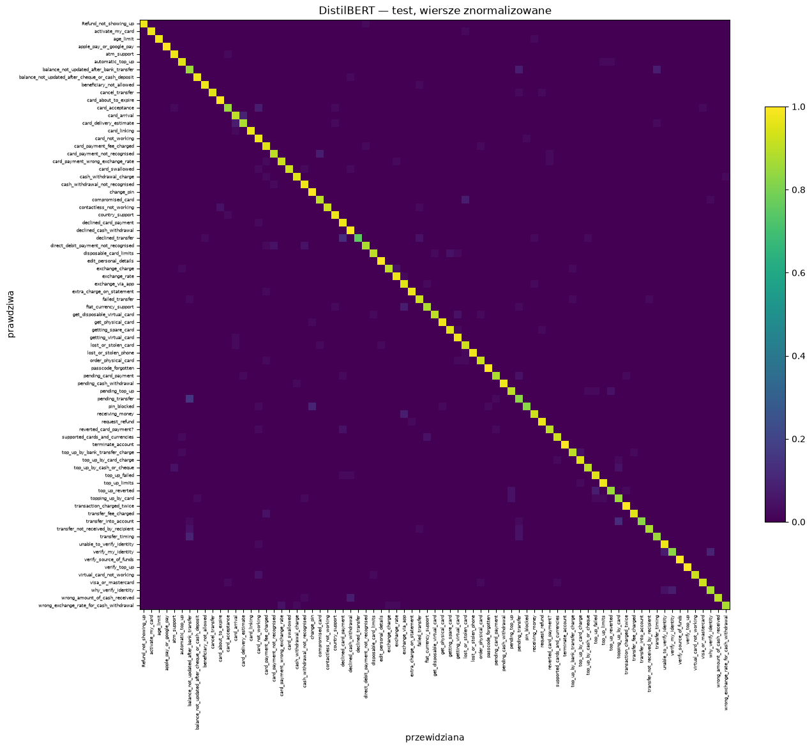

# Klasyfikacja zgłoszeń na BANKING77 — porównanie jakości, kosztu i wdrożenia metod NLP

[](https://github.com/MarcinPrDev/banking77-intent-ml/actions/workflows/ci.yaml)
[](https://github.com/MarcinPrDev/banking77-intent-ml/actions/workflows/deploy-kind.yaml)

Projekt końcowy kursu **AI & ML Engineering** (SAGES/Kodołamacz, gr. 06.12.2025).
System czyta jedną angielską wiadomość klienta banku i przypisuje ją do jednej z **77 intencji**
ze zbioru [BANKING77](https://github.com/PolyAI-LDN/task-specific-datasets) (PolyAI, 2020).

> **Co system robi:** dostaje wiadomość („I still haven't received my card") i zwraca intencję
> (`card_arrival`). **Czego nie robi:** nie załatwia sprawy klienta, nie ocenia ryzyka i nie
> rozpoznaje spraw spoza 77 klas — zawsze wybiera jedną ze znanych.



*Demo z 31.10.2026: UI Streamlit nad lokalnym API z modelem `distilbert-v1`. Zdania pochodzą
z `configs/smoke_cases.json`, nie ze zbioru BANKING77 (sekcja [Demo](#demo)). To samo online:
[Hugging Face Space `MarcinPr/banking77-intent-demo`](https://huggingface.co/spaces/MarcinPr/banking77-intent-demo).*

**Pytanie badawcze:** czy dostrajany mały transformer (DistilBERT) jest lepszy od TF-IDF
z regresją logistyczną i od zamrożonych embeddingów z kNN **na tyle, żeby opłacić jego koszt
na CPU**? Produktem jest uzasadniony wybór jednego modelu i działająca usługa — także wtedy,
gdyby najdroższy model przegrał.

Jak powstawał projekt (zmiana tematu 30.09.2026, plan 5 slotów, przebieg i księga godzin):
[docs/HISTORIA.md](docs/HISTORIA.md) i [docs/STATUS.md](docs/STATUS.md).

## W skrócie

Porównałem trzy metody na jednym zamrożonym protokole i wdrożyłem zwycięzcę jako API w Dockerze,
z automatycznym wdrożeniem do klastra kind w CI. Na teście 3 080 wiadomości DistilBERT ma
accuracy 93,02%, MiniLM+kNN 92,05%, TF-IDF+LR 90,81%.

Odpowiedź: **częściowo**. Względem TF-IDF+LR DistilBERT jest lepszy o 2,21 p.p. i ten koszt
przyjmuję (p95 predykcji na jednym wątku CPU: 31,42 ms wobec 0,43 ms). Względem kNN przewaga to
0,97 p.p. i nie jest istotna statystycznie (test McNemara z korektą Holma). Model do wdrożenia
wybrałem po zobaczeniu wyniku testu, więc 93,02% nie jest niezależnym potwierdzeniem tego wyboru.

## Spis treści

- **Skrót na 2 minuty:** [docs/PITCH.md](docs/PITCH.md)
- **Raport:** [Dane](#dane) · [Protokół ewaluacji](#protokół-ewaluacji-wspólny-dla-wszystkich-modeli)
  · [Modele i budżet strojenia](#modele-i-budżet-strojenia) · [Wyniki](#wyniki)
  ([tabela końcowa](#tabela-końcowa)) · [Analiza błędów](#analiza-błędów-w3)
  · [Odpowiedź na pytanie badawcze](#odpowiedź-na-pytanie-badawcze)
  · [Ograniczenia](#ograniczenia-i-granice-weryfikacji)
  · [Co nie zadziałało](#co-nie-zadziałało-i-co-zrobiłbym-inaczej) · [Dalsze prace](#dalsze-prace)
- **Uruchomienie:** [Quickstart](#quickstart) · [Demo](#demo) · [Odtworzenie wyników](#odtworzenie-wyników)
  · [Wdrożenie](#wdrożenie)
- **Projekt:** [Architektura](#architektura-wzorce-i-solid) · [Przepływ artefaktów modelu](#przepływ-artefaktów-modelu)
  · [Wymagania projektu końcowego](#wymagania-projektu-końcowego--gdzie-są-spełnione)
  · [Dlaczego bez Sparka i CV](#dlaczego-bez-sparka-i-cv)
- **Przebieg projektu (poza raportem):** [docs/STATUS.md](docs/STATUS.md) — plan 5 slotów, bramka po W1,
  minimum vs stretch, status i księga godzin · [docs/HISTORIA.md](docs/HISTORIA.md) — zmiana tematu, ADR-y
  · [Tooling](#tooling--współpraca-z-ai) · [Licencja](#licencja)

## Dane

| | Trening (`train.csv`) | Test (`test.csv`) |
|---|---:|---:|
| Wiersze | 10 003 | 3 080 |
| Kategorie | 77 | 77 |
| Przykłady na kategorię | 35–187 (mediana 127) | dokładnie 40 |
| Puste teksty / etykiety | 0 / 0 | 0 / 0 |
| Nadmiarowe duplikaty po normalizacji¹ | 31 | 4 |
| Grupy znormalizowane z różnymi etykietami | 1 | 1 |

¹ Normalizacja do audytu: Unicode NFKC → casefold → tokeny `\w+` połączone spacją. Po niej
**25 tekstów testowych ma bliźniaka w train** (z tą samą etykietą); bez nich zostaje **3 055**
zdań. Liczby z mojego audytu z 30.09.2026 (`split.dedup_normalization` w configu). Kod: duplikaty
i konflikt w train — notebook 01 §5 i `data/splits.py`; pokrycie testu i podzbiory 3 055 / 385 —
`data/audit.py` (CLI `scripts/make_test_subsets.py`).

- **Źródło:** repozytorium `PolyAI-LDN/task-specific-datasets`, commit
  `57ec275d8078af65b7731c2a98be812d844a6d6b`, pliki `banking_data/train.csv`
  (SHA-256 `b06e26ac…cbc664b`) i `banking_data/test.csv` (SHA-256 `d12d6e3b…cfeeb474d`), razem
  1 079 034 B. Pełne sumy w `configs/config.yaml`; pobiera i sprawdza je `scripts/fetch_data.py`.
  Nie korzystam z kopii na HF/MTEB: inna licencja w metadanych, inny protokół, w v2 usunięte wiersze.
- **Licencja danych:** CC BY 4.0, atrybucja w sekcji *Licencja*. Dane są poza repo; w repo jest
  kod, skrypt pobrania, mapa etykiet i manifest podziału.
- **Pochodzenie:** karta danych nie opisuje sposobu pozyskania ani anonimizacji (dane osobowe:
  „N/A"). Przeskanowałem 13 083 teksty pięcioma wzorcami (e-mail, URL, ≥9 cyfr, IBAN,
  przedstawianie się): **0 trafień**. To nie dowodzi braku danych osobowych — bez NER i bez
  ręcznego przeglądu. Gdyby w EDA wyszły istotne PII, zrezygnowałbym ze zbioru.
- **Jakość etykiet:** Ying & Thomas (2022) wskazują automatycznie **1 428 potencjalnych
  problemów w train (~14%)**. Nie usuwam ich hurtowo i nie poprawiam etykiet testu po obejrzeniu
  predykcji; pomyłki i niejednoznaczne intencje opisuje analiza błędów.
- **Ograniczenia zbioru:** test jest sztucznie zrównoważony, więc wynik nie mówi o częstości
  prawdziwych zgłoszeń; przy 40 przykładach na klasę jedna pomyłka to 2,5 p.p. recallu klasy;
  brak dat i identyfikatorów rozmów, więc podziału chronologicznego nie da się sprawdzić.
- **EDA (tylko train, 10 003 wiadomości):** długości — mediana / P95 / maksimum:
  znaki 47 / 151,9 / 433, słowa 10 / 29 / 79, tokeny DistilBERT ze specjalnymi 13 / 37 / 98
  ([notebook, §4, §6 i §9](notebooks/01_eda.ipynb)). `max_len=128` nie obcina żadnej wiadomości
  z train, choć przyszłych zgłoszeń to nie gwarantuje. Najkrótsze teksty mają mało kontekstu,
  najdłuższe to często opisy weryfikacji, a bliskie intencje różnią się szczegółami.

Wykresy z notebooka 01 (train, 10 003 wiadomości). Notebooki w repo są bez wyników (filtr
nbstripout), więc wykresy są zapisane tu, bez tekstów zdań:





## Protokół ewaluacji (wspólny dla wszystkich modeli)

1. **Wszystko przypięte:** commit danych, sumy plików, mapa nazw kategorii → id
   (`configs/label_map.json`).
2. **Walidacja wydzielona z train:** ~15% (`split.val_size`), stratyfikowana po etykiecie,
   **znormalizowane duplikaty zawsze w jednej części**. Indeksy w `dane/splits/` (w gicie same
   numery wierszy, bez tekstów), manifest `configs/split_manifest.json` (seed, val_size, n_train,
   n_val, sha256 indeksów). Konflikty etykiet sprawdzone przed podziałem.
3. **Test tylko do dwóch rzeczy:** audytu integralności i jednej oceny końcowej. Na teście nie ma
   fitu, HPO, wyboru epoki, progu ani promptu; TF-IDF dopasowany wyłącznie na train.
4. **Refit (14.10.2026):** trzy zamrożone konfiguracje uczone od nowa na całych 10 003 zdaniach
   (train + dawna walidacja); DistilBERT z harmonogramem na 5 epok, zatrzymany po 4. Po reficie
   nie ma już niezależnej walidacji. Z literaturą (protokół *Full*) porównuję accuracy na pełnym
   teście 3 080, pamiętając o innym strojeniu i jednym seedzie.
5. **Metryki:** `accuracy` — główna, bo porównywalna z literaturą; **macro-F1 — do wyboru
   checkpointu i konfiguracji na walidacji (ustalone z góry)**; recall i F1 na klasę; macierz
   pomyłek. Przy jednym seedzie różnica o ułamek punktu to nie wniosek.
6. **Kontrola wrażliwości:** każdy model raportuję też na podzbiorze **3 055** zdań bez
   bliźniaka w train (ustalonym przed treningiem). To kontrola, nie nowy benchmark.
7. **Koszt:** czas treningu, rozmiar całego artefaktu, latencja CPU p50/p95 przy batch=1
   (z preprocessingiem i embeddingami), **zimny start osobno od rozgrzanej predykcji**.
   Surowy wynik kNN lub softmaxu nie jest skalibrowanym prawdopodobieństwem.
8. **LLM (stretch A):** jeden model, jeden zamrożony prompt, **385 zdań testu (5 na klasę)
   wybranych z góry** — te same dla wszystkich modeli; raport jakości, błędów formatu, tokenów,
   latencji i kosztu. Prompt dobrany tylko na walidacji. Czy LLM widział BANKING77 w swoim
   treningu — nie wiadomo, więc jego wynik nie dowodzi generalizacji.

**Zamrożenie 14.10.2026, przed pierwszym spojrzeniem na test:**

- TF-IDF+LR: próba #12; MiniLM+kNN: k = 1, `uniform`, cosinus;
  DistilBERT: LR 6e-5, epoka 4 przy harmonogramie na 5 epok, `max_len=128`.
- Pełne parametry: `models.<nazwa>.frozen` i baza w configu; przypięte rewizje wag, seed 42.
  Po wyniku testu — żadnego strojenia ani zmian konfiguracji.
- Kolejność: commit z tym wpisem i [ADR-0002](docs/adr/0002-protokol-ewaluacji.md)
  → tag `experiments-frozen` → refit → jedna ocena na teście.
- Artefakty ze strojenia zachowane, finalne w `models/final/`; koszt finalnych modeli zmierzony od nowa.

**Punkty odniesienia (protokół Full: pełny train i test):** DistilBERT-base **92,1%**
(Qi i in. 2021: batch 32, max_len 128, AdamW wd 0,01, warmup 10% do LR 4e-5, 5 epok);
BERT-base 93,3%; RoBERTa-base 94,1%; BERT-large 93,66% (Casanueva i in. 2020).
Dummy (jedna klasa) = 1/77 = **1,30%**. Dla TF-IDF+LR nie ma wyniku kanonicznego, więc liczę
własny. Liczby z publikacji to konkretne konfiguracje, nie przedział, w który projekt musi trafić.

## Modele i budżet strojenia

| Model | Budżet strojenia (walidacja, MLflow) | Cel | Wagi / licencja |
|---|---|---|---|
| Dummy | brak | kontrola rozkładu i metryk | — |
| **TF-IDF + Logistic Regression** | `tfidf_lr.hpo_trials` = 16 konfiguracji wektoryzatora (słowa/znaki, n-gramy, min_df), regularyzacji (C) i wag klas (`class_weight`); punkt startu = pierwsza konfiguracja z configu (W1) | tani, interpretowalny baseline; kandydat do wdrożenia | — |
| **all-MiniLM-L6-v2 (zamrożony) + kNN** | kilka `k` × ważenie (uniform/distance) | wartość reprezentacji semantycznej bez dostrajania | HF `sentence-transformers/all-MiniLM-L6-v2`, Apache-2.0, rewizja przypięta w configu |
| **DistilBERT + głowica 77 klas** | 5 LR {2–6}e-5 × 5 epok = 25 kandydatów; budżet ustalony przed wynikami, pozostałe parametry wg Qi 2021 | efekt dostrajania reprezentacji; RTX 5080 | HF `distilbert/distilbert-base-uncased`, Apache-2.0, rewizja przypięta |
| *(stretch A)* LLM zero-shot | brak strojenia; prompt dobrany na walidacji | koszt/latencja/błędy formatu vs modele dostrajane | Groq (plan płatny, Developer tier) przez LiteLLM; model w `llm.model` |
| *(fallback)* TF-IDF + LinearSVC | mały grid C | trzecia metoda, gdy transformer nie ruszy — niewykorzystany | — |

Budżety, hiperparametry startowe i seed są tylko w `configs/config.yaml`. Budżet DistilBERT
podniosłem z 2–3 do 5 wartości LR, żeby sprawdzić obie strony 4e-5 z publikacji; decyzja zapadła
przed wynikami, więc nie dokładałem prób pod wynik — ale budżety trzech modeli nie są równe.
Czas treningu, VRAM i koszt CPU na moim sprzęcie są w MLflow.

## Architektura (wzorce i SOLID)

Trzy adaptery w `models/classifiers.py` implementują jeden interfejs `IntentClassifier`
z `models/predictor.py`. Fabryka w `models/factory.py` buduje albo wczytuje wybrany predyktor.

- **Strategy:** wspólny interfejs `fit / predict / predict_proba / save / load` dla TF-IDF+LR,
  MiniLM+kNN i DistilBERT. API i ewaluacja widzą tylko interfejs, więc podmiana modelu to wpis
  w configu, nie zmiana kodu. LLM zostaje **poza** interfejsem: kontrakt wymaga
  `predict` == argmax(`predict_proba`), a odpowiedź spoza 77 nazw ma być błędem formatu,
  nie klasą 0 — ocenia go `evaluation/llm_eval.py`.
- **Factory:** `build_predictor` tworzy adapter zamrożonej konfiguracji, `load_predictor` wczytuje
  zapisany artefakt; klasę wybiera rejestr `STRATEGIES`.
- **Pipeline sklearn** w TF-IDF+LR: `TfidfVectorizer` → `LogisticRegression`, zapisywane razem
  w `model.joblib`. W MiniLM+kNN tekst koduje `features/embeddings.py`, a indeks kNN jest
  zapisany osobno; bez własnych transformerów sklearn.
- **LabelMap:** jedna klasa nazwa ↔ id, ładowana z przypiętego pliku; używają jej wszystkie
  modele i API.
- **LLMClient** (stretch): wąski interfejs `complete(prompt)` z implementacjami `LiteLLMClient`
  (Groq przez LiteLLM) i `CachedClient` (cache odpowiedzi); w testach atrapa bez sieci.
- **SOLID w praktyce:** SRP — moduły `data/features/models/evaluation/api`; OCP — nowy model to
  nowa klasa i wpis w rejestrze; LSP — każdy predyktor przechodzi ten sam test kontraktu
  (zapis → odczyt → identyczne predykcje); DIP — API zależy od interfejsu, nie od torcha.



Na diagramie `ClassifierFactory` oznacza funkcje w `models/factory.py`, a `PredictService`
obsługę żądań w `api/app.py`; nie są to osobne klasy w kodzie.

## Przepływ artefaktów modelu

**MLflow** śledzi każdy run: parametry, metryki na walidacji, czas treningu, rozmiar artefaktu.
Magazyn jest lokalny i poza gitem (baza `mlflow.db`, artefakty w `mlruns/`; podgląd:
`uv run mlflow ui --backend-store-uri sqlite:///mlflow.db`).

**Wybrany model: DistilBERT** ([ADR-0003](docs/adr/0003-wybor-modelu-do-wdrozenia.md), 15.10) —
oceniony artefakt z refitu leży w `models/final/distilbert` i nie jest kopiowany. Sekcja `deploy`
w configu (`model_version: distilbert-v1`, `artifact_dir`) jest jednym źródłem dla build-arg
obrazu, tagu, manifestu k8s i odpowiedzi `/health` (`MODEL_VERSION`; bez tej zmiennej API zwraca
`deploy.model_version`). Artefakt jest **wpiekany w obraz CPU podczas `docker build`**: kontener
niczego nie pobiera na starcie, więc nie potrzebuje uprawnień ani czasu na pobranie. Tag obrazu
zawiera wersję modelu.

**Skąd CI bierze model do obrazu** — ADR-0003, opcja (a): asset GitHub Release przypięty tagiem
(`deploy.model_version`) z sumą SHA-256 w configu, pliki bit w bit zgodne z ocenionym artefaktem.
Odrzuciłem (b) trening lekkiego modelu w CI (tworzyłby nowy, nieoceniony artefakt) i (c) GCS
(infrastruktura ponad minimum). Szczegóły odrzuconych opcji — w ADR. DistilBERT wymaga torcha CPU
w obrazie: 3,18 GB lokalnie, budowa od zera w CI 98 s (run `deploy-kind` na PR #1, 18.10).
Po feedbacku prowadzącego (8.11.2026) wydzieliłem zależności treningu z obrazu serwującego —
zob. *Wdrożenie: Docker*.

**Release `distilbert-v1` (18.10):**
[github.com/MarcinPrDev/banking77-intent-ml/releases/tag/distilbert-v1](https://github.com/MarcinPrDev/banking77-intent-ml/releases/tag/distilbert-v1)
— tag na `d809c57` (commit refitu, `experiments-frozen`), asset `distilbert-v1.tar`
(268 789 760 B), SHA-256 w `deploy.release_sha256`. Archiwum zawiera niezmienione pliki
`models/final/distilbert` i `manifest.json` (SHA-256 każdego pliku, hash mapy etykiet, wersje
bibliotek, runy refit `5b883a97` i ocena `fb0d0bde`). Tar jest bez kompresji i z ustalonymi
metadanymi, więc te same pliki dają zawsze tę samą sumę. `scripts/model_release.py unpack`
sprawdza sumę archiwum, wersję, mapę etykiet, skład archiwum i sumę każdego pliku.

**MiniLM+kNN** (niewybrany, opis dla porządku): adapter zapisuje indeks kNN i metadane, a wagi
enkodera z przypiętej rewizji zostają w cache Hugging Face. Obraz musiałby zawierać też enkoder:
wpieczony cache HF albo enkoder zapisany w artefakcie. W tabeli kosztów rozmiar obejmuje **indeks
kNN oraz wagi, tokenizer i konfigurację enkodera**. `load()` rozgrzewa enkoder przed gotowością
API; pomiar zimnego startu obejmuje `load` i pierwszą predykcję w nowym procesie.

## Quickstart

**Co jest potrzebne:** Python 3.11 i uv; `curl` do pobrania modelu z GitHub Release (repo jest
publiczne od 31.10.2026, bez logowania); do obrazu i klastra: działający Docker (Docker Desktop),
kind v0.33.0 i kubectl ≥ 1.36 w `PATH`; do treningu DistilBERT: GPU NVIDIA. Na Windows sprawdź
porty (niżej: *Porty lokalne*).

**Ile to trwa:** na świeżym klonie (`46f47df`, 29.10.2026) przeszedłem drogę klon → środowisko →
dane z SHA-256 → weryfikacja plików podziału → testy i lint → modele bazowe (wyniki jak w *Wyniki na
walidacji*) → model z Release → obraz (budowa 97 s) → smoke `[OK]` w **ok. 7 min 15 s**, przy
ciepłych cache uv i Dockera, bez kind i bez treningu DistilBERT. Jedno potknięcie: smoke trzeba
uruchomić w drugim terminalu, przy działającym kontenerze.

```bash
# Środowisko lokalne (Python 3.11, uv) — JEDNA komenda z pełną listą extras używanych lokalnie:
uv sync --extra dev --extra nlp --extra gpu --extra serving
# Jednorazowo po klonie: filtr gita czyści wyjścia notebooków przy commicie (lokalnie zostają);
# --keep-id zachowuje identyfikatory komórek (bez niego nbstripout numeruje je od nowa)
uv run nbstripout --install --attributes .gitattributes
git config filter.nbstripout.clean "$(git config filter.nbstripout.clean) --keep-id"
uv run python scripts/fetch_data.py        # train.csv + test.csv z przypiętego commitu, weryfikacja SHA-256
uv run pytest                              # strażnik protokołu + testy dymne
uv run ruff check .
# UWAGA: `uv sync` jest "exact" — extras pominięte w komendzie są USUWANE ze środowiska
# (torch/transformers znikną po gołym `uv sync --extra dev`). Goły `--extra dev` jest tylko dla CI.
# Po każdym sync na maszynie z GPU: python -c "import torch; print(torch.cuda.is_available())"
# gpu = torch z indeksu cu128 (RTX 5080/sm_120) + transformers; nlp = sentence-transformers;
# serving = fastapi, uvicorn, httpx (API od W2); llm (stretch A): dodatkowo --extra llm
# + GROQ_API_KEY w .env (poza gitem); ui (stretch 3, Streamlit): dodatkowo --extra ui
# Bez GPU NVIDIA albo na macOS: zamiast --extra gpu użyj --extra cpu (torch 2.11.0 z indeksu CPU,
# jak w obrazie; koła cu128 są tylko dla Linuksa i Windows). Wystarcza do testów, API i obrazu;
# trening DistilBERT wymaga --extra gpu (accelerate + CUDA).
```

**Model do API i obrazu** — oceniony artefakt `models/final/distilbert` z GitHub Release
(alternatywnie `gh release download distilbert-v1 -p distilbert-v1.tar -D dist`) albo z własnego
refitu (`uv run python scripts/refit_final.py`):

```bash
curl -L --create-dirs -o dist/distilbert-v1.tar https://github.com/MarcinPrDev/banking77-intent-ml/releases/download/distilbert-v1/distilbert-v1.tar
uv run python scripts/model_release.py unpack dist/distilbert-v1.tar   # weryfikacja → models/final/distilbert
```

**Porty lokalne:** 18080 (API, kontener, UI) i 18081 (klaster kind). Na Windows Hyper-V, WSL2
i Docker Desktop rezerwują bloki portów TCP, a zakresy zmieniają się po restarcie (21.10.2026
m.in. 7969–8068 i 8071–8170, czyli także 8000, 8080 i 8081). Sprawdzisz to komendą
`netsh interface ipv4 show excludedportrange protocol=tcp`. Jeśli port wypada w zakresie, wybierz
inny; dla kind zmień też `hostPort` w `k8s/kind/cluster.yaml`.

**API lokalnie** — serwuje model z `deploy.artifact_dir` (DistilBERT); dokumentacja endpointów
pod `http://localhost:18080/docs`.

```bash
uv run uvicorn banking77_intent_ml.api.app:create_app --factory --port 18080
```

**UI demo** (`--extra ui`) — Streamlit nad działającym API: formularz, stan `/health`, wynik
`/predict`; model zostaje w API. Adres API ustawia się w panelu bocznym (domyślnie `ui.api_url`
z configu = `http://localhost:18080`; dla kind `http://localhost:18081`):

```bash
uv run streamlit run src/banking77_intent_ml/ui/app.py
```

**Obraz Docker CPU** — z artefaktem pobranym wyżej; `MODEL_VERSION` = `deploy.model_version`
z configu:

```bash
docker build --build-arg MODEL_VERSION=distilbert-v1 -t banking77-intent-api:distilbert-v1 .
docker run --rm -p 18080:8000 banking77-intent-api:distilbert-v1
uv run python scripts/smoke_api.py --url http://localhost:18080   # drugi terminal: smoke
# Obraz treningowo-analityczny na CPU (ten sam Dockerfile, cel `train`: grupa `train` + MiniLM;
# trening DistilBERT nadal wymaga GPU poza obrazem) — poprawka po feedbacku, 8.11.2026:
docker build --target train -t banking77-intent-train .
```

**Klaster kind lokalnie** (kind v0.33.0, kubectl ≥ 1.36, obraz zbudowany wyżej) — te same
manifesty co w CI (`k8s/`); Service NodePort jest dostępny z hosta pod `127.0.0.1:18081`
(`k8s/kind/cluster.yaml`); tag obrazu = `deploy.model_version`:

```bash
kind create cluster --name banking77 --config k8s/kind/cluster.yaml
kind load docker-image banking77-intent-api:distilbert-v1 --name banking77
kubectl apply -f k8s/
kubectl set image deployment/banking77-intent-api api=banking77-intent-api:distilbert-v1
kubectl rollout status deployment/banking77-intent-api --timeout=180s
uv run python scripts/smoke_api.py --url http://localhost:18081
kind delete cluster --name banking77
```

Ten sam przebieg wykonuje GitHub Actions (`.github/workflows/deploy-kind.yaml`) przy każdym pushu
na `main`, w pull requestach i na żądanie. Pierwszy zielony run na `main`:
[39138227351](https://github.com/MarcinPrDev/banking77-intent-ml/actions/runs/39138227351).

**GKE Autopilot (płatne, wykonane raz, 22.10):** ten sam obraz i te same manifesty; komendy,
przebieg i koszt — [docs/GKE.md](docs/GKE.md).

## Demo

Obraz z *Quickstart* (DistilBERT wpieczony w obraz CPU), `/health` i `/predict` na trzech
zdaniach z `configs/smoke_cases.json`. Napisałem je do testu dymnego, nie pochodzą z BANKING77.
Demo pokazuje, że usługa działa; o jakości mówią tabele wyników, nie te trzy zdania.

**Online (31.10.2026):** [Hugging Face Space `MarcinPr/banking77-intent-demo`](https://huggingface.co/spaces/MarcinPr/banking77-intent-demo)
— Streamlit z tym samym artefaktem `distilbert-v1`, ładowanym w procesie, bez API. Kod
w [`hf_space/`](hf_space/), wagi z `models/final/distilbert` (SHA-256 w karcie Space'a).
Na 14 zdaniach kontrolnych Space zwraca te same intencje co API, a score różni się najwyżej
o 9,5e-7. Space działa na CPU basic jako kontener Docker (na Hugging Face wymaga konta PRO);
po dłuższej bezczynności usypia, więc pierwsze wejście trwa dłużej.

```bash
docker run --rm -p 18080:8000 banking77-intent-api:distilbert-v1
# drugi terminal (bash; bez terminala: http://localhost:18080/docs)
curl -s http://localhost:18080/health
curl -s -X POST http://localhost:18080/predict -H "Content-Type: application/json" \
  -d "{\"text\": \"My new card still hasn't arrived, when will it come?\"}"
```

Odpowiedzi z 28.10.2026 (obraz zbudowany z kodu zgodnego z `main`):

```text
{"status":"ok","model":"distilbert","model_version":"distilbert-v1"}
{"intent":"card_arrival","intent_id":12,"score":0.9861456751823425,"model_version":"distilbert-v1"}
{"intent":"exchange_rate","intent_id":33,"score":0.8856154680252075,"model_version":"distilbert-v1"}
{"intent":"lost_or_stolen_card","intent_id":42,"score":0.6754384636878967,"model_version":"distilbert-v1"}
```

| Zdanie | Intencja (`intent_id`) | `score` |
|---|---|---:|
| My new card still hasn't arrived, when will it come? | `card_arrival` (12) | 0,986 |
| What exchange rate will I get if I pay in euros? | `exchange_rate` (33) | 0,886 |
| Someone stole my card, please block it right away. | `lost_or_stolen_card` (42) | 0,675 |

Pusty tekst albo same spacje → `422`. `score` to wynik softmaxu dla zwróconej klasy, nie
skalibrowane prawdopodobieństwo (sekcja *Kalibracja score*). Ten sam Dockerfile i model z Release
przechodzą w CI wdrożenie do kind i test HTTP — ostatni zielony run na `main` przed wysyłką:
[Deploy kind 40617499359](https://github.com/MarcinPrDev/banking77-intent-ml/actions/runs/40617499359).

## Odtworzenie wyników

Quickstart odtwarza **wdrożenie** z gotowym artefaktem. Ta sekcja odtwarza **liczby** z README
(walidacja, koszt, test) od zera, w dwóch osobnych przebiegach. Każdy przebieg to **osobny klon
i nowy magazyn MLflow**: `mlflow.db` i `mlruns/` powstają w katalogu klonu przy pierwszym runie.
Nie kopiuj ich z innego klonu, bo blokady budżetu liczą runy w magazynie.

- **A. Zamrożone modele** — konfiguracje z `models.*.frozen`, bez strojenia: wyniki walidacji,
  refit na 10 003, koszt i **jedna** ocena testowa.
- **B. Ponowne HPO** — pełne strojenie na walidacji; sprawdza procedurę wyboru konfiguracji,
  nie zmienia configu i nie dotyka testu.

Przygotowanie (A i B): środowisko i dane jak w Quickstart. Trening DistilBERT wymaga GPU NVIDIA
(`--extra gpu`); MiniLM liczy się też na CPU, wolniej. Wagi MiniLM i DistilBERT pobiorą się przy
pierwszym użyciu z HF Hub, pod rewizjami z configu. Pliki podziału są w gicie, więc te skrypty tylko
je weryfikują i niczego nie nadpisują:

```bash
uv run python scripts/make_label_map.py      # mapa etykiet = configs/label_map.json
uv run python scripts/make_splits.py         # podział train/val = manifest („zgodny”)
uv run python scripts/make_test_subsets.py   # podzbiory 3 055 / 385 = manifest (same liczby i hashe)
```

**A. Zamrożone modele** — kolejność obowiązkowa: refit i test dopiero po krokach walidacji.

| Krok | Komenda (`uv run python scripts/…`) | Blokada | Porównaj z |
|---|---|---|---|
| A1. Modele bazowe | `train_baselines.py --model dummy`, potem `--model tfidf_lr` | bez `--model` odmowa | *Wyniki na walidacji*: Dummy, TF-IDF + LR (W1) |
| A2. Zamrożone konfiguracje na train | `export_model.py tfidf_lr`, `minilm_knn`, `distilbert` | istniejący `models/<nazwa>` = odmowa | *Wyniki na walidacji* (accuracy i macro-F1 wypisuje skrypt; bez runu MLflow) |
| A3. Koszt CPU artefaktów W2 | `measure_cost.py` | badanie `cpu_cost_w2` raz w magazynie | *Koszt na CPU* |
| A4. Refit na 10 003 | `refit_final.py` | brak tagu `experiments-frozen`, istniejący artefakt albo run refitu = odmowa | runy `final_refit`, artefakty `models/final/` |
| A5. Koszt finalnych artefaktów | `measure_cost.py --final` | badanie `cpu_cost_final` raz w magazynie | tabela końcowa (koszt) |
| A6. **Ocena na teście — raz** | `evaluate_test.py` | brak tagu albo `models/final/`, istniejący run `split=test` = odmowa | tabela końcowa (3 080, 3 055) |

Po A6 analiza błędów: `notebooks/02_analiza_bledow.ipynb` (artefakty runów testowych z MLflow
i predykcje artefaktów z A2 na walidacji). Drugiego przebiegu A6 w tym samym magazynie skrypt nie
wykona, a wynik testu nie wraca do kroków A1–A5. Na tym samym sprzęcie (RTX 5080) wszystkie
ścieżki odtworzyły zamrożone runy co do bitu; na innym GPU lub sterowniku możliwe są małe różnice.
Nowe artefakty nie zastępują Release `distilbert-v1`: wdrożenie zawsze bierze oceniony artefakt
z Release (suma w configu).

**B. Ponowne HPO** — osobny klon i magazyn; bez refitu i bez testu.

| Krok | Komenda (`uv run python scripts/…`) | Blokada | Porównaj z |
|---|---|---|---|
| B1. TF-IDF + LR, Optuna TPE (16 prób) | `hpo_tfidf_lr.py` | badanie (tag `hpo_study`) raz w magazynie | `models.tfidf_lr.frozen` (próba #12) |
| B2. MiniLM + kNN, siatka k × wagi | `knn_minilm.py` | jak wyżej | `models.minilm_knn.frozen` (k = 1, `uniform`) |
| B3. DistilBERT, 5 LR × 5 epok | `train_distilbert.py` | jak wyżej; checkpointy ok. 6,3 GB w `dane/cache/distilbert` | `models.distilbert.frozen` (LR 6e-5, epoka 4) |
| B4. Seedy DistilBERT (stretch 1) | `seed_study_distilbert.py` | badanie `seed_study` raz; wymaga runu z B3 w tym samym magazynie (kontrola seeda 42) | *Rozrzut DistilBERT po seedach* |

Skrypty B drukują zwycięzcę jako fragment YAML, ale configu nie zmieniają: konfiguracje zamrożono
14.10, przed testem (ADR-0002). Inny zwycięzca to wniosek do raportu, nie powód do nowego strojenia.

**LLM (opcjonalnie; klucz `GROQ_API_KEY` w `.env`, środowisko z `--extra llm`, płatne API):**
`llm_zero_shot.py --stage val --prompt v1`, `--prompt v2`, potem `--stage test` z `llm.frozen_prompt`
z configu. Blokady jak wyżej: każdy wariant raz na walidacji, test raz w magazynie; odpowiedzi
w cache `dane/cache/llm`, więc przerwany przebieg nie kosztuje drugi raz.

## Wdrożenie

- **FastAPI:** `POST /predict` (tekst → intencja, id, wersja modelu), `GET /health` (status
  i `MODEL_VERSION`). Wejście sprawdza Pydantic; kontrakt odpowiedzi pilnuje test w pytest.
- **Metryki (dodatek, 29–30.10):** `GET /metrics` w formacie Prometheusa — liczba i czas żądań
  według metody, trasy i statusu, predykcje według intencji, rozkład `score`. To sygnał zmiany
  ruchu, nie miara jakości. Deployment ma adnotacje `prometheus.io/*`, ale serwera Prometheus
  w klastrze nie ma. W CI, po smoke, osobny krok sprawdza `/metrics` przez Service.
- **Docker:** obraz CPU z wpieczonym artefaktem jednego modelu. Config i mapa etykiet są w obrazie
  (`COPY configs/ /app/configs/`, `ENV BANKING77_CONFIG=/app/configs/config.yaml`; settings liczą
  ścieżki od położenia configu). Torch pochodzi z indeksu CPU, nie z PyPI, bo koło z PyPI na
  Linuksie zawiera CUDA. Rozmiar wersji `v1.0-submission`: 2,21 GB na runnerze CI (`docker image
  ls`); lokalnie Docker Desktop pokazywał 3,18 GB zajętości przy 822 MB skompresowanej treści
  (inna księgowość magazynu). Budowa od zera w CI: 98 s.
  **Po feedbacku prowadzącego (8.11.2026)** przeniosłem zależności treningu i analizy (pandas,
  pyarrow, optuna, mlflow, matplotlib, seaborn) z `dependencies` do grupy `train` (PEP 735).
  `uv sync` instaluje ją domyślnie, więc komendy lokalne i CI się nie zmieniły, a obraz serwujący
  buduje się z `--no-default-groups`. Efekt lokalnie: **3,19 GB → 2,49 GB** (`docker image inspect`:
  3 185 001 276 → 2 493 569 815 B), w obrazie nie ma pandas, mlflow ani optuny, smoke `[OK]`.
  Na runnerze CI (run `deploy-kind` 42502188218, PR #10): **1,71 GB wobec 2,21 GB**, budowa od zera
  ok. 56 s wobec 98 s. Ten sam Dockerfile ma drugi cel `train` — środowisko treningowo-analityczne
  na CPU (4,74 GB lokalnie).
- **kind w CI (wymóg projektu):** `docker build` → `kind create cluster` → `kind load docker-image`
  → `kubectl apply` (Deployment + Service) → `kubectl rollout status` → **test HTTP** `/health`
  i `/predict` → usunięcie klastra. To klaster testowy, który żyje tylko w trakcie przebiegu;
  dowodem wdrożenia są manifesty, logi workflow i test HTTP, nie publiczny adres. Pierwszy zielony
  run na `main`: [39138227351](https://github.com/MarcinPrDev/banking77-intent-ml/actions/runs/39138227351)
  (18.10, 6 min 28 s). Manifesty: `k8s/deployment.yaml` (2 repliki, sondy startowa, gotowości
  i życia na `/health`, requests 500m CPU / 512Mi, limit pamięci 1Gi), `k8s/service.yaml`
  (NodePort 30080), `k8s/kind/cluster.yaml` (klaster kind, węzeł przypięty digestem).
- **GKE (wykonane raz, 22.10, ręcznie):** ten sam obraz i te same manifesty na GKE Autopilot
  w `europe-central2`; obraz z Artifact Registry przypięty digestem, test przez port-forward.
  Klaster żył ok. 14 min i został usunięty tego samego wieczoru. Koszt z rozliczeń GCP: 0,10 zł,
  do zapłaty 0,00 zł. Przebieg, czasy, uprawnienia i log: [docs/GKE.md](docs/GKE.md).
- **Sekrety:** `GROQ_API_KEY` tylko w `.env` (poza gitem) albo w GitHub Secrets; w kodzie
  i configu nie ma kluczy.

## Dlaczego bez Sparka i CV

Dane mają **~1 MB**: 13 083 krótkie zdania, mediana 10 słów w train i 9 w teście, maksimum 79.
Każdy krok — wczytanie, TF-IDF, embeddingi, nawet fine-tuning — mieści się w pamięci jednej
maszyny, więc Spark dodałby infrastrukturę bez powodu. Spark, Dataproc i CI/CD zrobiłem w
siostrzanym repo [us-accidents-etl](https://github.com/MarcinPrDev/us-accidents-etl) (prywatne,
ćwiczenie z kursu na materiałach prowadzącego; dostęp na prośbę). Zadanie jest czysto tekstowe,
więc computer vision nie ma tu zastosowania. Projekt obejmuje za to resztę kursu: Python,
klasyczne ML, OOP i testy, eksperymenty w MLflow, DL/NLP z transformerami, API, Docker,
Kubernetes, CI/CD, a LLM jako rozszerzenie.

## Wymagania projektu końcowego — gdzie są spełnione

Punkty *End-to-end* z dokumentu kursu „Wszystko o projekcie końcowym” (SAGES, gr. 06.12.2025)
i miejsca, gdzie projekt je realizuje:

| Wymaganie | Gdzie w repo |
|---|---|
| 1a. Analiza rozkładów cech | [Dane](#dane) — liczność klas w train i teście, długości tekstów (znaki, słowa, tokeny); [`notebooks/01_eda.ipynb`](notebooks/01_eda.ipynb) §2 i §4 |
| 1b. Analiza braków danych i ich powodów | [Dane](#dane) — zero pustych tekstów i etykiet, pochodzenie i czyszczenie nieudokumentowane; notebook 01 §1 |
| 1c. Analiza wartości odstających | [Dane](#dane) — maksima długości i teksty skrajne; notebook 01 §4 i §6 (teksty skrajne i niejednoznaczne) |
| 1d. Utworzenie nowych cech | TF-IDF (słowa lub n-gramy znakowe) i embeddingi MiniLM — [Modele i budżet strojenia](#modele-i-budżet-strojenia); słownictwo: notebook 01 §7 |
| 2a. Przetestowanie kilku algorytmów | Dummy, TF-IDF + LR, MiniLM + kNN, DistilBERT, LLM zero-shot (stretch) — [Wyniki](#wyniki) |
| 2b. Optymalizacja hiperparametrów | Optuna (TF-IDF + LR), siatka (kNN), LR × epoki (DistilBERT) — [Modele i budżet strojenia](#modele-i-budżet-strojenia); [Wrażliwość na budżet strojenia](#wrażliwość-na-budżet-strojenia) |
| 3a. Programowanie obiektowe, wzorce, SOLID | [Architektura (wzorce i SOLID)](#architektura-wzorce-i-solid) |
| 3b. Pipeline'y do przetwarzania danych | pipeline'y sklearn i przepływ artefaktów — [Architektura](#architektura-wzorce-i-solid), [Przepływ artefaktów modelu](#przepływ-artefaktów-modelu) |
| 3c. Testy jednostkowe | `tests/` (pytest w CI: [`ci.yaml`](.github/workflows/ci.yaml)), w tym strażnik protokołu [`tests/test_contract.py`](tests/test_contract.py) |
| 4a. API, konteneryzacja, wdrożenie na klaster, CI/CD | FastAPI ([`src/banking77_intent_ml/api/`](src/banking77_intent_ml/api/)), [`Dockerfile`](Dockerfile), [`k8s/`](k8s/), workflow [`deploy-kind.yaml`](.github/workflows/deploy-kind.yaml) z testem HTTP — [Wdrożenie](#wdrożenie) |
| 4b. Lokalnie lub na GCP | kind lokalnie i w CI; GKE Autopilot (stretch, 22.10) — [Wdrożenie](#wdrożenie) |

## Wyniki

### Wyniki na walidacji

Zamrożona walidacja z manifestu służy do wyboru konfiguracji, nie do porównań z literaturą.
Liczby z MLflow:

| Model | Konfiguracja (zamrożona) | Acc (val) | Macro-F1 (val) | N-train / N-val | Budżet HPO | Czas treningu |
|---|---|---:|---:|---:|---:|---:|
| Dummy `most_frequent` | — | 1,87% | 0,05% | 8 504 / 1 499 | 0 | < 0,01 s |
| Dummy `stratified` (seed 42) | — | 1,13% | 1,04% | 8 504 / 1 499 | 0 | < 0,01 s |
| TF-IDF + LR | W1, przed HPO: wartości domyślne sklearn 1.9 (unigramy, `C` = 1,0, bez wag klas) | 84,39% | 83,89% | 8 504 / 1 499 | 0 (HPO w W2) | 0,50 s |
| TF-IDF + LR | **zamrożona (HPO W2, próba #12):** znaki `char_wb` (2,4), `min_df` 2, `sublinear_tf`, `C` ≈ 49,7, wagi `balanced` | 89,26% | 89,32% | 8 504 / 1 499 | 16 (Optuna TPE) | 2,95 s |
| MiniLM + kNN | **zamrożona (siatka W2):** all-MiniLM-L6-v2 @ `1110a243` (zamrożone embeddingi, cosinus) + kNN k = 1, `uniform` | 91,06% | 91,27% | 8 504 / 1 499 | 8 (siatka 4 × 2) | 7,7 s (kodowanie train, GPU) + 0,01 s (kNN) |
| DistilBERT | **zamrożona (W2):** distilbert-base-uncased @ `12040acc`, LR 6e-5, epoka 4 z 5 (wariant 4; reszta jak Qi 2021: batch 32, `max_len` 128, warmup 10%, wd 0,01) | 90,99% | 90,76%[^distilbert] | 8 504 / 1 499 | 25 (5 LR × 5 epok) | 22,8 s (5 epok z oceną co epokę, GPU) |

[^distilbert]: 90,76% to `val_macro_f1` z epoki 4 runu `f37e7471`; główne `macro_f1` tego runu to 90,78% z epoki 5. Różnica jest poniżej 0,001 (0,1 punktu procentowego), więc reguła remisu wybrała wcześniejszą epokę.

### Rozrzut DistilBERT po seedach

Badanie z 18.10, zaplanowane przed wynikiem: 5 nowych seedów plus kontrolny 42, zamrożona
konfiguracja, wynik po epoce 4 bez wyboru epoki dla każdego seeda osobno, ta sama walidacja
8 504 / 1 499, test nietknięty. Liczby z MLflow (badanie `seed_study=distilbert_val_seeds`,
commit `f93d533`):

| Seed | Acc (val) | Macro-F1 (val) | Run |
|---|---:|---:|---|
| 42 — kontrola (odtwarza run W2 `f37e7471` co do bitu) | 90,99% | 90,76% | `e2de28e4` |
| 1 | 91,06% | 90,80% | `b5601e4a` |
| 2 | 91,33% | 91,14% | `b2d3378f` |
| 3 | 91,26% | 91,02% | `72aa5341` |
| 4 | 91,26% | 91,12% | `4ca957e5` |
| 5 | 90,93% | 90,80% | `5adb3736` |
| **6 seedów: średnia (odch. std)** | **91,14% (0,17)** | **90,94% (0,17)** | |
| min – max | 90,93–91,33% | 90,76–91,14% | |

Punkt odniesienia: MiniLM + kNN jest deterministyczny i ma na tej samej walidacji macro-F1
91,27% — wyżej niż DistilBERT w każdym z sześciu przebiegów, więc zmiana seeda nie odwróciła
rankingu. Trening jednego seeda trwa 22–25 s na GPU. To miara losowości treningu na jednym
podziale, nie przewagi na nowych danych.

### Wrażliwość na budżet strojenia

Macro-F1 na tej samej zamrożonej walidacji 1 499 zdań, jeden seed; liczby z MLflow:

| Ścieżka | Bez strojenia | Mniejszy budżet | Pełny budżet (zamrożona) | Zysk ze strojenia |
|---|---:|---:|---:|---:|
| TF-IDF + LR | 0,8389 — domyślne sklearn (W1) | 0,8833 — 8 pierwszych prób | 0,8932 — 16 prób Optuny | +0,0543 |
| MiniLM + kNN | 0,9006 — k = 5, `uniform` (domyślne sklearn) | — | 0,9127 — siatka 8 punktów | +0,0121 |
| DistilBERT | 0,9022 — konfiguracja Qi 2021 (LR 4e-5, 5 epok) | — | 0,9076 — 25 kandydatów (5 LR × 5 epok) | +0,0054 |

„8 pierwszych prób” to próby 0–7 tego samego badania Optuny (najlepsza: próba 6); TPE losuje
pierwsze 10 prób, więc ta kolumna to w praktyce przeszukiwanie losowe. Pełny budżet DistilBERT
to wartość z reguły remisu (epoka 4: 0,9076; epoka 5: 0,9078).

Najwięcej zyskał TF-IDF+LR: +0,0543 macro-F1, z czego drugie osiem prób dało 0,0099. MiniLM+kNN
zachował najwyższy wynik, a DistilBERT poprawił konfigurację Qi 2021 o 0,0054. Punkty startowe,
budżety i jeden seed różnią się między ścieżkami, więc to nie jest porównanie pełnych możliwości
modeli. Zwycięskie LR 6e-5 DistilBERT leży na brzegu siatki, a macro-F1 dla LR 2e-5–4e-5 jeszcze
rosło w 5. epoce — ten budżet nie wyczerpał modelu.

### Koszt na CPU

Pomiar `cpu_cost_w2` z 14.10 (kod z commita `aa210d7`): batch=1 przez wspólny interfejs
predyktora, tylko CPU. Liczby z MLflow:

| Ścieżka | Wątki | Latencja p50 | Latencja p95 | Zimny start: mediana (max) | Artefakt | Run MLflow |
|---|---:|---:|---:|---:|---:|---|
| TF-IDF + LR | 1 | 0,28 ms | 0,42 ms | 0,85 s (0,86 s) | 5,0 MB | `ee671463` |
| TF-IDF + LR | 8 | 0,27 ms | 0,36 ms | 0,85 s (0,86 s) | 5,0 MB | `7fe52480` |
| MiniLM + kNN | 1 | 9,57 ms | 13,83 ms | 4,40 s (4,45 s) | 104,7 MB | `48ddd8ae` |
| MiniLM + kNN | 8 | 7,58 ms | 8,97 ms | 4,38 s (4,50 s) | 104,7 MB | `53dd2727` |
| DistilBERT | 1 | 17,52 ms | 31,27 ms | 3,20 s (3,24 s) | 268,8 MB | `36c5c183` |
| DistilBERT | 8 | 7,28 ms | 9,91 ms | 3,13 s (3,13 s) | 268,8 MB | `1312a257` |

Jak mierzyłem (`evaluation.cost` w configu): latencja po rozgrzaniu to 20 predykcji rozgrzewki,
potem 200 zdań z walidacji (seed 42, te same dla każdej ścieżki) × 3 przebiegi, `predict_proba`
na jednym tekście, percentyle z `numpy.percentile`. Zimny start to mediana i maksimum z 10 nowych
procesów: import kodu, `load` i pierwsza predykcja, bez startu interpretera, z plikami modeli już
w cache systemu plików. W zimnym starcie dominuje import kodu (~0,78 s na każdej ścieżce, sklearn)
i `load` (TF-IDF 0,07 s, MiniLM+kNN 3,60 s z rozgrzaniem enkodera, DistilBERT 2,31–2,34 s).
8 wątków to rdzenie fizyczne tej maszyny (AMD Zen 5, Windows 11). Artefakt to cały katalog
`models/<nazwa>`; dla MiniLM+kNN razem z wagami enkodera z cache Hugging Face (91,6 MB).
Bez narzutu HTTP.

Na tym etapie TF-IDF+LR miał najniższą latencję, najmniejszy artefakt i najkrótszy zimny start,
kosztem niższego macro-F1. MiniLM+kNN wygrywał jakością; DistilBERT miał niższe macro-F1
i większy artefakt, ale krótszy zimny start i podobną latencję po rozgrzaniu przy 8 wątkach.
Przy k = 1 `score` kNN w API zawsze wynosi 1,0 i nie mówi nic o pewności predykcji.

Dwa runy TF-IDF + LR tej samej konfiguracji (`89d5ccf6`, `bb347398` — ten drugi dał artefakt
w `models/`) mają identyczne metryki, więc trening jest deterministyczny.

**Wynik bazowy (7.10):** TF-IDF + LR przed strojeniem miał accuracy 84,39% i macro-F1 83,89% na
1 499 zdaniach walidacji po treningu na 8 504. Literaturowe 92,1% DistilBERT dotyczy testu 3 080
zdań po treningu na pełnych 10 003, więc tych liczb nie porównuję wprost. Mała różnica między
metrykami nie wyklucza słabych klas: `virtual_card_not_working` ma F1 50,0% i recall 33,3% przy
precision 100% — model wskazał tę klasę dwa razy, oba trafnie, ale cztery z sześciu przykładów
oddał innym klasom. Przy sześciu przykładach jedna pomyłka zmienia recall o 16,7 p.p.

### Tabela końcowa

Jedna ocena na teście po reficie na 10 003 zdaniach; koszt zmierzony dla finalnych artefaktów.
Liczby z MLflow:

| Model | Acc (test 3 080) | Acc (3 055) | Macro-F1 (3 080) | Macro-F1 (3 055) | Czas treningu (10 003) | Artefakt | Latencja CPU p50 / p95 | Zimny start (1 w. / 8 w.) |
|---|---:|---:|---:|---:|---:|---:|---:|---:|
| Dummy | 1,30% (arytmetyka) | — | — | — | 0 | — | — | — |
| TF-IDF + LR | 90,81% | 90,77% | 90,83% | 90,78% | 4,9 s (CPU) | 5,2 MB | 0,28 / 0,43 ms (1 w.) · 0,27 / 0,42 ms (8 w.) | 0,85 s / 0,85 s |
| MiniLM + kNN | 92,05% | 92,01% | 92,03% | 91,99% | 3,0 s (GPU) | 107,0 MB | 12,16 / 16,83 ms (1 w.) · 9,26 / 10,89 ms (8 w.) | 4,69 s / 4,69 s |
| DistilBERT | 93,02% | 92,96% | 93,05% | 93,00% | 25,5 s (GPU) | 268,8 MB | 17,48 / 31,42 ms (1 w.) · 8,22 / 11,45 ms (8 w.) | 3,30 s / 3,19 s |

Źródła w MLflow: ocena końcowa — runy `0c08edb4`, `04ec980a`, `fb0d0bde` (`split=test`, commit
`6cae45d`; kolumnę macro-F1 (3 055) dopisałem 28.10 z metryki `clean_macro_f1` tych samych runów,
bez ponownej oceny); refit — runy `f7e23471`, `4509d9d4`, `5b883a97` (`final_refit`, commit
`d809c57` = tag `experiments-frozen`); koszt — badanie `cpu_cost_final`, po dwa runy na ścieżkę
(1 i 8 wątków: `4e0fe1ce`/`9b7c4505`, `a8276f36`/`bea6c48a`, `56a7fbb4`/`0ec07580`), metodyka jak
w *Koszt na CPU*. Runy zapisały hashe commitów sprzed przepisania historii 14.10; odpowiedniki są
w artefakcie `provenance/git-commit-map-2026-10-14.json` każdego runu. Czas treningu to `fit`
adaptera na 10 003 zdaniach razem z wczytaniem wag lub enkodera (GPU: RTX 5080). Artefakt
MiniLM + kNN to indeks 10 003 wektorów plus wagi enkodera z cache Hugging Face.

Co z tego wynika:

- DistilBERT jest najlepszy: accuracy 93,02%, macro-F1 93,05%; o 0,97 p.p. nad MiniLM+kNN
  i o 2,21 p.p. nad TF-IDF+LR.
- Wobec literatury (protokół Full): o 0,92 p.p. wyżej niż DistilBERT u Qi i in. (92,1%)
  i o 0,28 p.p. niżej niż BERT-base (93,3%) — przy innym LR, innej liczbie epok i jednym
  seedzie, więc nie twierdzę, że ta przewaga jest powtarzalna.
- Na walidacji prowadził MiniLM+kNN, na teście DistilBERT. Zmieniły się dwie rzeczy naraz
  (zbiór oceny i ilość danych po reficie), więc nie wiem, która z nich odwróciła ranking.
- Bez 25 zdań z bliźniakiem w train accuracy spada najwyżej o 0,06 p.p., ranking bez zmian.

Wyniki na 385 zdaniach są niżej, razem z LLM. O wyborze modelu po teście — w sekcji
[Odpowiedź na pytanie badawcze](#odpowiedź-na-pytanie-badawcze) i w
[ADR-0003](docs/adr/0003-wybor-modelu-do-wdrozenia.md).

### Istotność różnic accuracy (3 080)

Dodatek z 29–30.10; plan analizy zapisałem w commicie `0fe484a` przed obliczeniami. Analiza
działa na zapisanych predykcjach, bez ponownego treningu: dokładny dwustronny test McNemara,
korekta Holma dla trzech par, próg 0,05, parowany bootstrap z 10 000 losowań (seed 42, 95%
przedziały percentylowe). Parametry w `evaluation.significance` i `models.seed`.

| Para (A − B) | Różnica accuracy (p.p.) | 95% przedział bootstrapu (p.p.) | p po Holmie | Istotna przy 0,05 |
|---|---:|---:|---:|---|
| DistilBERT − MiniLM+kNN | +0,97 | [0,03; 1,92] | 0,050315 | nie |
| DistilBERT − TF-IDF+LR | +2,21 | [1,23; 3,15] | 0,00001598 | tak |
| MiniLM+kNN − TF-IDF+LR | +1,23 | [0,19; 2,27] | 0,042138 | tak |

Oba modele semantyczne są istotnie lepsze od TF-IDF+LR. DistilBERT ma o 30 błędów mniej niż kNN,
ale p po Holmie = 0,050315 przekracza 0,05 — nie mogę więc ogłosić przewagi, choć to nie dowód
równej jakości. Przedział bootstrapu tej pary nie obejmuje zera, ale bootstrap jest przybliżony
i liczony dla każdej pary osobno, bez korekty na wiele porównań. Rozstrzyga ustalony z góry test
McNemara z Holmem (dla tej pary korekta nie zmieniła p).

Źródło: MLflow `546ebc7e1d2b4823b975964549568892`, tag `analysis=significance`, artefakt
`significance.csv`; predykcje z runów `fb0d0bde`, `04ec980a`, `0c08edb4`. Run zapisał commit
`b6d938b`; poprawkę wyboru runów w loaderze dodałem później jako `8120316`, więc hash runu jej
nie obejmuje.

### Kalibracja score na teście (3 080)

Dodatek z 31.10; plan w commicie `2b81dcf`, przed obliczeniami: cztery modele, 15 przedziałów
równej szerokości na [0, 1], domkniętych z prawej `(a, b]` (pierwszy obejmuje też 0). Analiza na
zapisanych predykcjach — bez ponownej predykcji, bez dopasowywania kalibracji i bez zmiany wyboru
modelu.

Pewność to `score` wybranej klasy, trafienie to zgodność z etykietą. ECE to średnia bezwzględna
różnica między accuracy a średnią pewnością w przedziałach, ważona ich licznościami; im niższa,
tym lepsza zgodność.

| Model | N | Accuracy | Średnia pewność | ECE (skala 0–1) |
|---|---:|---:|---:|---:|
| DistilBERT | 3 080 | 0,9302 | 0,9355 | 0,0096 |
| TF-IDF + LR | 3 080 | 0,9081 | 0,8763 | 0,0332 |
| Basal 4,5B v2 | 3 080 | 0,8039 | 0,8894 | 0,0908 |
| Basal ultra v2 | 3 080 | 0,8481 | 0,9295 | 0,0814 |

Źródło: MLflow `5203c896710a4ddd803958e0935be1cb`, tag `analysis=calibration`,
artefakty `calibration_summary.csv` i `calibration_bins.csv`.



Góra: słupki to accuracy w przedziale, czerwone kreski to średnia pewność (kreska nad słupkiem:
pewność zawyżona; poniżej szczytu: zaniżona), linia przerywana to idealna kalibracja. Dół:
liczności w skali logarytmicznej. Wykres z tabel CSV runu (`calibration_report.py --redraw`).

DistilBERT ma najniższe ECE. TF-IDF+LR zaniża pewność względem accuracy, oba warianty Basala ją
zawyżają — kalibracja dostarczona z Basalem nie przełożyła się na BANKING77, a wyższa accuracy
ultra tego nie naprawia. Niskie ECE DistilBERT nie gwarantuje dobrej pewności dla każdej klasy
ani dla spraw spoza 77 intencji.

Zastrzeżenia: ECE zależy od liczby i granic przedziałów; mierzę tylko score wybranej klasy, nie
cały rozkład po 77 klasach; bez przedziałów ufności, więc różnic ECE nie traktuję jako
potwierdzonych statystycznie. kNN pominąłem zgodnie z planem (przy k = 1 score zawsze 1,0),
LLM — bo run testowy nie zapisał score. Temperature scaling zostaje w *Dalszych pracach*, na
nowych oznaczonych danych; ten pomiar opisuje zamrożone modele i nie służy do dopasowania
kalibracji ani progów na teście.

### LLM zero-shot na 385 wiadomościach testu

Badanie z 20.10: model `groq/openai/gpt-oss-20b`, temperatura 0, `reasoning_effort` low.
Odpowiedź musi być dokładnie jedną nazwą etykiety; wszystko inne liczę jako błąd formatu, czyli
pomyłkę. Prompt wybrany na walidacji, test raz. Te same 385 wiadomości (5 na klasę, ustalone
na początku projektu) dla wszystkich ścieżek; metryki `llm385_*` z MLflow:

| Ścieżka | Acc (385) | Macro-F1 (385) | Błędy formatu | Koszt i latencja | Run |
|---|---:|---:|---:|---|---|
| DistilBERT | 91,95% | 92,02% | — | tabela końcowa (CPU) | `fb0d0bde` |
| MiniLM + kNN | 91,69% | 91,57% | — | tabela końcowa (CPU) | `04ec980a` |
| TF-IDF + LR | 91,17% | 91,12% | — | tabela końcowa (CPU) | `0c08edb4` |
| LLM zero-shot (prompt v2) | 80,78% | 79,67% | 3 | 0,0213 USD za 385 zapytań; p50 0,15 s / p95 0,65 s przez API | `219ab1e3` |

LLM był tani (całe badanie ok. 0,064 USD), ale wypadł gorzej od wszystkich trzech modeli
uczonych na BANKING77. Błędy formatu to tylko 3 z 74 pomyłek, więc problemem jest wybór
intencji, nie forma odpowiedzi. DistilBERT wyprzedził tu kNN o jedną odpowiedź — to nie jest
różnica, z której cokolwiek wnioskuję. Wniosek dotyczy tego modelu z promptem v2, nie wszystkich
modeli zero-shot.

Dobór promptu na walidacji (ta sama próbka 385 zdań, 5 na klasę, seed `split.random_state`):
v1 — accuracy 79,74%, macro-F1 79,71%, 2 błędy formatu (run `526e5400`); **v2** — 81,30% /
81,47%, 4 błędy (run `081d183e`); zamroziłem v2 według macro-F1. Tokeny na teście: 215 396 wejścia
i 17 285 wyjścia (ok. 560 na zapytanie, bo prompt zawiera listę 77 etykiet). Latencja LLM
obejmuje sieć i kolejkę API, więc nie porównuję jej z pomiarami CPU modeli lokalnych.
O ekspozycji na benchmark — protokół pkt 8 i *Ograniczenia*.

### Basal zero-shot — dodatek z 30–31.10

Skąd ten dodatek: w drugiej połowie października 2026 r. o Basalu było w Polsce głośno po rankingu
JevBench (v1.6.28, 17.10.2026), który ocenia trafność i kalibrację decyzji, nie pisanie tekstu.
Wariant `basal-omni-1.0-ultra` zajął tam od 1. do 4. miejsca wśród modeli z otwartymi wagami,
zależnie od zestawienia
([ITwiz, 21.10.2026](https://itwiz.pl/polski-model-ai-wyprzedzil-rozwiazania-openai-i-microsoftu/),
[Bezprawnik, 25.10.2026](https://bezprawnik.pl/basal-ai/)). Basal to polski model decyzyjny
(Remigiusz Kinas; wersja 4,5B dostrojona z `speakleash/Bielik-4.5B-v3.0-Instruct` według NOTICE
pakietu): dostaje listę opcji, wybiera jedną i zwraca rozkład prawdopodobieństw. Klasyfikacja
intencji ma dokładnie taki kształt, więc Basal dało się sprawdzić bez dostrajania. Zrobiłem to
z ciekawości, poza wymaganiami zaliczenia: badanie 1 dotyczy modelu 4,5B, badanie 2 — wariantu
ultra. Wybrany model do wdrożenia się nie zmienił.

Pełny opis obu badań (plany, środowisko, wybór wariantu opisów v1/v2 na walidacji, latencje,
koszty): [docs/BASAL.md](docs/BASAL.md); środowisko ultra na H100:
[docs/basal-ultra.md](docs/basal-ultra.md).

#### Basal 4,5B — badanie 1, 30–31.10

Model `Remek/basal-2.0-4.5B`, rewizja `e5ba914`, silnik `basal-serve` 2.4.1. Zadanie: wybór
jednej z 77 intencji, bez swobodnego generowania; zero-shot, bez dostrajania i bez przykładów
w żądaniu; ekspozycja Basala na BANKING77 nieznana. Dwa warianty opisów intencji:
v1 to nazwy etykiet zapisane jako frazy, v2 to krótkie opisy; niejednoznaczne nazwy sprawdziłem
tylko na części treningowej. Kalibracja pochodzi z modelu, bez mojego dopasowania — jej jakość
na BANKING77 jest w sekcji [Kalibracja score](#kalibracja-score-na-teście-3-080).

Zamrożony wybór: `basal_4_5b` / `v2`, commit `4a87d48` przed testem. Test 31.10: jeden przebieg
na 3 080 zdaniach, z tych samych predykcji także wynik na podzbiorze 385 (run `8cdd3c0f`, tagi
`split=test`, `stage=extension`; zapisane predykcje i tabele na klasę). Czas ok. 57 min, p50
żądania HTTP 1 089,8 ms, p95 1 144,1 ms.

| Model | Accuracy (3 080) | Macro-F1 (3 080) | Accuracy (385) | Macro-F1 (385) |
|---|---:|---:|---:|---:|
| DistilBERT | 0,9302 | 0,9305 | 0,9195 | 0,9202 |
| MiniLM + kNN | 0,9205 | 0,9203 | 0,9169 | 0,9157 |
| TF-IDF + LR | 0,9081 | 0,9083 | 0,9117 | 0,9112 |
| Basal ultra v2 (zero-shot) | 0,8481 | 0,8441 | 0,8286 | 0,8107 |
| LLM v2 (zero-shot) | — | — | 0,8078 | 0,7967 |
| Basal 4,5B v2 (zero-shot) | 0,8039 | 0,7966 | 0,7870 | 0,7787 |

Źródło: metryki `test_*` i `llm385_*` w MLflow. Basal 4,5B: `8cdd3c0f`, DistilBERT: `fb0d0bde`,
MiniLM+kNN: `04ec980a`, TF-IDF+LR: `0c08edb4`, LLM: `219ab1e3`, Basal ultra: `b855251a`.
LLM oceniłem tylko na 385 wiadomościach, więc porównania w tej części dotyczą tych samych wierszy.

Basal 4,5B wypadł gorzej niż wszystkie trzy modele uczone na BANKING77, zarówno na 3 080, jak
i na 385 zdaniach. Brak dostrajania nie zrekompensował niższej jakości i kosztu predykcji na GPU.
Wniosek dotyczy modelu 4,5B z opisami v2 w trybie `eager`, nie całej rodziny Basal ani
najlepszego możliwego czasu tego silnika.

#### Basal ultra — badanie 2, 31.10

Osobny plan w commicie `9f36a77`, przed obliczeniami. Model `Remek/basal-omni-1.0-ultra` (31B),
rewizja `6d5ba67`, na wynajętej karcie H100 80 GB w RunPod. Te same instrukcje, opisy v1/v2
i próbka walidacji 385 zdań co dla 4,5B (zgodność skrótów zapisana w MLflow); bez dostrajania,
ekspozycja na BANKING77 nieznana. Środowisko i przebieg: [notatka](docs/basal-ultra.md).

Ultra trafiła 2 612 z 3 080 wiadomości, o 136 więcej niż 4,5B (2 476), ale nadal mniej niż każdy
z trzech modeli uczonych na BANKING77. Na tych samych 385 zdaniach: ultra 319 trafień, LLM v2 311,
Basal 4,5B 303, modele uczone 351–354. Ultra jest więc najlepsza z badanych ścieżek zero-shot na
tej próbce; trwałej przewagi nad LLM to nie dowodzi, a testów istotności dla Basala nie
planowałem i nie robiłem.

Koszt z rozliczeń RunPod: 9,90 USD (GPU 9,83 USD, dyski 0,07 USD). Pod działał ok. 2 h 28 min,
z czego ok. 1 h 18 min to czekanie na wpis frozen; kwota obejmuje przygotowanie, walidację,
oczekiwanie i test. Sam test trwał 48 min, czyli ok. 3,2 USD za GPU przy stawce 3,99 USD/h —
to szacunek, nie pozycja rachunku. Pod usunięty po teście, tunel zamknięty.

## Analiza błędów (W3)

Notebook [`notebooks/02_analiza_bledow.ipynb`](notebooks/02_analiza_bledow.ipynb) zbiera
najczęstsze pary pomyłek i recall na klasę z oceny końcowej (same agregaty, bez czytania zdań
testowych), porównuje błędy trzech ścieżek po `row_id` i przegląda 20 błędów modeli z walidacji.
Etykiet nie zmieniałem.



Macierz pomyłek DistilBERT na teście (3 080 zdań, wiersze znormalizowane, więc przekątna to
recall klasy; zapisany wynik komórki notebooka 02, §1, bez tekstów zdań).

Główna trudność to bliskie intencje: krótkie zdania często nie mają dość kontekstu, żeby je
rozróżnić. Modele semantyczne poprawiają wynik względem TF-IDF, ale potrafią zaczepić się
o poboczny fragment zdania. DistilBERT myli się najrzadziej; wysoki score nie gwarantuje jednak
trafienia, a score kNN przy k = 1 nie niesie żadnej informacji o pewności.

## Odpowiedź na pytanie badawcze

**Częściowo.** Względem TF-IDF+LR poprawa jest dla mnie warta kosztu DistilBERT; względem
MiniLM+kNN wyniki nie dają jednoznacznej odpowiedzi.

Jakość: na teście 3 080 zdań DistilBERT ma accuracy 93,02%, MiniLM+kNN 92,05%, TF-IDF+LR 90,81%
(macro-F1 odpowiednio 93,05%, 92,03% i 90,83%). To 30 i 68 błędów mniej. Przewaga nad TF-IDF+LR
jest istotna po korekcie Holma; przewaga nad kNN nie przekracza progu 0,05 (p po Holmie =
0,050315). Wobec TF-IDF+LR DistilBERT wygrywał też na walidacji, wobec kNN nie: na 1 499 zdaniach
walidacji prowadził kNN, na teście DistilBERT.

Cena: artefakt 268,8 MB wobec 107,0 MB (kNN) i 5,2 MB (TF-IDF+LR); p95 predykcji na jednym wątku
CPU 31,42 ms wobec 16,83 ms i 0,43 ms (po rozgrzaniu, batch=1, 200 zdań z dawnej walidacji, trzy
przebiegi, bez HTTP). Zimny start DistilBERT (3,30 s) jest krótszy niż kNN (4,69 s), ale dłuższy
niż TF-IDF+LR (0,85 s). Refit na 10 003 zdaniach: 25,5 s DistilBERT i 3,0 s kNN na GPU,
4,9 s TF-IDF+LR na CPU — różny sprzęt, więc czasu nie przeliczam na koszt.

Zgodnie z ADR-0003 postawiłem na jakość i nie ustaliłem liczbowego progu opłacalności. To
kompromis projektowy, nie dowód opłacalności w banku. Dwa zastrzeżenia: model do wdrożenia
wybrałem po zobaczeniu wyników testu (spośród trzech zamrożonych wcześniej, bez dalszego
strojenia), więc 93,02% nie jest niezależnym potwierdzeniem wyboru; i nie mam dowodu trwałej
przewagi nad kNN.

## Ograniczenia i granice weryfikacji

- **Dane.** Pochodzenie tekstów i sposób anonimizacji nie są udokumentowane; mój skan
  13 083 zdań prostymi wzorcami dał zero trafień, ale to nie dowód braku danych osobowych
  (sekcja [Dane](#dane)). Wskazania Ying & Thomas to potencjalne problemy etykiet, nie
  potwierdzone błędy; etykiet nie zmieniałem.
- **Test.** 40 zdań na klasę, więc jedna pomyłka to 2,5 p.p. recallu klasy, a wynik nie mówi
  nic o częstości prawdziwych zgłoszeń. Brak dat i identyfikatorów rozmów ogranicza kontrolę
  podziału. Podzbiór 3 055 to kontrola wpływu bliźniaków z train, nie wynik do porównań
  z publikacjami.
- **Jeden seed.** Wynik DistilBERT na teście pochodzi z jednego seeda; sześć seedów sprawdziłem
  tylko na walidacji (1 499 zdań, jeden podział), więc nie wiem, jak stabilny jest ranking na
  teście. TF-IDF+LR i kNN są deterministyczne; seed Optuny wpływał na dobór konfiguracji
  TF-IDF+LR, siatka kNN była pełna.
- **Istotność.** Przewaga obu modeli semantycznych nad TF-IDF+LR jest istotna po Holmie;
  dla pary DistilBERT–kNN hipotezy równej accuracy nie odrzucam (p po Holmie = 0,050315), co nie
  znaczy, że modele są równe. Bootstrap opisuje niepewność próby przy ustalonych modelach, bez
  losowości treningu i strojenia. Analiza nie dotyczy podzbioru 385, gdzie DistilBERT ma tylko
  jedno trafienie więcej niż kNN. Szczegóły: [Istotność różnic](#istotność-różnic-accuracy-3-080).
- **Strojenie.** Budżety były ograniczone i różne między modelami. LR DistilBERT 6e-5 leży na
  brzegu siatki, a krzywe dla niższych LR jeszcze rosły. Porównuję wybrane konfiguracje, nie
  pełne możliwości modeli; z literaturą tylko na teście Full (3 080 zdań, refit na 10 003),
  przy innym LR, liczbie epok i seedzie.
- **Zakres systemu.** Tylko angielski. Model zawsze wybiera jedną z 77 znanych intencji; spraw
  spoza nich nie wykrywa i na takich danych nie był sprawdzany, podobnie jak na prawdziwych
  zgłoszeniach firmy. Score nie jest skalibrowaną pewnością (kNN przy k = 1 zwraca zawsze 1,0),
  a że dawna walidacja weszła do refitu, kalibracja i próg przekazania sprawy człowiekowi
  wymagają nowych danych.
- **LLM.** Oceniony na 385 wiadomościach, tych samych co modele lokalne. Czy widział BANKING77
  w swoim treningu — nie wiadomo, więc jego wynik nie dowodzi generalizacji; latencja zawiera
  sieć i API, więc nie porównuję jej z lokalną predykcją CPU.
- **Koszt.** Zależy od sprzętu i warunków: pomiary CPU bez HTTP i bez równoległych żądań, zimny
  start z plikami w cache systemu. Czasy refitu nie obejmują strojenia; rozmiar artefaktu to nie
  rozmiar obrazu ani RAM. Zielone smoke testy dowodzą, że wdrożenie działa — nie jakości na
  nowych danych ani gotowości produkcyjnej.
- **Zgodność obrazu z modelem.** Sprawdzona na 50 zdaniach dawnej walidacji (50 zgodnych id,
  różnica score najwyżej 3e-07) i na 14 zdaniach smoke; obrazu nie oceniałem ponownie na teście.
  Odtworzenie wyników na świeżym klonie zrobiłem na tej samej maszynie, więc nie wiem, czy wyniki
  zgodzą się co do bitu na innym sprzęcie.

## Co nie zadziałało i co zrobiłbym inaczej

- **Plan czasu był za ciasny.** Rezerwa skończyła się już po pierwszym slocie, a wdrożenie
  wymagało nadgodzin (szczegóły w [docs/STATUS.md](docs/STATUS.md)). Następnym razem wcześniej
  ograniczyłbym rozszerzenia i zostawił więcej czasu na odtworzenie projektu i redakcję raportu.
- **Model do wdrożenia wybrałem po wynikach testu.** Powinienem był zdecydować na podstawie
  walidacji i kosztów, zanim otworzyłem test. Do tego od początku: dane do kalibracji wydzielone
  przed refitem, kilka seedów i ocena niepewności różnic w planie.
- **Analiza błędów w notebooku** miała na początku tekst w komórkach kodu i liczby bez obliczeń,
  które je uzasadniają. Następnym razem każda tabela i wniosek obok kodu, który je produkuje,
  i uruchomienie całego notebooka przed review.
- **Środowisko i usługi zjadały czas:** zależności, zmiany API bibliotek, porty na Windows,
  limity Groq, brak ról konta w GCP. Krótki przebieg próbny na starcie sprawdziłby wymagania,
  uprawnienia i limity — a dla LLM to, czy budżet tokenów wystarcza na niepustą odpowiedź.
- **Obraz CPU zawierał zależności treningu i analizy.** Poprawiłem to 8.11.2026 po feedbacku
  prowadzącego (grupa `train`, obraz 3,19 → 2,49 GB), ale środowisko serwowania powinno być
  osobne od razu. Podobnie próbę odtworzenia z README na świeżym klonie zrobiłbym zaraz po
  pierwszym działającym wdrożeniu, nie dopiero 21–22.10 — wcześniej wyszłyby brakujące kroki
  instrukcji.

## Dalsze prace

Modelowanie (decyzja z 13.10):

- Szersze HPO dla wszystkich trzech ścieżek.
- Zagnieżdżona grupowana walidacja krzyżowa: strojenie na podziałach wewnętrznych, ocena na
  zewnętrznych, znormalizowane duplikaty zawsze razem.
- Kilka seedów, żeby zmierzyć stabilność wyników.
- Front jakość–koszt: warianty, których nie da się poprawić w jednym kryterium bez pogorszenia
  drugiego.

Produkcja (27.10):

- Sprawy spoza 77 intencji: nowe zgłoszenia z nieznanymi intencjami obok znanych; reguła
  odrzucania i przekazywania człowiekowi, z pomiarem, ile znanych spraw odrzuci przy okazji.
  Dobór reguły i ocena na osobnych danych.
- Kalibracja score DistilBERT (np. temperature scaling) na nowych oznaczonych danych, z osobnymi
  częściami do kalibracji, wyboru progu i oceny końcowej; miara: wykres kalibracji i ECE. Bez
  obecnego testu i bez dawnej walidacji, która weszła do refitu. Kalibracja nie zastępuje
  wykrywania spraw spoza zakresu.

Basal (31.10):

- Kolejne warianty, np. `mini` i 11B FP8, tym samym protokołem: wybór wariantu na walidacji 385,
  jeden przebieg testu dla zamrożonego wyboru. 11B FP8 wymaga GPU, na którym zmieszczą się tryby
  z grafami CUDA. Wariant `basal-omni-1.0-ultra` jest już oceniony w badaniu 2.

## Tooling — współpraca z AI

Projekt powstawał z asystą **Claude (Anthropic)** w roli pair-programmera i reviewera: plan,
szkielet, code review, debugowanie. Decyzje projektowe, analiza, modelowanie i wnioski są moje.
Commity współtworzone z asystentem mają stopkę `Co-Authored-By` w historii git. W ADR-ach
(`docs/adr/`) sekcje *Decyzja* i *Konsekwencje* pisałem sam; w ADR-0001 sekcje *Kontekst*
i *Rozważane opcje* zestawił asystent z moich notatek z researchu (oznaczone w pliku).

## Licencja

**Kod:** MIT — plik [`LICENSE`](LICENSE).
**Dane:** BANKING77 — Casanueva, Temčinas, Gerz, Henderson, Vulić (2020), *Efficient Intent
Detection with Dual Sentence Encoders*, PolyAI; repozytorium `PolyAI-LDN/task-specific-datasets`,
licencja **CC BY 4.0**. Danych nie ma w repo — pobiera je `scripts/fetch_data.py` z przypiętego
commitu. Moje zmiany względem oryginału: wydzielenie walidacji z train (indeksy w manifeście)
i normalizacja tekstu tylko do audytu duplikatów; tekstów i etykiet nie modyfikuję. Wagi modeli
all-MiniLM-L6-v2 i distilbert-base-uncased — Apache-2.0.
