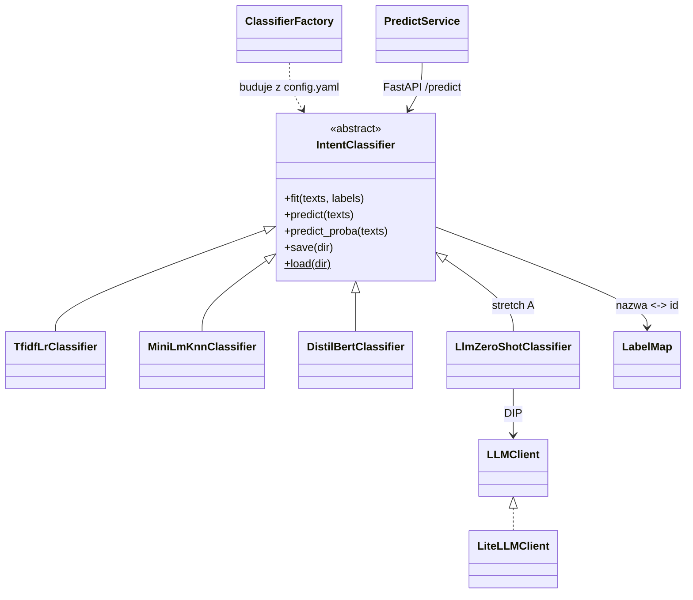

# Klasyfikacja zgłoszeń na BANKING77 — porównanie jakości, kosztu i wdrożenia metod NLP

Projekt końcowy kursu **AI & ML Engineering** (SAGES/Kodołamacz, gr. 06.12.2025).
Klasyfikacja intencji pojedynczej wiadomości klienta banku do jednej z **77 kategorii**
na benchmarku [BANKING77](https://github.com/PolyAI-LDN/task-specific-datasets) (PolyAI, 2020).

> **Zmiana tematu 30.09.2026.** Do 29.09 projekt dotyczył predykcji `Severity` na US Accidents.
> Powody i liczby z audytu: sekcja *Historia decyzji* i `docs/adr/0001-zmiana-tematu-na-banking77.md`.
> Repo i pakiet przemianowano 2.10.2026 (wcześniej `us-accidents-ml` / `us_accidents_ml`) — zapis
> w `docs/RENAME.md`; stare adresy GitHuba przekierowują.

> **Co system robi:** dostaje angielską wiadomość („I still haven't received my card"), zwraca
> identyfikator intencji (`card_arrival`). **Czego nie robi:** nie rozwiązuje sprawy klienta,
> nie ocenia ryzyka, nie wykrywa intencji spoza 77 klas (test nie waliduje OOD).

**Pytanie badawcze:** czy dostrajany mały transformer (DistilBERT) poprawia jakość klasyfikacji
względem TF-IDF + regresji logistycznej i zamrożonych embeddingów + kNN **na tyle, żeby uzasadnić
większy koszt uczenia i predykcji na CPU**? Wynikiem projektu jest uzasadniony wybór jednego modelu
i działająca usługa — także wtedy, gdy najdroższy model nie wygra.

## Dane

| | Trening (`train.csv`) | Test (`test.csv`) |
|---|---:|---:|
| Wiersze | 10 003 | 3 080 |
| Kategorie | 77 | 77 |
| Przykłady na kategorię | 35–187 (mediana 127) | dokładnie 40 |
| Puste teksty / etykiety | 0 / 0 | 0 / 0 |
| Nadmiarowe duplikaty po normalizacji¹ | 31 | 4 |
| Grupy znormalizowane z różnymi etykietami | 1 | 1 |

¹ Normalizacja audytowa: Unicode NFKC → casefold → tokeny `\w+` połączone spacją. **25 tekstów
testowych ma odpowiednik w train** po tej normalizacji (etykiety zgodne); bez nich zostaje **3 055**.
Liczby z własnego audytu danych (30.09.2026, normalizacja jak w `split.dedup_normalization`
w configu); skrypt audytu trafi do repo w W1 (`notebooks/` lub `scripts/`), notatka źródłowa poza repo.

- **Źródło:** repozytorium `PolyAI-LDN/task-specific-datasets`, przypięty commit
  `57ec275d8078af65b7731c2a98be812d844a6d6b`, pliki `banking_data/train.csv`
  (SHA-256 `b06e26ac…cbc664b`) i `banking_data/test.csv` (SHA-256 `d12d6e3b…cfeeb474d`), łącznie
  1 079 034 B. Pełne sumy w `configs/config.yaml`; pobranie i weryfikacja: `scripts/fetch_data.py`.
  Nie mieszamy z kopiami z HF/MTEB (inna licencja w metadanych, inny protokół, w v2 usunięte wiersze).
- **Licencja danych:** CC BY 4.0 — atrybucja w sekcji *Licencja*. Dane poza repo; w repo kod,
  skrypt pobrania, mapa etykiet i manifest splitu.
- **Co wiemy o pochodzeniu:** karta danych nie dokumentuje sposobu pozyskania ani anonimizacji
  (przy danych osobowych wpis „N/A"). Własny skan 13 083 tekstów pięcioma wzorcami (e-mail, URL,
  ≥9 cyfr, IBAN, przedstawianie się) dał **0 trafień — to nie dowodzi braku PII** (bez NER, bez
  ręcznego przeglądu). **Wykrycie istotnych PII w trakcie EDA = podstawa rezygnacji ze zbioru.**
- **Znane problemy etykiet:** Ying & Thomas (2022) wskazują automatycznie **1 428 potencjalnych
  problemów w train (~14%)**. Nie usuwamy ich hurtowo i nie zmieniamy etykiet testu po obejrzeniu
  predykcji; analizujemy pomyłki i niejednoznaczne intencje w analizie błędów.
- **Ograniczenia zbioru:** test jest sztucznie zrównoważony (wynik nie odwzorowuje częstości
  rzeczywistych zgłoszeń); przy 40 przykładach na klasę jedna pomyłka = 2,5 p.p. recallu klasy;
  brak czasu i identyfikatorów rozmów (nie da się zweryfikować podziału chronologicznego).

## Protokół ewaluacji (wspólny dla wszystkich modeli)

1. **Przypięte:** commit, sumy plików, mapa nazw kategorii → id (`configs/label_map.json`).
2. **Walidacja z train:** ~15% (`split.val_size`), stratyfikowana; **znormalizowane duplikaty
   trafiają razem do jednej części**; indeksy w `dane/splits/` (poza gitem, katalog nietykalny)
   + manifest `configs/split_manifest.json` (git-tracked: seed, val_size, n_train, n_val,
   sha256 indeksów). Konflikty etykiet zbadane przed podziałem.
3. **Test tylko do dwóch rzeczy:** audytu integralności i oceny końcowej. Żadnego fitu, HPO,
   wyboru epoki, progu ani doboru promptu na teście. TF-IDF dopasowany wyłącznie na train.
4. **Refit — decyzja 14.10.2026:** trzy zamrożone konfiguracje uczone od nowa na całych
   10 003 zdaniach (train + dawna walidacja). DistilBERT: harmonogram na 5 epok, stop po 4.
   Po reficie brak niezależnej walidacji. Porównanie z *Full*: accuracy na pełnym teście 3 080,
   z uwzględnieniem różnic strojenia i jednego seeda.
5. **Metryki:** `accuracy` — główna, do porównania z literaturą; **macro-F1 — metryka wyboru
   checkpointu/konfiguracji na walidacji (ustalone z góry)**; recall i F1 per klasa; macierz
   pomyłek. Przy jednym seedzie nie wyciągamy wniosków z różnic o ułamek punktu procentowego.
6. **Kontrola wrażliwości:** każdy model raportowany także na podzbiorze **3 055** tekstów bez
   pokrycia z train (ustalonym przed treningiem). To nie nowy benchmark — nie porównywać
   z publikacjami na 3 080.
7. **Koszt:** czas treningu, rozmiar całego artefaktu, latencja CPU p50/p95 dla batch=1
   (z preprocessingiem i ekstrakcją embeddingów), **zimny start osobno od rozgrzanej predykcji**.
   Surowego wyniku kNN/softmaxu nie nazywamy skalibrowanym prawdopodobieństwem.
8. **LLM (stretch A):** jeden model, jeden zamrożony prompt, **385 wiadomości testowych
   (5 na klasę) wybranych z góry** — te same 385 dla wszystkich modeli w tabeli; raport jakości,
   błędów formatu, tokenów, latencji i kosztu. Dobór promptu tylko na walidacji. **Ekspozycja LLM
   na benchmark nieustalona** — brak gwarancji czystego testu; wynik nie dowodzi generalizacji.

**Zamrożenie — 14.10.2026, przed pierwszym wynikiem na teście:**

- TF-IDF+LR: próba #12; MiniLM+kNN: k = 1, `uniform`, cosinus;
  DistilBERT: LR 6e-5, epoka 4 przy harmonogramie na 5 epok, `max_len=128`.
- Pełne parametry: `models.<nazwa>.frozen` i baza w configu; przypięte rewizje wag, seed 42.
  Bez nowego HPO i zmian konfiguracji po wyniku testowym.
- Kolejność: commit z tym wpisem i [ADR-0002](docs/adr/0002-protokol-ewaluacji.md)
  → tag `experiments-frozen` na tym commicie → refit → jednorazowa ocena na teście.
- Artefakty W2 zachowane; finalne w `models/final/`. Koszty finalnych modeli mierzone ponownie.

**Punkty odniesienia (protokół Full, pełny train i test):** DistilBERT-base **92,1%**
(Qi i in. 2021: batch 32, max_len 128, AdamW wd 0,01, warmup 10% do LR 4e-5, 5 epok);
BERT-base 93,3%; RoBERTa-base 94,1%; BERT-large 93,66% (Casanueva i in. 2020).
Dummy (jedna klasa) = 1/77 = **1,30%**. Kanonicznego wyniku TF-IDF+LR nie ma — wyznaczamy własny.
Liczby z publikacji to konkretne konfiguracje, nie gwarantowany przedział wyników tego projektu.

## Modele i budżet strojenia

| Model | Budżet strojenia (walidacja, MLflow) | Cel | Wagi / licencja |
|---|---|---|---|
| Dummy | brak | kontrola rozkładu i metryk | — |
| **TF-IDF + Logistic Regression** | `tfidf_lr.hpo_trials` = 16 konfiguracji wektoryzatora (słowa/znaki, n-gramy, min_df), regularyzacji (C) i wag klas (`class_weight`); punkt startu = pierwsza konfiguracja z configu (W1) | tani, interpretowalny baseline; kandydat do wdrożenia | — |
| **all-MiniLM-L6-v2 (zamrożony) + kNN** | kilka `k` × ważenie (uniform/distance) | wartość reprezentacji semantycznej bez dostrajania | HF `sentence-transformers/all-MiniLM-L6-v2`, Apache-2.0, rewizja przypięta w configu |
| **DistilBERT + głowica 77 klas** | 5 LR {2–6}e-5 × 5 epok = 25 kandydatów; budżet ustalony przed wynikami, pozostałe parametry wg Qi 2021 | efekt dostrajania reprezentacji; RTX 5080 | HF `distilbert/distilbert-base-uncased`, Apache-2.0, rewizja przypięta |
| *(stretch A)* LLM zero-shot | brak strojenia; prompt dobrany na walidacji | koszt/latencja/błędy formatu vs modele dostrajane | Groq (plan płatny, Developer tier) przez LiteLLM; model w `llm.model` |
| *(fallback)* TF-IDF + LinearSVC | mały grid C | trzecia metoda, gdy transformer nie ruszy | — |

Wartości liczbowe (budżety, hiperparametry startowe, seed) — wyłącznie z `configs/config.yaml`.
Budżet DistilBERT zwiększono z 2–3 do 5 LR, by sprawdzić wartości po obu stronach 4e-5
z publikacji; decyzja przed wynikami zapobiega dokładaniu prób pod wynik, ale nie wyrównuje
budżetów między modelami.
Czas treningu, VRAM i koszty CPU na sprzęcie autora zapisano w MLflow.

## Architektura (wzorce i SOLID)

*Propozycja architektury przeniesiona z planu z lipca (szkic asystenta). Wybór wzorców
potwierdza albo zmienia autor w W2 przy projekcie interfejsu predyktora — odstępstwo = ADR.*

- **Strategy:** wspólny interfejs predyktora (`fit / predict / predict_proba / save / load`) z
  implementacjami dla TF-IDF+LR, MiniLM+kNN, DistilBERT i (stretch) LLM. API i ewaluacja widzą
  tylko interfejs — podmiana modelu = zmiana wpisu w configu, nie kodu.
- **Factory** buduje predyktor z `configs/config.yaml` (nazwa strategii + hiperparametry).
- **Pipeline'y sklearn** dla ścieżek klasycznych (wektoryzator → klasyfikator w jednym obiekcie,
  jeden `joblib`); własne transformery (`BaseEstimator`/`TransformerMixin`) tam, gdzie trzeba.
- **LabelMap** — jedna klasa mapująca nazwa ↔ id, ładowana z przypiętego pliku; wszystkie modele
  i API używają tej samej instancji (koniec z mieszaniem indeksów z różnych kopii danych).
- **LLMClient** (stretch) — wąski interfejs `classify`, cienki wrapper na LiteLLM — DIP, mockowalny.
- Mapowanie SOLID: SRP (moduły `data/features/models/evaluation/api`), OCP (nowy model = nowa
  klasa, nie edycja istniejących), LSP (każdy predyktor przechodzi ten sam test kontraktu
  zapis→odczyt→identyczne predykcje), DIP (API zależy od interfejsu, nie od torcha).



Nazwy klas są robocze — ostateczne nazewnictwo i podział na moduły to decyzja autora w W2.

## Przepływ artefaktów modelu

**MLflow** (lokalnie, poza gitem: baza `mlflow.db` z runami + artefakty w `mlruns/`; podgląd:
`uv run mlflow ui --backend-store-uri sqlite:///mlflow.db`) = tracking wszystkich runów: parametry, metryki na walidacji,
czas treningu, rozmiar artefaktu. **Wybrany model (ADR-0003, 15.10): DistilBERT** — oceniony
artefakt z refitu w `models/final/distilbert`, bez kopiowania. Sekcja `deploy` w configu
(`model_version: distilbert-v1`, `artifact_dir`) — jedno źródło dla build-arg obrazu, tagu,
manifestu k8s i odpowiedzi `/health` (`MODEL_VERSION`; bez tej zmiennej API zwraca
`deploy.model_version`). Manifest z hashami plików powstaje przy pakowaniu do Release (W4).
Artefakt jest **wpiekany w obraz CPU podczas `docker build`** (bez pobierania na starcie
kontenera — brak cold startu i uprawnień runtime). Tag obrazu zawiera wersję modelu.

**Skąd CI bierze artefakt do `docker build` — rozstrzygnięte w ADR-0003: opcja (a)**, GitHub
Release asset przypięty tagiem (`deploy.model_version`) + sha256 w configu; pliki bit w bit
zgodne z ocenionym artefaktem. Rozważane były też: (b) trening lekkiego modelu w CI z danych
pobranych przez `fetch_data.py --only train` (bez `test.csv`; działa tylko dla TF-IDF; manifest
splitu niesie tylko hash, więc w CI trzeba odtworzyć podział `make_splits` i porównać hash
z manifestem — albo refitować na całych 10 003 bez podziału) — odrzucone, bo tworzy nowy
artefakt; (c) GCS (tylko jeśli GCP wejdzie jako stretch) — odrzucone. W4 implementuje (a).
Wybrany DistilBERT wymaga torcha CPU w obrazie — rozmiar i czas budowy **do zmierzenia**.

**MiniLM+kNN (niewybrany w ADR-0003; opis zostaje dla porządku):** adapter zapisuje indeks kNN i metadane, a wagi enkodera
z przypiętej rewizji pozostają w cache Hugging Face. Obraz musi zawierać również enkoder:
do wyboru wpieczenie cache HF albo zapis enkodera wewnątrz artefaktu. W tabeli kosztów
rozmiar obejmuje **indeks kNN + wagi, tokenizer i konfigurację enkodera**. `load()` rozgrzewa
enkoder przed gotowością API; pomiar zimnego startu nadal obejmuje `load` i pierwszą predykcję
w nowym procesie.

## Quickstart

```bash
# Środowisko lokalne (Python 3.11, uv) — JEDNA komenda z pełną listą extras używanych lokalnie:
uv sync --extra dev --extra nlp --extra gpu --extra serving
# Jednorazowo po klonie: filtr gita czyści wyjścia notebooków przy commicie (lokalnie zostają);
# --keep-id zachowuje identyfikatory komórek (bez niego nbstripout numeruje je od nowa)
uv run nbstripout --install --attributes .gitattributes
git config filter.nbstripout.clean "$(git config filter.nbstripout.clean) --keep-id"
uv run python scripts/fetch_data.py        # train.csv + test.csv z przypiętego commitu, weryfikacja SHA-256
uv run pytest                              # strażnik protokołu + testy dymne
uv run ruff check .
# UWAGA: `uv sync` jest "exact" — extras pominięte w komendzie są USUWANE ze środowiska
# (torch/transformers znikną po gołym `uv sync --extra dev`). Goły `--extra dev` jest tylko dla CI.
# Po każdym sync na maszynie z GPU: python -c "import torch; print(torch.cuda.is_available())"
# gpu = torch z indeksu cu128 (RTX 5080/sm_120) + transformers; nlp = sentence-transformers;
# serving = fastapi, uvicorn, httpx (API od W2); llm (stretch A): dodatkowo --extra llm
# + GROQ_API_KEY w .env (poza gitem)
```

**API lokalnie** — serwuje model z `deploy.artifact_dir` (ADR-0003: DistilBERT); port 8000 bywa
na Windows zarezerwowany przez system, stąd 8080; dokumentacja endpointów: `http://localhost:8080/docs`.

```bash
uv run uvicorn banking77_intent_ml.api.app:create_app --factory --port 8080
```

**Obraz Docker CPU** (W3) — wymaga artefaktu `models/final/distilbert` (refit:
`uv run python scripts/refit_final.py`; w W4 artefakt z GitHub Release); `MODEL_VERSION` =
`deploy.model_version` z configu:

```bash
docker build --build-arg MODEL_VERSION=distilbert-v1 -t banking77-intent-api:distilbert-v1 .
docker run --rm -p 8080:8000 banking77-intent-api:distilbert-v1
uv run python scripts/smoke_api.py --url http://localhost:8080   # drugi terminal: smoke
```

Od W4: `kind` + workflow w GitHub Actions odtwarzalny z instrukcji w `docs/`.

## Plan — 5 slotów, 60 h (30.09 → 31.10.2026)

Podział pracy: dane/protokół/EDA **10 h** · modele/HPO **12 h** · ewaluacja i analiza błędów **6 h**
· pakiet/API/testy **8 h** · Docker/kind/CI **9 h** · raport/demo **7 h** · rezerwa **8 h**.
Godziny slotu obejmują weekend i wieczory danego tygodnia — od 5.10.2026 każdy wieczór pn–pt
(także piątek) jest roboczy (~1–1,5 h, jedno małe zadanie; rozkład dzienny w playbookach slotów
i w kalendarzu), a godziny ponad budżet slotu idą do księgi rezerwy. Nazwy slotów W1–W5 są
używane przez skille (`/start-etapu Wn`) i kalendarz.

| Slot | Termin | h | Wymagany rezultat (definicja „done") |
|---|---|---:|---|
| **W1** | pt 2.10 (wieczór) + **3–4.10** | 12 | dane pobrane i zweryfikowane; krótka EDA + audyt jakości (duplikaty, konflikty, długości, PII); mapa etykiet; **zamrożona walidacja** (grupowany, stratyfikowany split + manifest); TF-IDF baseline w MLflow; predykcje przeżywają zapis/odczyt; krótki test uruchomienia DistilBERT na GPU |
| **W2** | **10–11.10** | 14 | trzy ścieżki (TF-IDF+LR, MiniLM+kNN, DistilBERT) z ograniczonym HPO na walidacji; pierwsze pomiary CPU (latencja, rozmiar); szkic interfejsu predyktora + Factory; **FastAPI z baseline'em** (`/predict`, `/health`, wersja modelu) |
| **W3** | **17–18.10** | 14 | **zamrożenie eksperymentów**; ocena końcowa na teście + podzbiór 3 055; analiza błędów; wybrany artefakt wersjonowany; testy jednostkowe (mapa etykiet, walidacja wejścia, zapis→odczyt, kontrakt API); Dockerfile (obraz CPU). **Bez nowych rodzin modeli** |
| **W4** | **24–25.10** | 14 | **kind + automatyczny workflow** (build → load → Deployment/Service → test HTTP) w GitHub Actions; próba odtworzenia projektu z instrukcji na czystym klonie; wykorzystanie rezerwy |
| **W5** | **31.10 (sobota)** | 6 | raport (README z wynikami i wnioskami), demo, kontrola reprodukowalności, **oddanie**. Bez nowych funkcji |
| | **Razem** | **60** | **Wdrożenie działa przed ostatnim dniem; 1.11 tylko poprawki po wysyłce** |

**Księga godzin:** 60 h = 52 h pracy + 8 h rezerwy. Rezerwa leży w W4 (ogony W1–W3, próba
odtworzenia, debug workflow). Wieczory 26–30.10 (test obrony, gitleaks, wnioski — do 4,5 h) są
**poza** 60 h: pokrywa je niewykorzystana rezerwa albo świadome nadgodziny. Wieczory
30.09–1.10 pochłonęła decyzja o zmianie tematu (research + weryfikacje) — poza budżetem W1.
Stan rezerwy: wiersz w *Status*, aktualizowany na koniec każdego slotu.

**Dokumentacja przyrostowo:** koniec slotu = aktualizacja *Status* w README + wiersz w tabeli
wyników (accuracy, macro-F1, koszt) + 1–2 zdania „co nie zadziałało". ADR-y (`docs/adr/`, MADR)
pisane w momencie decyzji.

## Minimum vs stretch

**MINIMUM (zalicza rubrykę):** EDA z audytem jakości · przypięte dane + zamrożony protokół ·
Dummy / TF-IDF+LR / MiniLM+kNN / DistilBERT z ograniczonym HPO w MLflow · porównanie jakości
i kosztu · analiza błędów · pakiet OOP (Strategy/Factory/pipeline'y) + pytest · FastAPI ·
Docker (CPU) · **kind z automatycznym deployem i testem HTTP w CI** · README z wnioskami
i instrukcją odtworzenia.

**STRETCH — w tej kolejności, dopiero po domknięciu minimum:**
1. dodatkowe seedy finalnego transformera (przedział wyników zamiast jednej liczby);
2. **LLM zero-shot (wariant A)** — Groq przez LiteLLM na 385 wiadomościach, protokół jak wyżej;
3. prosty UI (Streamlit) nad API;
4. GCP: GKE tym samym obrazem (klaster żyje godziny), Artifact Registry.

Rezerwa 8 h **nie jest** z góry budżetem na stretch.

## Bramka po W1 i fallback

**Bramka (powtórka: piątek 9.10, pierwotnie niedziela 4.10) — kontynuujemy, jeśli:** dane i grupowany podział są
odtwarzalne (fetch → make_splits → identyczny manifest), baseline uczy się sensownie ponad Dummy
na tej samej walidacji, predykcje przeżywają zapis/odczyt, i wiadomo, gdzie pójdzie czas wdrożenia.
**Nie uzależniamy decyzji od 92%.** Jeśli po 3–4 h diagnostyki baseline nie działa → naprawić
loader / mapę etykiet / pipeline **przed** kolejnymi modelami. Problemy GPU mają osobny timebox
i nie blokują ścieżek CPU.

**Stan na 9.10:** warunki techniczne są spełnione — dane i zamrożony podział są odtwarzalne,
TF-IDF+LR osiąga 84,39% accuracy wobec 1,87% Dummy `most_frequent` na walidacji, a zapis i odczyt
modelu zachowują identyczne predykcje. **Decyzja autora (pt 9.10): kontynuujemy — W2 od 10.10.**
Czas wdrożenia: autor ocenia plan W2–W4 jako wykonalny przy większym dziennym wymiarze pracy;
godziny ponad plan slotów trafiają do księgi rezerwy (*Status*).

**Fallback:** przy problemach z transformerem trzecią metodą zostaje **TF-IDF + LinearSVC**
(mniej powtórki DL, rdzeń rubryki zachowany). Przy budżecie bliższym 50 h — od początku tnij HPO
i UI, nie wdrożenie. Poślizg o 1 slot w W1–W3 → tnij stretch/HPO i dokładaj wieczory tak, by W4
zaczął się z działającym obrazem Docker; W4–W5 są nietykalne (wdrożenie = twardy wymóg rubryki) —
jeśli na starcie W4 nie ma obrazu, wdrażamy baseline TF-IDF, nie czekamy na lepszy model.

## Wdrożenie

- **FastAPI:** `POST /predict` (tekst → intencja, id, wersja modelu), `GET /health` (status +
  `MODEL_VERSION`); walidacja wejścia (Pydantic), test kontraktu odpowiedzi w pytest.
- **Docker:** obraz CPU z wpieczonym artefaktem; jeden wybrany model. Config i mapa etykiet
  w obrazie: `COPY configs/ /app/configs/` + `ENV BANKING77_CONFIG=/app/configs/config.yaml`
  (settings liczą ścieżki od położenia configu). Rozmiar i czas budowy — do zmierzenia
  (TF-IDF: bez torcha; DistilBERT/kNN: torch z indeksu CPU, nie z PyPI — na Linuxie koło z PyPI
  zawiera CUDA).
- **kind w CI (obowiązkowe):** workflow GitHub Actions: `docker build` → `kind create cluster`
  → `kind load docker-image` → `kubectl apply` (Deployment + Service) → `kubectl rollout status`
  → **test HTTP** `/health` i `/predict` → teardown klastra. Dokumentujemy, że to klaster
  testowy; dowodem wdrożenia są manifesty, logi workflow i test HTTP, nie żywy URL.
- **GKE (stretch #4):** ten sam obraz, klaster żyje **godziny, nie tygodnie**, `teardown`
  tego samego dnia. Koszt: kredyt GKE (74,40 USD/mies.) pokrywa opłatę za zarządzanie klastrem,
  **nie compute**; alert budżetowy nie zatrzymuje naliczania; nie zakładać zerowego kosztu na
  podstawie free tier. Aktywacja kredytu GCP dopiero po działającym kind (W4).
- **Sekrety:** `GROQ_API_KEY` tylko w `.env` (poza gitem) / GitHub Secrets; w kodzie i configu
  żadnych kluczy.

## Dlaczego bez Sparka i CV

Dane to **~1 MB** (13 083 krótkich zdań; mediana 10 słów w train i 9 w test, maksimum 79 słów).
Każdy krok — wczytanie, TF-IDF, embeddingi, nawet fine-tuning — mieści się w pamięci jednej maszyny;
Spark ETL dodałby infrastrukturę bez uzasadnienia w objętości danych („big data w chmurze" — Spark
ETL, Dataproc, CI/CD — zrealizowano w siostrzanym repo
[us-accidents-etl](https://github.com/MarcinPrDev/us-accidents-etl)).
Zadanie jest czysto tekstowe — CV nie ma tu sensownego zastosowania. Zakres powtórki
kursu: Python, klasyczne ML, OOP/testy, eksperymenty (MLflow), DL/NLP (transformery), API,
Docker, Kubernetes, CI/CD; LLM jako stretch.

## Status

- [x] Szkielet projektu (pakiet, config, CI, uv) — przeniesiony z poprzedniego tematu
- [x] Smoke testy: GPU (torch cu128, sm_120, `scripts/smoke_gpu.py`), klucz Groq przez LiteLLM
      (`scripts/smoke_llm.py`) — infrastruktura sprawdzona przed pivotem
- [x] **30.09:** decyzja o zmianie tematu na BANKING77 · **2.10:** nowy plan-of-record, config,
      strażnik protokołu (`tests/test_contract.py`) i `scripts/fetch_data.py` w repo
- [x] **ADR-0001 — zmiana tematu na BANKING77**: zaakceptowany 9.10 (kontekst i opcje zestawione
      z notatek researchu; sekcje *Decyzja* i *Konsekwencje* — autor)
- [x] **[ADR-0002 — protokół ewaluacji](docs/adr/0002-protokol-ewaluacji.md)** — zaakceptowany 14.10:
      grupowany split, grupa konfliktowa, mapa etykiet, podzbiory testowe i refit na 10 003.
- [x] **W1** (pt 2.10 wieczór + weekend 3–4.10; twarde minimum domknięte w wieczory 5–9.10):
  - [x] dane pobrane i zweryfikowane (`scripts/fetch_data.py`: SHA-256, 10 003 / 3 080 wierszy)
  - [x] loader z walidacją struktury (`data/loader.py`) + testy na sztucznych CSV
  - [x] mapa etykiet `configs/label_map.json` (77 kategorii, id wg `sorted()` nazw)
  - [x] zamrożony split train/val (`scripts/make_splits.py`): 8 504 / 1 499, 9 972 grupy
    duplikatów (31 nadmiarowych), grupa konfliktowa w train; indeksy w `dane/splits/` (w gicie)
    + `configs/split_manifest.json`; ponowne uruchomienie tylko weryfikuje („zgodny”)
  - [x] strażnik protokołu zielony na realnych plikach (zakres rozszerzony 4.10)
  - [x] podzbiory testowe 3 055 / 385 + audyt nazw kategorii testu (S2, 5.10; pliki w
    `dane/splits/` tylko do odczytu)
  - [x] wspólna `evaluate()` + Dummy ×2 (6.10) i TF-IDF+LR (7.10) w MLflow — wyniki w tabeli niżej
  - [x] zapis/odczyt modelu (`models/persistence.py`, 9.10): joblib + metadane (wersje bibliotek,
    hash mapy etykiet, id runu); identyczne predykcje w nowym procesie, udowodnione testem
  - [x] krótka EDA z wnioskami (`notebooks/01_eda.ipynb`, sekcje 1–8, 6.10); długości w tokenach
    → sob 10.10, redakcja wniosków → wt 13.10
  - [x] rewizje wag przypięte w configu (9.10; MiniLM i DistilBERT, licencje apache-2.0) + test
    uruchomienia DistilBERT na GPU (`scripts/smoke_gpu.py`, 9.10): działa — mini-epoka 10 kroków
    × batch 32 na zdaniach z train, bf16, szczyt VRAM 1,40 GB z 17,1 GB; bez metryk
  - Bramka po W1: 4.10 nie przeszła (brak baseline'u w MLflow i testu zapisu/odczytu), warunkowo
    kontynuowano; **powtórka pt 9.10: zielona — kontynuujemy, W2 od 10.10** (szczegóły:
    *Bramka po W1 i fallback*)
  - Co nie zadziałało: twarde minimum nie zmieściło się w weekendzie 3–4.10 — baseline
    w MLflow i zapis/odczyt przechodzą na wieczory 5–9.10 (pierwsze do cięcia: DistilBERT, EDA)
- [x] **2.10 — zależności pod BANKING77**: z zależności głównych usunięte `xgboost`, `duckdb`,
      `pygeohash`; dodany extra `serving` (`fastapi`, `uvicorn[standard]`, `httpx` — wymagany przez
      `TestClient`); `optuna` zostaje do decyzji przy HPO w W2 (Optuna czy siatka)
- [x] **W2** (plan 10–11.10, realizacja 12–14.10): trzy ścieżki + HPO + pomiary CPU + API
  z baseline'em — **zamknięty 14.10, bramka zielona**; ADR-0002 i decyzja o reficie zapisane 14.10 (W3)
  - [x] HPO TF-IDF+LR (12.10): Optuna TPE, 16 prób na walidacji, wybór po macro-F1 (remis → mniej
    cech); zamrożona próba #12 w `models.tfidf_lr.frozen`
  - [x] MiniLM+kNN (12.10): embeddingi z przypiętej rewizji (cache), siatka k {1, 3, 5, 10} ×
    {uniform, distance} na walidacji; zamrożone k = 1, `uniform` w `models.minilm_knn.frozen`
  - [x] DistilBERT (13.10): 5 LR {2–6}e-5 × 5 epok (budżet podniesiony z 2–3 przed wynikami),
    ocena co epokę, wybór po macro-F1 (remis → mniej epok); zamrożony wariant 4, epoka 4
    w `models.distilbert.frozen`, artefakt w `models/distilbert/`; zwycięzca na brzegu siatki LR
  - [x] Wspólny interfejs predyktora (13.10): `IntentClassifier` + fabryka z configu + trzy
    adaptery (kod autora); test kontraktu zielony dla trzech ścieżek; każdy adapter odtwarza
    zamrożony run na walidacji co do bitu; artefakty `models/tfidf_lr/` i `models/minilm_knn/`
    (`scripts/export_model.py`, trening na train) oraz `models/distilbert/` z zamrożenia
  - [x] FastAPI z baseline'em (13.10): `POST /predict` (top-1: intencja, id, `score`, wersja
    modelu), `GET /health`, 422 dla pustego lub za długiego tekstu (> 500 znaków), predyktor
    ładowany raz (lifespan); serwuje `api.model` (TF-IDF+LR); lokalnie port 8080 (8000
    zarezerwowany przez Windows)
  - [x] Pomiary kosztu CPU (14.10): latencja batch=1 p50/p95 przy 1 i 8 wątkach, zimny start,
    rozmiar artefaktu — tabela *Koszt na CPU* niżej
  - Co nie zadziałało: weekend 10–11.10 bez pracy, więc W2 przesunął się na 12–14.10.
    Czas zabrały też problemy środowiska: czerwone CI po imporcie `sentence-transformers`,
    brak `accelerate`, zmiany API w `transformers` 5 i puste `CUDA_VISIBLE_DEVICES` na Windows.
- [ ] W3 (plan 12–18.10, realizacja od 14.10): zamrożenie, ocena końcowa, analiza błędów,
  artefakt, testy, Docker
  - [x] Zamrożenie (14.10): ADR-0002 (protokół z W1 + refit przed testem), tag
    `experiments-frozen` na `d809c57`
  - [x] Refit na 10 003 (14.10): runy `final_refit`, artefakty w `models/final/`; koszt
    finalnych artefaktów — badanie `cpu_cost_final`
  - [x] Ocena końcowa na teście — raz (14.10): tabela końcowa i interpretacja niżej
  - [x] Analiza błędów (15.10): notebook 02, wnioski w sekcji *Analiza błędów (W3)*
  - [x] ADR-0003 (15.10): wdrażamy DistilBERT; model w CI z GitHub Release (opcja a); sekcja
    `deploy` w configu (`distilbert-v1`, `models/final/distilbert`)
  - [x] Obraz Docker CPU (15.10): `banking77-intent-api:distilbert-v1`, **3,18 GB** (`.venv`
    1,9 GB — torch CPU 750 MB, pyarrow 153 MB, scipy 113 MB, transformers 112 MB; model 257 MiB);
    torch 2.11.0+cpu (`torch.version.cuda` = None, brak pakietów `nvidia-*`); model ładuje się
    bez sieci; gotowość 3,5 s od `docker run`; RAM 391 MiB; test przeniesienia: te same id
    w 50/50, |Δ score| ≤ 3e-07. Zależności główne (mlflow, optuna, matplotlib, seaborn,
    pyarrow) zostają w obrazie — decyzja autora 15.10, rozmiar zmierzony
  - [x] `scripts/smoke_api.py` (15.10): `/health` z wersją z configu, 14 zdań kontrolnych
    (napisanych na potrzeby testu, nie ze zbioru) z oczekiwanymi wynikami ocenionego artefaktu
    (`configs/smoke_cases.json`), 422 dla pustego tekstu; wobec kontenera: [OK]. Test
    przeniesienia na dawnej walidacji wykonany jednorazowo (te same id w 50/50)
  - [ ] Testy W3 §1.5 (uzupełnienie)
  - [x] 14.10: decyzja o reficie trzech ścieżek na 10 003 i zapis zamrożonych konfiguracji.
  - [ ] Tag `experiments-frozen`, refit i pomiary finalnych artefaktów; potem ocena na teście.
- [ ] W4 (24–25.10): kind + workflow CI + test HTTP + odtworzenie z instrukcji
- [ ] W5 (31.10): raport, demo, reprodukowalność, **oddanie**
- [ ] gitleaks + LICENSE → upublicznienie repo (najpóźniej przy wysyłce)
- [x] **2.10 — zmiana nazwy** repo, pakietu i folderu na `banking77-intent-ml` /
      `banking77_intent_ml` (`docs/RENAME.md`)
- [x] **2.10 — porządki po poprzednim temacie**: notebook EDA, `csv_to_parquet.py`, `sanity_w1.py`
      i loader US Accidents usunięte z repo (treść w historii gita do commita `bc20003`; kopie
      robocze i dane poza repo). Loader BANKING77 i nowy `notebooks/01_eda.ipynb` powstają w W1
- Rezerwa: zużyto **8 z 8 h** (stan po W1, 9.10: W1 zajął 20 h przy budżecie 12 h; kolejne
  nadwyżki = świadome nadgodziny albo cięcie wg kolejności z *Bramka po W1 i fallback*;
  aktualizacja na koniec każdego slotu)
  - W2 (12–14.10): **14 h pracy przy budżecie 14 h — 0 h nadwyżki**; rezerwa nadal zużyta 8 z 8 h.

**Wyniki na walidacji** (W1–W2; zamrożona walidacja z manifestu — do wyboru konfiguracji,
nie do porównań z literaturą; wszystkie liczby z MLflow):

| Model | Konfiguracja (zamrożona) | Acc (val) | Macro-F1 (val) | N-train / N-val | Budżet HPO | Czas treningu |
|---|---|---:|---:|---:|---:|---:|
| Dummy `most_frequent` | — | 1,87% | 0,05% | 8 504 / 1 499 | 0 | < 0,01 s |
| Dummy `stratified` (seed 42) | — | 1,13% | 1,04% | 8 504 / 1 499 | 0 | < 0,01 s |
| TF-IDF + LR | W1, przed HPO: wartości domyślne sklearn 1.9 (unigramy, `C` = 1,0, bez wag klas) | 84,39% | 83,89% | 8 504 / 1 499 | 0 (HPO w W2) | 0,50 s |
| TF-IDF + LR | **zamrożona (HPO W2, próba #12):** znaki `char_wb` (2,4), `min_df` 2, `sublinear_tf`, `C` ≈ 49,7, wagi `balanced` | 89,26% | 89,32% | 8 504 / 1 499 | 16 (Optuna TPE) | 2,95 s |
| MiniLM + kNN | **zamrożona (siatka W2):** all-MiniLM-L6-v2 @ `1110a243` (zamrożone embeddingi, cosinus) + kNN k = 1, `uniform` | 91,06% | 91,27% | 8 504 / 1 499 | 8 (siatka 4 × 2) | 7,7 s (kodowanie train, GPU) + 0,01 s (kNN) |
| DistilBERT | **zamrożona (W2):** distilbert-base-uncased @ `12040acc`, LR 6e-5, epoka 4 z 5 (wariant 4; reszta jak Qi 2021: batch 32, `max_len` 128, warmup 10%, wd 0,01) | 90,99% | 90,76%[^distilbert] | 8 504 / 1 499 | 25 (5 LR × 5 epok) | 22,8 s (5 epok z oceną co epokę, GPU) |

[^distilbert]: 90,76% to `val_macro_f1` z epoki 4 runu `f37e7471`; główne `macro_f1` tego runu to 90,78% z epoki 5. Różnica jest poniżej 0,001 (0,1 punktu procentowego), więc reguła remisu wybrała wcześniejszą epokę.

**Wrażliwość na budżet strojenia** (macro-F1 na tej samej zamrożonej walidacji 1 499 zdań,
jeden seed; liczby z MLflow):

| Ścieżka | Bez strojenia | Mniejszy budżet | Pełny budżet (zamrożona) | Zysk ze strojenia |
|---|---:|---:|---:|---:|
| TF-IDF + LR | 0,8389 — domyślne sklearn (W1) | 0,8833 — 8 pierwszych prób | 0,8932 — 16 prób Optuny | +0,0543 |
| MiniLM + kNN | 0,9006 — k = 5, `uniform` (domyślne sklearn) | — | 0,9127 — siatka 8 punktów | +0,0121 |
| DistilBERT | 0,9022 — konfiguracja Qi 2021 (LR 4e-5, 5 epok) | — | 0,9076 — 25 kandydatów (5 LR × 5 epok) | +0,0054 |

„8 pierwszych prób” to próby 0–7 tego samego badania Optuny (najlepsza: próba 6); TPE losuje
pierwsze 10 prób, więc ta kolumna to w praktyce przeszukiwanie losowe. Pełny budżet DistilBERT
to wartość wybrana regułą remisu (epoka 4: 0,9076; epoka 5: 0,9078).

**Zysk ze strojenia (W2):** najwięcej na tej walidacji zyskał TF-IDF+LR (+0,0543 macro-F1);
drugie osiem prób dodało 0,0099. MiniLM+kNN zachował najwyższy wynik, a DistilBERT poprawił
konfigurację Qi 2021 o 0,0054. Przy różnych punktach startowych, budżetach i jednym seedzie
nie jest to porównanie pełnych możliwości modeli.

**Ograniczenie DistilBERT:** zwycięskie LR 6e-5 leży na brzegu siatki, a macro-F1 dla LR
2e-5–4e-5 nadal rosło w 5. epoce, więc ten budżet nie wyczerpuje możliwości modelu.

**Koszt na CPU** (W2, pomiar `cpu_cost_w2` z 14.10, kod z commita `aa210d7`; batch=1 przez
wspólny interfejs predyktora, tylko CPU; liczby z MLflow):

| Ścieżka | Wątki | Latencja p50 | Latencja p95 | Zimny start: mediana (max) | Artefakt | Run MLflow |
|---|---:|---:|---:|---:|---:|---|
| TF-IDF + LR | 1 | 0,28 ms | 0,42 ms | 0,85 s (0,86 s) | 5,0 MB | `ee671463` |
| TF-IDF + LR | 8 | 0,27 ms | 0,36 ms | 0,85 s (0,86 s) | 5,0 MB | `7fe52480` |
| MiniLM + kNN | 1 | 9,57 ms | 13,83 ms | 4,40 s (4,45 s) | 104,7 MB | `48ddd8ae` |
| MiniLM + kNN | 8 | 7,58 ms | 8,97 ms | 4,38 s (4,50 s) | 104,7 MB | `53dd2727` |
| DistilBERT | 1 | 17,52 ms | 31,27 ms | 3,20 s (3,24 s) | 268,8 MB | `36c5c183` |
| DistilBERT | 8 | 7,28 ms | 9,91 ms | 3,13 s (3,13 s) | 268,8 MB | `1312a257` |

Metodyka (decyzje autora 14.10, `evaluation.cost` w configu): latencja po rozgrzaniu = 20
predykcji rozgrzewki, potem 200 zdań z walidacji (seed 42, te same dla każdej ścieżki) × 3
przebiegi, `predict_proba` na jednym tekście, percentyle z `numpy.percentile`. Zimny start =
mediana i maksimum z 10 nowych procesów: import kodu + `load` + pierwsza predykcja, bez startu
interpretera; pliki modeli były już w cache systemu plików. Zimny start to głównie import kodu
(~0,78 s na każdej ścieżce, sklearn) i `load` (TF-IDF 0,07 s, MiniLM+kNN 3,60 s z rozgrzaniem
enkodera, DistilBERT 2,31–2,34 s). 8 wątków = rdzenie fizyczne tej maszyny (AMD Zen 5,
Windows 11). Artefakt = cały katalog `models/<nazwa>`; dla MiniLM+kNN z wagami enkodera
z cache Hugging Face (91,6 MB). Bez narzutu HTTP z API.

**Jakość a koszt (W2, pomiary `cpu_cost_w2` w MLflow):** TF-IDF+LR ma najniższą latencję,
najmniejszy artefakt i najkrótszy zimny start, kosztem niższego macro-F1.
MiniLM+kNN wygrywa jakością; DistilBERT ma niższe macro-F1 i większy artefakt, ale krótszy
zimny start i podobną latencję po rozgrzaniu przy 8 wątkach CPU.
Przy k = 1 `score` kNN w API zawsze wynosi 1,0 — nie informuje o pewności predykcji.

TF-IDF + LR: dwa runy tej samej konfiguracji (`89d5ccf6`, `bb347398` — ten drugi dał artefakt
w `models/`) mają identyczne metryki, co przy okazji potwierdza determinizm treningu.

**Interpretacja (autor, 7.10):** TF-IDF + LR uzyskał accuracy 84,39% i macro-F1 83,89% na 1 499
zdaniach walidacji wydzielonej z train, po treningu na 8 504 zdaniach; literaturowe 92,1%
DistilBERT dotyczy testu 3 080 zdań po treningu na pełnych 10 003, więc wyniki nie są
bezpośrednio porównywalne. Niewielka różnica między metrykami nie wyklucza słabości pojedynczych
klas: `virtual_card_not_working` ma najniższe F1 (50,0%) i recall (33,3%) przy precision 100% —
model wskazał tę klasę dwukrotnie, oba razy trafnie, ale pozostałe cztery przykłady przypisał
innym klasom; przy sześciu przykładach jedna pomyłka zmienia recall o 16,7 punktu procentowego.

**Tabela końcowa** (W3, test dotknięty raz; koszt finalnych artefaktów po reficie;
wszystkie liczby z MLflow / wykonanego kodu):

| Model | Acc (test 3 080) | Acc (3 055) | Macro-F1 (3 080) | Czas treningu (10 003) | Artefakt | Latencja CPU p50 / p95 | Zimny start (1 w. / 8 w.) |
|---|---:|---:|---:|---:|---:|---:|---:|
| Dummy | 1,30% (arytmetyka) | — | — | 0 | — | — | — |
| TF-IDF + LR | 90,81% | 90,77% | 90,83% | 4,9 s (CPU) | 5,2 MB | 0,28 / 0,43 ms (1 w.) · 0,27 / 0,42 ms (8 w.) | 0,85 s / 0,85 s |
| MiniLM + kNN | 92,05% | 92,01% | 92,03% | 3,0 s (GPU) | 107,0 MB | 12,16 / 16,83 ms (1 w.) · 9,26 / 10,89 ms (8 w.) | 4,69 s / 4,69 s |
| DistilBERT | 93,02% | 92,96% | 93,05% | 25,5 s (GPU) | 268,8 MB | 17,48 / 31,42 ms (1 w.) · 8,22 / 11,45 ms (8 w.) | 3,30 s / 3,19 s |

Źródła (MLflow): ocena końcowa — runy `0c08edb4`, `04ec980a`, `fb0d0bde` (`split=test`,
commit `6cae45d`); refit na 10 003 — runy `f7e23471`, `4509d9d4`, `5b883a97` (`final_refit`,
commit `d809c57` = tag `experiments-frozen`); koszt — badanie `cpu_cost_final`, po dwa runy
na ścieżkę (1 i 8 wątków: `4e0fe1ce`/`9b7c4505`, `a8276f36`/`bea6c48a`, `56a7fbb4`/`0ec07580`),
metodyka jak w tabeli *Koszt na CPU*. Runy zapisały hashe commitów sprzed przepisania historii
14.10; odpowiedniki — artefakt `provenance/git-commit-map-2026-10-14.json` w każdym runie.
Czas treningu = `fit` adaptera na 10 003 zdaniach z wczytaniem wag lub enkodera (GPU: RTX 5080).
Artefakt MiniLM + kNN = indeks 10 003 wektorów + wagi enkodera z cache Hugging Face.

**Interpretacja oceny końcowej (14.10, refit na 10 003):**

- DistilBERT najlepszy w tym przebiegu: accuracy 93,02%, macro-F1 93,05%.
  Przewaga accuracy: 0,97 p.p. nad MiniLM+kNN i 2,21 p.p. nad TF-IDF+LR.
- Protokół Full: accuracy o 0,92 p.p. wyższe niż DistilBERT u Qi i in. (92,1%)
  i o 0,28 p.p. niższe niż BERT-base (93,3%). Inny LR, liczba epok i jeden seed;
  bez wniosku o powtarzalnej przewadze nad wynikiem z publikacji.
- Na walidacji prowadził MiniLM+kNN, na teście DistilBERT. Inny zbiór oceny i więcej danych
  treningowych po reficie; brak podstaw do przypisania zmiany rankingu samemu refitowi.
- Po wyłączeniu 25 nakładek: spadek accuracy najwyżej o 0,06 p.p., ranking bez zmian.
  Mały wpływ wykrytego pokrycia train/test na wynik ogólny.

Źródło: runy `fb0d0bde`, `04ec980a`, `0c08edb4` z commita `6cae45d`; jedna ocena na ścieżkę.
Wyniki na 385 przykładach pozostają w MLflow, do raportu razem z LLM.
Wybór do wdrożenia: jakość razem z kosztami finalnych artefaktów. Konfiguracje bez dalszego strojenia.

## Analiza błędów (W3)

Notebook: [`notebooks/02_analiza_bledow.ipynb`](notebooks/02_analiza_bledow.ipynb) — najczęstsze pary
pomyłek i recall per klasa z oceny końcowej (same agregaty, bez czytania zdań testowych), porównanie
błędów trzech ścieżek po `row_id`, przegląd 20 błędów modeli W2 na walidacji; etykiety bez zmian.

Główna trudność to rozróżnianie bliskich intencji. Krótkie zdania często nie zawierają
wystarczającego kontekstu.

Modele semantyczne poprawiają wynik ogólny względem TF-IDF. Nadal potrafią jednak skupić się
na pobocznym fragmencie zdania.

DistilBERT popełnia najmniej błędów. Wysoki score nie gwarantuje poprawności, a score kNN
przy k równym 1 nie informuje o pewności odpowiedzi.

## Dalsze prace

Po oddaniu projektu (decyzja C z 13.10):

- Szersze HPO dla wszystkich trzech ścieżek.
- Zagnieżdżona grupowana CV: strojenie na podziałach wewnętrznych, ocena na zewnętrznych;
  znormalizowane duplikaty zawsze razem.
- Kilka seedów, żeby sprawdzić stabilność wyników.
- Front jakość–koszt: warianty, których nie da się poprawić w jednym kryterium bez pogorszenia drugiego.

## Historia decyzji

- **ADR-0001 — zmiana tematu z US Accidents na BANKING77** (`docs/adr/0001-zmiana-tematu-na-banking77.md`).
  Etykieta `Severity` w US Accidents okazała się mieszanką skal różnych dostawców API z dryfem
  schematu (udział klasy 3 w Source1 spada z ~18% do 0% od 2021; zgodność między źródłami
  kappa 0,01–0,05), bez uczciwego publicznego punktu odniesienia dla kontraktu „w chwili
  zgłoszenia". Przy budżecie 50–65 h do 31.10 i szacunku 59–89 h dla starego planu wybrano
  zbiór z ugruntowanym benchmarkiem i gotowym testem (kryterium: bezpieczeństwo terminu).
- Wnioski z audytu US Accidents (drabina leakage, kappa źródeł) i temat NHTSA Recalls →
  **po oddaniu projektu**, nie jako stretch.

## Tooling — współpraca z AI

Projekt rozwijany z asystą **Claude (Anthropic)** w roli pair-programmera i reviewera
(plan, szkielet, code review, debugowanie). Decyzje projektowe, analiza, modelowanie
i wnioski — autor. Commity współtworzone z asystentem są oznaczone stopką
`Co-Authored-By` w historii git. ADR-y w `docs/adr/`: sekcje *Decyzja* i *Konsekwencje* pisze
autor; w ADR-0001 sekcje *Kontekst* i *Rozważane opcje* zestawił asystent z notatek researchu
(oznaczone w pliku).

## Licencja

**Kod:** MIT (plik `LICENSE` przed upublicznieniem repo).
**Dane:** BANKING77 — Casanueva, Temčinas, Gerz, Henderson, Vulić (2020), *Efficient Intent
Detection with Dual Sentence Encoders*, PolyAI; repozytorium `PolyAI-LDN/task-specific-datasets`,
licencja **CC BY 4.0**. Dane nie są przechowywane w repo — pobiera je `scripts/fetch_data.py`
z przypiętego commitu. Zmiany własne względem oryginału: wydzielenie walidacji z train (indeksy
w manifeście), normalizacja tekstu wyłącznie do audytu duplikatów; teksty i etykiety nie są
modyfikowane. Wagi modeli: all-MiniLM-L6-v2 i distilbert-base-uncased — Apache-2.0.
