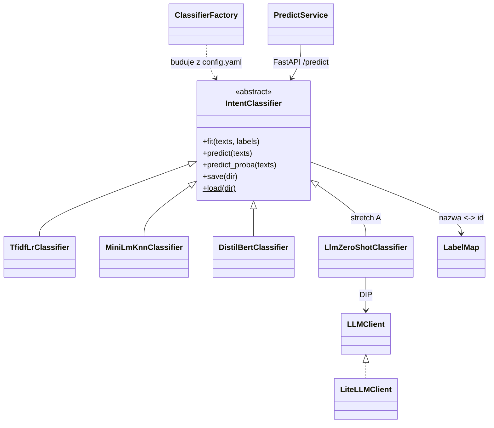

# Klasyfikacja zgłoszeń na BANKING77 — porównanie jakości, kosztu i wdrożenia metod NLP

Projekt końcowy kursu **AI & ML Engineering** (SAGES/Kodołamacz, gr. 06.12.2025).
Klasyfikacja intencji pojedynczej wiadomości klienta banku do jednej z **77 kategorii**
na benchmarku [BANKING77](https://github.com/PolyAI-LDN/task-specific-datasets) (PolyAI, 2020).

> **Zmiana tematu 30.09.2026.** Do 29.09 projekt dotyczył predykcji `Severity` na US Accidents.
> Powody i liczby z audytu: sekcja *Historia decyzji* i `docs/adr/0001-zmiana-tematu-na-banking77.md`.
> Nazwa repo/pakietu (`us-accidents-ml`, `us_accidents_ml`) jest historyczna — zmiana nazwy to osobna
> decyzja, checklista w `docs/RENAME.md`.

> **Co system robi:** dostaje angielską wiadomość („I still haven't received my card"), zwraca
> identyfikator intencji (`card_arrival`). **Czego nie robi:** nie rozwiązuje sprawy klienta,
> nie ocenia ryzyka, nie wykrywa intencji spoza 77 klas (test nie waliduje OOD).

**Pytanie badawcze:** czy dostrajany mały transformer (DistilBERT) poprawia jakość klasyfikacji
względem TF-IDF + regresji logistycznej i zamrożonych embeddingów + kNN **na tyle, żeby uzasadnić
większy koszt uczenia i predykcji na CPU**? Wynikiem projektu jest uzasadniony wybór jednego modelu
i działająca usługa — także wtedy, gdy najdroższy model nie wygra.

## Dane

| | Trening (`train.csv`) | Test (`test.csv`) |
|---|---:|---:|
| Wiersze | 10 003 | 3 080 |
| Kategorie | 77 | 77 |
| Przykłady na kategorię | 35–187 (mediana 127) | dokładnie 40 |
| Puste teksty / etykiety | 0 / 0 | 0 / 0 |
| Nadmiarowe duplikaty po normalizacji¹ | 31 | 4 |
| Grupy znormalizowane z różnymi etykietami | 1 | 1 |

¹ Normalizacja audytowa: Unicode NFKC → casefold → tokeny `\w+` połączone spacją. **25 tekstów
testowych ma odpowiednik w train** po tej normalizacji (etykiety zgodne); bez nich zostaje **3 055**.
Liczby z własnego audytu danych (30.09.2026, normalizacja jak w `split.dedup_normalization`
w configu); skrypt audytu trafi do repo w W1 (`notebooks/` lub `scripts/`), notatka źródłowa poza repo.

- **Źródło:** repozytorium `PolyAI-LDN/task-specific-datasets`, przypięty commit
  `57ec275d8078af65b7731c2a98be812d844a6d6b`, pliki `banking_data/train.csv`
  (SHA-256 `b06e26ac…cbc664b`) i `banking_data/test.csv` (SHA-256 `d12d6e3b…cfeeb474d`), łącznie
  1 079 034 B. Pełne sumy w `configs/config.yaml`; pobranie i weryfikacja: `scripts/fetch_data.py`.
  Nie mieszamy z kopiami z HF/MTEB (inna licencja w metadanych, inny protokół, w v2 usunięte wiersze).
- **Licencja danych:** CC BY 4.0 — atrybucja w sekcji *Licencja*. Dane poza repo; w repo kod,
  skrypt pobrania, mapa etykiet i manifest splitu.
- **Co wiemy o pochodzeniu:** karta danych nie dokumentuje sposobu pozyskania ani anonimizacji
  (przy danych osobowych wpis „N/A"). Własny skan 13 083 tekstów pięcioma wzorcami (e-mail, URL,
  ≥9 cyfr, IBAN, przedstawianie się) dał **0 trafień — to nie dowodzi braku PII** (bez NER, bez
  ręcznego przeglądu). **Wykrycie istotnych PII w trakcie EDA = podstawa rezygnacji ze zbioru.**
- **Znane problemy etykiet:** Ying & Thomas (2022) wskazują automatycznie **1 428 potencjalnych
  problemów w train (~14%)**. Nie usuwamy ich hurtowo i nie zmieniamy etykiet testu po obejrzeniu
  predykcji; analizujemy pomyłki i niejednoznaczne intencje w analizie błędów.
- **Ograniczenia zbioru:** test jest sztucznie zrównoważony (wynik nie odwzorowuje częstości
  rzeczywistych zgłoszeń); przy 40 przykładach na klasę jedna pomyłka = 2,5 p.p. recallu klasy;
  brak czasu i identyfikatorów rozmów (nie da się zweryfikować podziału chronologicznego).

## Protokół ewaluacji (wspólny dla wszystkich modeli)

1. **Przypięte:** commit, sumy plików, mapa nazw kategorii → id (`configs/label_map.json`).
2. **Walidacja z train:** ~15% (`split.val_size`), stratyfikowana; **znormalizowane duplikaty
   trafiają razem do jednej części**; indeksy w `dane/splits/` (poza gitem, katalog nietykalny)
   + manifest `configs/split_manifest.json` (git-tracked: seed, val_size, n_train, n_val,
   sha256 indeksów). Konflikty etykiet zbadane przed podziałem.
3. **Test tylko do dwóch rzeczy:** audytu integralności i oceny końcowej. Żadnego fitu, HPO,
   wyboru epoki, progu ani doboru promptu na teście. TF-IDF dopasowany wyłącznie na train.
4. **Zamrożenie konfiguracji** na walidacji, potem *opcjonalny* refit na całych 10 003 z ustaloną
   z góry liczbą epok — tylko takie wyniki zestawiamy z kolumną *Full* w literaturze. Jeśli refitu
   nie robimy, jawnie raportujemy mniejszy budżet danych.
5. **Metryki:** `accuracy` — główna, do porównania z literaturą; **macro-F1 — metryka wyboru
   checkpointu/konfiguracji na walidacji (ustalone z góry)**; recall i F1 per klasa; macierz
   pomyłek. Przy jednym seedzie nie wyciągamy wniosków z różnic o ułamek punktu procentowego.
6. **Kontrola wrażliwości:** każdy model raportowany także na podzbiorze **3 055** tekstów bez
   pokrycia z train (ustalonym przed treningiem). To nie nowy benchmark — nie porównywać
   z publikacjami na 3 080.
7. **Koszt:** czas treningu, rozmiar całego artefaktu, latencja CPU p50/p95 dla batch=1
   (z preprocessingiem i ekstrakcją embeddingów), **zimny start osobno od rozgrzanej predykcji**.
   Surowego wyniku kNN/softmaxu nie nazywamy skalibrowanym prawdopodobieństwem.
8. **LLM (stretch A):** jeden model, jeden zamrożony prompt, **385 wiadomości testowych
   (5 na klasę) wybranych z góry** — te same 385 dla wszystkich modeli w tabeli; raport jakości,
   błędów formatu, tokenów, latencji i kosztu. Dobór promptu tylko na walidacji. **Ekspozycja LLM
   na benchmark nieustalona** — brak gwarancji czystego testu; wynik nie dowodzi generalizacji.

**Punkty odniesienia (protokół Full, pełny train i test):** DistilBERT-base **92,1%**
(Qi i in. 2021: batch 32, max_len 128, AdamW wd 0,01, warmup 10% do LR 4e-5, 5 epok);
BERT-base 93,3%; RoBERTa-base 94,1%; BERT-large 93,66% (Casanueva i in. 2020).
Dummy (jedna klasa) = 1/77 = **1,30%**. Kanonicznego wyniku TF-IDF+LR nie ma — wyznaczamy własny.
Liczby z publikacji to konkretne konfiguracje, nie gwarantowany przedział wyników tego projektu.

## Modele i budżet strojenia

| Model | Budżet strojenia (walidacja, MLflow) | Cel | Wagi / licencja |
|---|---|---|---|
| Dummy | brak | kontrola rozkładu i metryk | — |
| **TF-IDF + Logistic Regression** | `tfidf_lr.hpo_trials` = 16 konfiguracji wektoryzatora (słowa/znaki, n-gramy, min_df) i regularyzacji (C) | tani, interpretowalny baseline; kandydat do wdrożenia | — |
| **all-MiniLM-L6-v2 (zamrożony) + kNN** | kilka `k` × ważenie (uniform/distance) | wartość reprezentacji semantycznej bez dostrajania | HF `sentence-transformers/all-MiniLM-L6-v2`, Apache-2.0, rewizja przypięta w configu |
| **DistilBERT + głowica 77 klas** | 2–3 konfiguracje (np. LR × epoki), start wg Qi 2021 | efekt dostrajania reprezentacji; RTX 5080 | HF `distilbert/distilbert-base-uncased`, Apache-2.0, rewizja przypięta |
| *(stretch A)* LLM zero-shot | brak strojenia; prompt dobrany na walidacji | koszt/latencja/błędy formatu vs modele dostrajane | Groq (plan płatny, Developer tier) przez LiteLLM; model w `llm.model` |
| *(fallback)* TF-IDF + LinearSVC | mały grid C | trzecia metoda, gdy transformer nie ruszy | — |

Wartości liczbowe (budżety, hiperparametry startowe, seed) — wyłącznie z `configs/config.yaml`.
VRAM, czas treningu i latencja na sprzęcie autora: **do zmierzenia** (nikt tego nie liczył).

## Architektura (wzorce i SOLID)

*Propozycja architektury przeniesiona z planu z lipca (szkic asystenta). Wybór wzorców
potwierdza albo zmienia autor w W2 przy projekcie interfejsu predyktora — odstępstwo = ADR.*

- **Strategy:** wspólny interfejs predyktora (`fit / predict / predict_proba / save / load`) z
  implementacjami dla TF-IDF+LR, MiniLM+kNN, DistilBERT i (stretch) LLM. API i ewaluacja widzą
  tylko interfejs — podmiana modelu = zmiana wpisu w configu, nie kodu.
- **Factory** buduje predyktor z `configs/config.yaml` (nazwa strategii + hiperparametry).
- **Pipeline'y sklearn** dla ścieżek klasycznych (wektoryzator → klasyfikator w jednym obiekcie,
  jeden `joblib`); własne transformery (`BaseEstimator`/`TransformerMixin`) tam, gdzie trzeba.
- **LabelMap** — jedna klasa mapująca nazwa ↔ id, ładowana z przypiętego pliku; wszystkie modele
  i API używają tej samej instancji (koniec z mieszaniem indeksów z różnych kopii danych).
- **LLMClient** (stretch) — wąski interfejs `classify`, cienki wrapper na LiteLLM — DIP, mockowalny.
- Mapowanie SOLID: SRP (moduły `data/features/models/evaluation/api`), OCP (nowy model = nowa
  klasa, nie edycja istniejących), LSP (każdy predyktor przechodzi ten sam test kontraktu
  zapis→odczyt→identyczne predykcje), DIP (API zależy od interfejsu, nie od torcha).



Nazwy klas są robocze — ostateczne nazewnictwo i podział na moduły to decyzja autora w W2.

## Przepływ artefaktów modelu

**MLflow** (lokalny `mlruns/`) = tracking wszystkich runów: parametry, metryki na walidacji,
czas treningu, rozmiar artefaktu. Po zamrożeniu eksperymentów (W3) **jeden wybrany model**
trafia do `models/<nazwa>/<wersja>/` z manifestem (sha256 plików, wersje bibliotek, metryki
walidacyjne, data). Wersja wybranego artefaktu trafi do configu w W3 (sekcja `deploy`:
`model_version`, `artifact_dir`) — jedno źródło dla build-arg obrazu, tagu, manifestu k8s
i odpowiedzi `/health` (`MODEL_VERSION`).
Artefakt jest **wpiekany w obraz CPU podczas `docker build`** (bez pobierania na starcie
kontenera — brak cold startu i uprawnień runtime). Tag obrazu zawiera wersję modelu.

**Otwarte (decyzja autora w W3):** skąd CI bierze artefakt do `docker build` — (a) GitHub Release
asset przypięty tagiem + sha256 w configu, (b) trening lekkiego modelu w CI z danych pobranych
przez `fetch_data.py --only train` (bez `test.csv`; działa tylko dla TF-IDF; manifest splitu niesie tylko hash, więc w CI trzeba
odtworzyć podział `make_splits` i porównać hash z manifestem — albo refitować na całych 10 003 bez
podziału), (c) GCS (tylko jeśli GCP wejdzie jako stretch). Decyzja jest częścią ADR wyboru
artefaktu w W3 — W4 tylko ją implementuje.
Jeśli wygra DistilBERT, obraz musi mieć torch CPU — rozmiar i czas budowy **do zmierzenia**.

## Quickstart

```bash
# Środowisko lokalne (Python 3.11, uv) — JEDNA komenda z pełną listą extras używanych lokalnie:
uv sync --extra dev --extra nlp --extra gpu          # od W2 dodatkowo: --extra serving (FastAPI)
uv run python scripts/fetch_data.py        # train.csv + test.csv z przypiętego commitu, weryfikacja SHA-256
uv run pytest                              # strażnik protokołu + testy dymne
uv run ruff check .
# UWAGA: `uv sync` jest "exact" — extras pominięte w komendzie są USUWANE ze środowiska
# (torch/transformers znikną po gołym `uv sync --extra dev`). Goły `--extra dev` jest tylko dla CI.
# Po każdym sync na maszynie z GPU: python -c "import torch; print(torch.cuda.is_available())"
# gpu = torch z indeksu cu128 (RTX 5080/sm_120) + transformers; nlp = sentence-transformers;
# llm (stretch A): --extra llm + GROQ_API_KEY w .env (poza gitem); serving (od W2): fastapi, uvicorn, httpx
```

Od W2: `uv run uvicorn ...` z modelem baseline; od W3: `docker build` + `docker run` z testem
`/health`; od W4: `kind` + workflow w GitHub Actions odtwarzalny z instrukcji w `docs/`.

## Plan — 5 slotów, 60 h (30.09 → 31.10.2026)

Podział pracy: dane/protokół/EDA **10 h** · modele/HPO **12 h** · ewaluacja i analiza błędów **6 h**
· pakiet/API/testy **8 h** · Docker/kind/CI **9 h** · raport/demo **7 h** · rezerwa **8 h**.
Godziny slotu obejmują weekend i krótkie wieczory danego tygodnia. Nazwy slotów W1–W5 są
używane przez skille (`/start-etapu Wn`) i kalendarz.

| Slot | Termin | h | Wymagany rezultat (definicja „done") |
|---|---|---:|---|
| **W1** | pt 2.10 (wieczór) + **3–4.10** | 12 | dane pobrane i zweryfikowane; krótka EDA + audyt jakości (duplikaty, konflikty, długości, PII); mapa etykiet; **zamrożona walidacja** (grupowany, stratyfikowany split + manifest); TF-IDF baseline w MLflow; predykcje przeżywają zapis/odczyt; krótki test uruchomienia DistilBERT na GPU |
| **W2** | **10–11.10** | 14 | trzy ścieżki (TF-IDF+LR, MiniLM+kNN, DistilBERT) z ograniczonym HPO na walidacji; pierwsze pomiary CPU (latencja, rozmiar); szkic interfejsu predyktora + Factory; **FastAPI z baseline'em** (`/predict`, `/health`, wersja modelu) |
| **W3** | **17–18.10** | 14 | **zamrożenie eksperymentów**; ocena końcowa na teście + podzbiór 3 055; analiza błędów; wybrany artefakt wersjonowany; testy jednostkowe (mapa etykiet, walidacja wejścia, zapis→odczyt, kontrakt API); Dockerfile (obraz CPU). **Bez nowych rodzin modeli** |
| **W4** | **24–25.10** | 14 | **kind + automatyczny workflow** (build → load → Deployment/Service → test HTTP) w GitHub Actions; próba odtworzenia projektu z instrukcji na czystym klonie; wykorzystanie rezerwy |
| **W5** | **31.10 (sobota)** | 6 | raport (README z wynikami i wnioskami), demo, kontrola reprodukowalności, **oddanie**. Bez nowych funkcji |
| | **Razem** | **60** | **Wdrożenie działa przed ostatnim dniem; 1.11 tylko poprawki po wysyłce** |

**Księga godzin:** 60 h = 52 h pracy + 8 h rezerwy. Rezerwa leży w W4 (ogony W1–W3, próba
odtworzenia, debug workflow). Wieczory 26–30.10 (test obrony, gitleaks, wnioski — do 4,5 h) są
**poza** 60 h: pokrywa je niewykorzystana rezerwa albo świadome nadgodziny. Wieczory
30.09–1.10 pochłonęła decyzja o zmianie tematu (research + weryfikacje) — poza budżetem W1.
Stan rezerwy: wiersz w *Status*, aktualizowany na koniec każdego slotu.

**Dokumentacja przyrostowo:** koniec slotu = aktualizacja *Status* w README + wiersz w tabeli
wyników (accuracy, macro-F1, koszt) + 1–2 zdania „co nie zadziałało". ADR-y (`docs/adr/`, MADR)
pisane w momencie decyzji.

## Minimum vs stretch

**MINIMUM (zalicza rubrykę):** EDA z audytem jakości · przypięte dane + zamrożony protokół ·
Dummy / TF-IDF+LR / MiniLM+kNN / DistilBERT z ograniczonym HPO w MLflow · porównanie jakości
i kosztu · analiza błędów · pakiet OOP (Strategy/Factory/pipeline'y) + pytest · FastAPI ·
Docker (CPU) · **kind z automatycznym deployem i testem HTTP w CI** · README z wnioskami
i instrukcją odtworzenia.

**STRETCH — w tej kolejności, dopiero po domknięciu minimum:**
1. dodatkowe seedy finalnego transformera (przedział wyników zamiast jednej liczby);
2. **LLM zero-shot (wariant A)** — Groq przez LiteLLM na 385 wiadomościach, protokół jak wyżej;
3. prosty UI (Streamlit) nad API;
4. GCP: GKE tym samym obrazem (klaster żyje godziny), Artifact Registry.

Rezerwa 8 h **nie jest** z góry budżetem na stretch.

## Bramka po W1 i fallback

**Bramka (niedziela 4.10 wieczór) — kontynuujemy, jeśli:** dane i grupowany podział są
odtwarzalne (fetch → make_splits → identyczny manifest), baseline uczy się sensownie ponad Dummy
(1,30%), predykcje przeżywają zapis/odczyt, i wiadomo, gdzie pójdzie czas wdrożenia.
**Nie uzależniamy decyzji od 92%.** Jeśli po 3–4 h diagnostyki baseline nie działa → naprawić
loader / mapę etykiet / pipeline **przed** kolejnymi modelami. Problemy GPU mają osobny timebox
i nie blokują ścieżek CPU.

**Fallback:** przy problemach z transformerem trzecią metodą zostaje **TF-IDF + LinearSVC**
(mniej powtórki DL, rdzeń rubryki zachowany). Przy budżecie bliższym 50 h — od początku tnij HPO
i UI, nie wdrożenie. Poślizg o 1 slot w W1–W3 → tnij stretch/HPO i dokładaj wieczory tak, by W4
zaczął się z działającym obrazem Docker; W4–W5 są nietykalne (wdrożenie = twardy wymóg rubryki) —
jeśli na starcie W4 nie ma obrazu, wdrażamy baseline TF-IDF, nie czekamy na lepszy model.

## Wdrożenie

- **FastAPI:** `POST /predict` (tekst → intencja, id, wersja modelu), `GET /health` (status +
  `MODEL_VERSION`); walidacja wejścia (Pydantic), test kontraktu odpowiedzi w pytest.
- **Docker:** obraz CPU z wpieczonym artefaktem; jeden wybrany model. Config i mapa etykiet
  w obrazie: `COPY configs/ /app/configs/` + `ENV BANKING77_CONFIG=/app/configs/config.yaml`
  (settings liczą ścieżki od położenia configu). Rozmiar i czas budowy — do zmierzenia
  (TF-IDF: bez torcha; DistilBERT/kNN: torch z indeksu CPU, nie z PyPI — na Linuxie koło z PyPI
  zawiera CUDA).
- **kind w CI (obowiązkowe):** workflow GitHub Actions: `docker build` → `kind create cluster`
  → `kind load docker-image` → `kubectl apply` (Deployment + Service) → `kubectl rollout status`
  → **test HTTP** `/health` i `/predict` → teardown klastra. Dokumentujemy, że to klaster
  testowy; dowodem wdrożenia są manifesty, logi workflow i test HTTP, nie żywy URL.
- **GKE (stretch #4):** ten sam obraz, klaster żyje **godziny, nie tygodnie**, `teardown`
  tego samego dnia. Koszt: kredyt GKE (74,40 USD/mies.) pokrywa opłatę za zarządzanie klastrem,
  **nie compute**; alert budżetowy nie zatrzymuje naliczania; nie zakładać zerowego kosztu na
  podstawie free tier. Aktywacja kredytu GCP dopiero po działającym kind (W4).
- **Sekrety:** `GROQ_API_KEY` tylko w `.env` (poza gitem) / GitHub Secrets; w kodzie i configu
  żadnych kluczy.

## Dlaczego bez Sparka i CV

Dane to **~1 MB** (13 083 krótkich zdań; mediana 10 słów w train i 9 w test, maksimum 79 słów).
Każdy krok — wczytanie, TF-IDF, embeddingi, nawet fine-tuning — mieści się w pamięci jednej maszyny;
Spark ETL dodałby infrastrukturę bez uzasadnienia w objętości danych („big data w chmurze" — Spark
ETL, Dataproc, CI/CD — zrealizowano w siostrzanym repo
[us-accidents-etl](https://github.com/MarcinPrDev/us-accidents-etl)).
Zadanie jest czysto tekstowe — CV nie ma tu sensownego zastosowania. Zakres powtórki
kursu: Python, klasyczne ML, OOP/testy, eksperymenty (MLflow), DL/NLP (transformery), API,
Docker, Kubernetes, CI/CD; LLM jako stretch.

## Status

- [x] Szkielet projektu (pakiet, config, CI, uv) — przeniesiony z poprzedniego tematu
- [x] Smoke testy: GPU (torch cu128, sm_120, `scripts/smoke_gpu.py`), klucz Groq przez LiteLLM
      (`scripts/smoke_llm.py`) — infrastruktura sprawdzona przed pivotem
- [x] **30.09:** decyzja o zmianie tematu na BANKING77 · **2.10:** nowy plan-of-record, config,
      strażnik protokołu (`tests/test_contract.py`) i `scripts/fetch_data.py` w repo
- [ ] **ADR-0001 — szkic** (kontekst i opcje zestawione z notatek researchu; sekcje *Decyzja*
      i *Konsekwencje* do dopisania przez autora, status → zaakceptowany) — termin: przed bramką 4.10
- [ ] **W1** (pt 2.10 wieczór + weekend 3–4.10): fetch → EDA + audyt jakości → mapa etykiet
      → `make_splits` + manifest → TF-IDF baseline w MLflow → zapis/odczyt → test DistilBERT na GPU
      → **bramka 4.10**
- [ ] **W1/W2 — commit „Zależności pod BANKING77"** (`pyproject.toml`): usunąć resztki poprzedniego
      tematu z zależności głównych (`xgboost`, `duckdb`, `pygeohash`; `optuna` zostaje tylko jeśli HPO
      TF-IDF idzie przez Optunę), dodać extra `serving` (`fastapi`, `uvicorn[standard]`, `httpx` —
      `TestClient` FastAPI wymaga `httpx`); `uv lock` + `uv sync --locked ...` lokalnie **przed** pushem
      (CI używa `--locked` — lock bez commitu = czerwone CI). Najpóźniej na starcie W2 (API)
- [ ] W2 (10–11.10): trzy ścieżki + HPO + pomiary CPU + API z baseline'em
- [ ] W3 (17–18.10): zamrożenie, ocena końcowa, analiza błędów, artefakt, testy, Docker
- [ ] W4 (24–25.10): kind + workflow CI + test HTTP + odtworzenie z instrukcji
- [ ] W5 (31.10): raport, demo, reprodukowalność, **oddanie**
- [ ] gitleaks + LICENSE → upublicznienie repo (najpóźniej przy wysyłce)
- [ ] zmiana nazwy repo/pakietu (`docs/RENAME.md`) — decyzja autora, termin otwarty
- [ ] porządki po poprzednim temacie (W1): `data/loader.py` (martwy — do zastąpienia loaderem
      BANKING77), `notebooks/01_eda.ipynb`, `scripts/csv_to_parquet.py` — archiwum albo usunięcie
- Rezerwa: zużyto **0 z 8 h** (aktualizacja na koniec każdego slotu)

**Wyniki na walidacji** (W1–W2; zamrożona walidacja z manifestu — do wyboru konfiguracji,
nie do porównań z literaturą; wszystkie liczby z MLflow):

| Model | Konfiguracja (zamrożona) | Acc (val) | Macro-F1 (val) | N-train / N-val | Budżet HPO | Czas treningu |
|---|---|---:|---:|---:|---:|---:|
| Dummy (`most_frequent` / `stratified`) | — | do zmierzenia | | | 0 | |
| TF-IDF + LR | | do zmierzenia | | | | |
| MiniLM + kNN | | do zmierzenia | | | | |
| DistilBERT | | do zmierzenia | | | | |

**Tabela końcowa** (W3, test dotknięty raz; koszt z W2; wszystkie liczby z MLflow / wykonanego kodu):

| Model | Acc (test 3 080) | Acc (3 055) | Macro-F1 | Czas treningu | Artefakt | Latencja CPU p50/p95 |
|---|---:|---:|---:|---:|---:|---:|
| Dummy | 1,30% (arytmetyka) | — | — | 0 | — | — |
| TF-IDF + LR | do zmierzenia | | | | | |
| MiniLM + kNN | do zmierzenia | | | | | |
| DistilBERT | do zmierzenia | | | | | |

## Historia decyzji

- **ADR-0001 — zmiana tematu z US Accidents na BANKING77** (`docs/adr/0001-zmiana-tematu-na-banking77.md`).
  Etykieta `Severity` w US Accidents okazała się mieszanką skal różnych dostawców API z dryfem
  schematu (udział klasy 3 w Source1 spada z ~18% do 0% od 2021; zgodność między źródłami
  kappa 0,01–0,05), bez uczciwego publicznego punktu odniesienia dla kontraktu „w chwili
  zgłoszenia". Przy budżecie 50–65 h do 31.10 i szacunku 59–89 h dla starego planu wybrano
  zbiór z ugruntowanym benchmarkiem i gotowym testem (kryterium: bezpieczeństwo terminu).
- Wnioski z audytu US Accidents (drabina leakage, kappa źródeł) i temat NHTSA Recalls →
  **po oddaniu projektu**, nie jako stretch.

## Tooling — współpraca z AI

Projekt rozwijany z asystą **Claude (Anthropic)** w roli pair-programmera i reviewera
(plan, szkielet, code review, debugowanie). Decyzje projektowe, analiza, modelowanie
i wnioski — autor. Commity współtworzone z asystentem są oznaczone stopką
`Co-Authored-By` w historii git. ADR-y w `docs/adr/`: sekcje *Decyzja* i *Konsekwencje* pisze
autor; w ADR-0001 sekcje *Kontekst* i *Rozważane opcje* zestawił asystent z notatek researchu
(oznaczone w pliku).

## Licencja

**Kod:** MIT (plik `LICENSE` przed upublicznieniem repo).
**Dane:** BANKING77 — Casanueva, Temčinas, Gerz, Henderson, Vulić (2020), *Efficient Intent
Detection with Dual Sentence Encoders*, PolyAI; repozytorium `PolyAI-LDN/task-specific-datasets`,
licencja **CC BY 4.0**. Dane nie są przechowywane w repo — pobiera je `scripts/fetch_data.py`
z przypiętego commitu. Zmiany własne względem oryginału: wydzielenie walidacji z train (indeksy
w manifeście), normalizacja tekstu wyłącznie do audytu duplikatów; teksty i etykiety nie są
modyfikowane. Wagi modeli: all-MiniLM-L6-v2 i distilbert-base-uncased — Apache-2.0.
