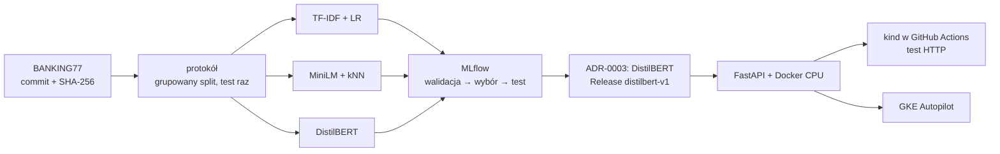

# BANKING77 — projekt w 2 minuty

Skrót [README](../README.md) (pełny raport, protokół i źródła liczb). Liczby z MLflow, jak w README.

## Problem

Bank dostaje krótkie wiadomości klientów po angielsku i musi przypisać każdą do jednej
z **77 intencji** (np. `card_arrival`), żeby trafiła do właściwej obsługi.
**Pytanie:** czy dostrajany mały transformer (DistilBERT) jest na tyle lepszy od tanich metod,
żeby uzasadnić większy koszt uczenia i predykcji na CPU?

## Podejście

Trzy metody na jednym zamrożonym protokole:

- **TF-IDF + regresja logistyczna** — strojenie Optuną (16 prób),
- **zamrożone embeddingi all-MiniLM-L6-v2 + kNN** — siatka k × wagi,
- **DistilBERT** dostrajany na zgłoszeniach — LR × liczba epok.

Protokół: przypięty commit danych i sumy SHA-256, grupowany podział walidacyjny (znormalizowane
duplikaty zawsze razem) z manifestem, wybór konfiguracji po macro-F1 na walidacji, accuracy jako
metryka główna, **test (3 080 wiadomości) dotknięty raz**.

## Wyniki (test 3 080, modele po reficie na 10 003)

| Model | Accuracy | Macro-F1 | Latencja CPU p95 (1 wątek) | Artefakt |
|---|---:|---:|---:|---:|
| TF-IDF + LR | 90,81% | 90,83% | 0,43 ms | 5,2 MB |
| MiniLM + kNN | 92,05% | 92,03% | 16,83 ms | 107,0 MB |
| **DistilBERT** | **93,02%** | **93,05%** | 31,42 ms | 268,8 MB |

- Przewaga DistilBERT nad TF-IDF + LR: +2,21 p.p. accuracy — istotna (McNemar, korekta Holma).
  Nad MiniLM + kNN: +0,97 p.p. — **nieistotna** po korekcie.
- Kalibracja score (ECE, 15 przedziałów): DistilBERT 0,0096, TF-IDF + LR 0,0332.

**Odpowiedź: „częściowo”.** Przy pierwszeństwie jakości większy koszt DistilBERT jest uzasadniony
względem TF-IDF + LR, ale przewaga nad kNN nie osiągnęła istotności. DistilBERT wybrano po
obejrzeniu wyników testu ([ADR-0003](adr/0003-wybor-modelu-do-wdrozenia.md)) — wynik nie jest
niezależnym potwierdzeniem wyboru.

## Wdrożenie

FastAPI (`/predict`, `/health`, `/metrics`) → obraz Docker (CPU) → **kind w GitHub Actions**:
build, deploy i test HTTP przy każdym pushu na `main`. Jednorazowo ten sam obraz na GKE Autopilot
(22.10.2026). UI w Streamlit. Odtworzenie ze świeżego klonu do działającego kontenera:
ok. 7 min 15 s (ciepłe cache uv i Dockera, bez kind i bez treningu DistilBERT).

## Dodatki (zero-shot, bez strojenia wag)

- LLM (`gpt-oss-20b` przez Groq) na 385 wiadomościach testu: accuracy 80,78%.
- Polski model decyzyjny Basal na 3 080: 4,5B — 80,39%, ultra (31B, wynajęte H100) — 84,81%.
  Oba poniżej modeli uczonych i z zawyżoną pewnością (ECE 0,0908 i 0,0814).

## Ograniczenia

Model zawsze wybiera jedną z 77 znanych intencji (bez wykrywania spraw spoza zbioru), tylko
angielski, test zrównoważony (40 wiadomości na klasę), jeden seed DistilBERT w ocenie końcowej.

**Stack:** Python 3.11 i uv · scikit-learn, Optuna · sentence-transformers, PyTorch, transformers ·
MLflow · FastAPI, Docker, Kubernetes (kind, GKE), GitHub Actions · Streamlit · Prometheus · LiteLLM.
